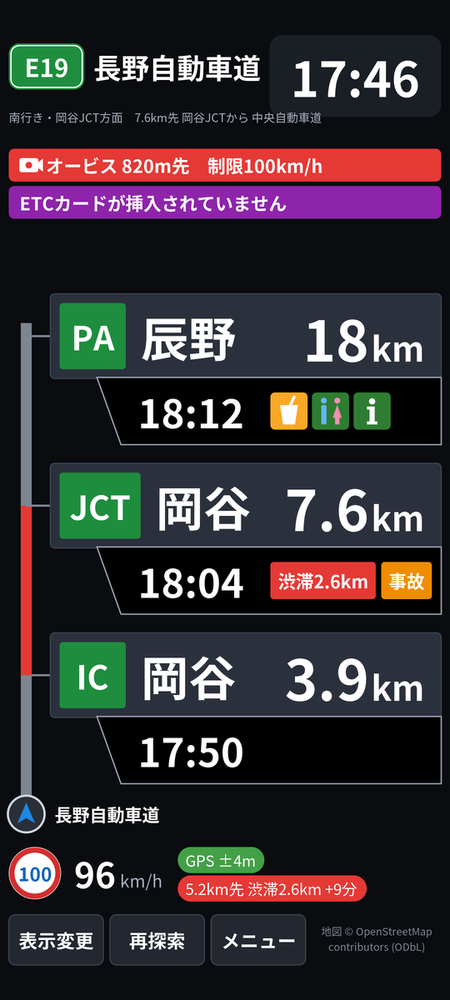
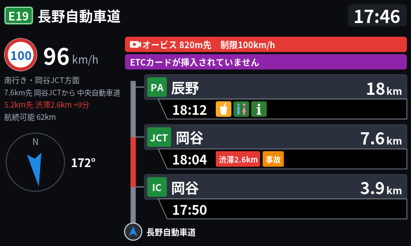
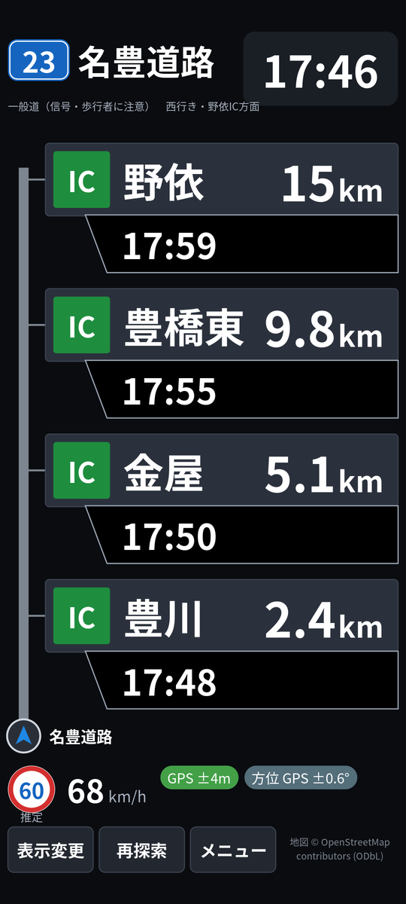
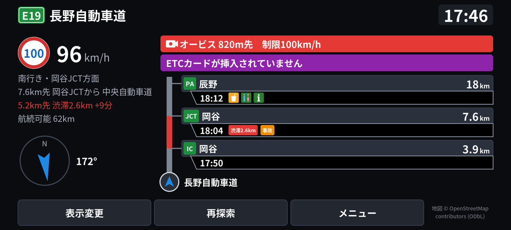
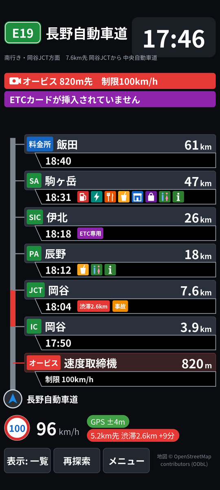

# ハイウェイモード（Android / Android Auto）

カーナビの「ハイウェイモード」のように、走行中の高速道路・有料道路・都市高速・**主要バイパス**で
**前方の IC / JCT / SA / PA / スマートIC / 本線料金所までの距離と到着予定時刻**、
SA/PA の設備、ETC 専用かどうか、**渋滞・事故・通行止め**、**オービス（速度取締機）** を表示する Android アプリです。
**Android Auto** にも対応し、車の画面に同じ表示を出せます（車速信号・ETC カード状態・航続距離も活用）。

| 縦画面（渋滞・オービス・ETC 警告） | Android Auto（800×480） | 主要バイパス（名豊道路） |
|---|---|---|
|  |  |  |

| 横画面 | 一覧表示（オービスも並べる設定） |
|---|---|
|  |  |

※ 画像は実際の描画コード（`PanelRenderer`）を PC 上で描画したものです（数値はサンプル）。

---

## 今回の更新（v1.1）

| ご要望 | 対応 |
|---|---|
| 地図データがなかなか取得できない | **全国データ（HWDB 形式）をアプリに同梱**／**ワンタップで一括ダウンロード・更新**／**地方単位で端末内作成**。Overpass への問い合わせは「データに無い範囲だけ」に。オンライン取得もヘッジ要求（遅いサーバーを待たず別サーバーへ）・2 本並列・ストリーミング解析で高速化 |
| 任意で地図データ更新 | メニュー →「地図データ」→「最新データに更新」。起動時に 1 日 1 回、新しい版があればお知らせ（自動では更新しない） |
| 主要バイパス（名豊道路・名阪国道など）でも使いたい | IC（出口分岐）のある一般国道の区間を自動判定して対象に追加。IC の無い一般区間・交差点の多い国道は対象外 |
| リアルタイム渋滞情報（3 / 5 分間隔、ETA に反映） | **HERE / TomTom / Google** から選択。間隔は **3 分・5 分・自動**（前方に渋滞があれば 3 分・無ければ 5 分、路線が変わったら即取り直し）。到着予定・帯の色・各施設の「渋滞○km」「事故」「通行止」に反映 |
| オービス表示 | 地図データに含まれる速度取締機＋**自分で登録（ワンタップ）・CSV 取り込み**。2km 手前から上部に表示、1km・500m 手前で音声案内 |
| デモで表示されない IC / SA があった | 原因を特定して修正（下記）。再現テストを追加 |
| Android Auto 対応・車速信号の活用 | 車の画面にハイウェイモードを描画。**車速信号でトンネル内の位置誤差 31m → 1m 未満**、ETC カード未挿入の警告、航続距離と次の GS の照合 |

### 「表示されない IC / SA」の原因と修正
1. **名称の無い出口分岐を捨てていた** → 出口ランプの行き先（SA/PA 区域・別路線・一般道）と、反対車線の同じ IC 名・ランプ名・案内方面から名称と種別を補うように。
2. **出口分岐ノードが片方の車線にしか登録されていない IC**（OSM では珍しくない）→ 本線からランプが分かれる地点を「推定出口」として拾うように。
3. **上下線集約型・中央分離帯側の SA/PA**（区域が右側にある）を「進行方向の左側」ルールで除外していた → 区域が本線にかかっている・その車線から分かれるランプが区域に入る場合も、その方向の施設に。
4. **ランプ側のエッジを基準に判定**して別路線判定が狂うことがあった → 本線側を基準に。本線同士がランプ無しで分かれる JCT も検出。
5. **SA/PA の区域データが隣のタイルにあると読み込まれない**ことがあった → 前方 40km の経路沿いと、タイル境界に近い地点の隣接タイルも先読み。

---

## 主な機能

- **対象道路**：高速自動車国道・都市高速（`motorway`）、有料道路（`toll=yes`）、自動車専用道路（`motorroad=yes`）、**IC のある主要バイパス**（一般国道 `trunk` のうち IC が並ぶ区間）。
- **前方施設の一覧**：IC・JCT・SA・PA・スマートIC・本線料金所を近い順に（距離「3.9km」、到着予定「17:50」）。JCT で路線が変わっても同じ路線番号・名称の本線を辿ります。
- **施設情報**：ガソリンスタンド（ブランド・営業時間）、EV 充電、レストラン、軽食、コンビニ、ショップ、トイレ、案内所、シャワー、宿泊、ドッグラン、ATM。タップで詳細。
- **ETC 専用**：スマート IC、名称の「ETC専用」、出口料金所の `payment:cash=no` など。
- **進行方向判定（高精度）**：ジャイロ＋GPS＋コンパスのカルマンフィルタと HMM マップマッチング。トンネル内は推測航法（Android Auto では車速信号・車両ジャイロも使用）。
- **到着予測（高精度）**：制限速度・カーブ・料金所・運転傾向（自動学習）・現在速度・渋滞の持続推定、さらに**リアルタイム渋滞情報**。
- **オービス**：上部の赤い帯（2km 手前から）、一覧への表示（任意）、音声案内（1km・500m 手前）。
- **音声案内**：オービス接近、前方 10km 以内の渋滞（長さ・遅れ）、ETC カード未挿入、給油の目安（ナビ音声として再生し、音楽は一時的に小さく）。
- 常駐サービス（画面を消しても計測継続）、デモ走行、表示切替（大きく 3〜4 件 / 一覧 / SA・PA のみ）、SA/PA 停車中の表示保持。

---

## ビルド方法

### 必要なもの
- Android Studio（最新版推奨。JDK 17 以上同梱）
- Android 8.0（API 26）以上の実機（GPS・ジャイロ搭載）

### 手順
1. このフォルダ `HighwayMode/` を Android Studio の **Open** で開く
2. Gradle Sync を待つ（初回は数分）
3. 実機を USB 接続し **Run ▶**

```bash
./gradlew assembleDebug          # app/build/outputs/apk/debug/app-debug.apk
./gradlew :core:test             # 単体テスト＋走行シミュレーションによる精度レポート
./gradlew :datatool:run --args="help"   # 地図データ作成ツール
```

構成：AGP 8.13.2 / Kotlin 2.2.21 / Gradle 8.14.3 / compileSdk・targetSdk 36 / minSdk 26。
依存ライブラリは Android Auto 用の `androidx.car.app:app` / `app-projected` 1.7.0 と `androidx.core` のみ（演算部 `core` は Kotlin 標準ライブラリのみ）。

---

## 地図データ（いちばん大事な準備）

アプリは次の順で地図を読みます。**1 か 2 を用意すると、通信を待たずにすぐ表示されます。**

1. **アプリ同梱データ** `app/src/main/assets/hwdb/japan-highways.hwdb`（無圧縮で APK に格納し、端末にコピーせず直接読む）
2. **ダウンロードしたデータ**（メニュー →「地図データ」→「最新データに更新」）
3. **端末内で作成したデータ**（同画面の「地方を指定して端末内で作成」。Overpass から都道府県単位でまとめて取得）
4. 上記に無い範囲だけ **Overpass API からその場で取得**（設定でオフにも可。取得したタイルは 60 日キャッシュ）

### HWDB 形式
OpenStreetMap から高速道路・有料道路・主要バイパス・出口分岐・料金所・SA/PA と設備・オービスだけを抜き出し、
約 22km 四方のタイルごとに圧縮した独自形式です（`core/hwdb`）。
- 座標は OSM と同じ 1e-7 度精度・差分の可変長整数、タグはアプリが使うものだけ。
  テストデータでは **Overpass の JSON 218KB → 16KB（約 1/13、gzip した JSON の約 1/3）**、読み込みは約 8 倍速。
  全国分で数 MB〜十数 MB 程度の見込みです。
- タイル単位で途中から読めるので、全国分を入れてもメモリに全部は載せません。道路の無い海・山のタイルも「空」と記録するので通信しません。
- 各タイルに CRC32、配布ファイルに SHA-256。ダウンロードは途中再開（HTTP Range）でき、検証が通ってから差し替えます。
- 地方ごとに作ったファイルの境界タイルは、両方の地方がそろうと自動で結合して使います。

### 全国データの作り方

**A. GitHub Actions（おすすめ：PC 不要・毎週自動更新・データ同梱 APK も作成）**
1. このプロジェクトを自分の GitHub リポジトリ（**public**）に push
2. Actions タブ →「build-hwdb」→ **Run workflow**（以後は毎週月曜 3:17 に自動）
3. Releases に次が公開されます
   - `hwdb-YYYYMMDD`：`japan-highways.hwdb`、`hwdb-manifest.json`、**データ同梱 APK**（`HighwayMode-YYYYMMDD.apk`）
   - `hwdb-latest`：アプリが更新確認に使う目録（固定 URL）
4. この APK には配布元 URL（`https://github.com/<ユーザー>/<リポジトリ>/releases/download/hwdb-latest/hwdb-manifest.json`）が埋め込まれ、
   以後はアプリの「最新データに更新」で新しいデータだけを取得できます。

   ※ CI の APK はビルドごとに異なるデバッグ鍵で署名されるため、上書きインストールできないことがあります。
   固定の署名鍵を使う場合は `app/build.gradle.kts` の `signingConfig` を自分の鍵に変更してください（または手元でビルドした APK を使い、データだけ CI から取得）。

**B. PC（osmium-tool あり・数分）**
```bash
brew install osmium-tool      # macOS（Ubuntu: sudo apt install osmium-tool）
scripts/build-hwdb.sh         # → app/src/main/assets/hwdb/japan-highways.hwdb
```
Geofabrik の日本全域データ（約 2GB）から抽出して作ります。そのままビルドするとアプリに同梱されます。

**C. PC（osmium なし・Overpass から都道府県単位で取得、全国で 30〜90 分程度）**
```bash
./gradlew :datatool:run --args="overpass --regions all --out app/src/main/assets/hwdb/japan-highways.hwdb"
./gradlew :datatool:run --args="overpass --regions kanto,chubu --out kanto-chubu.hwdb"   # 地方だけ
```

**D. スマホだけで（地方単位）**：メニュー →「地図データ」→「地方を指定して端末内で作成」。通知に進み具合が出ます（1 地方 数分〜20 分）。

自分のサーバーで配布する場合は `datatool manifest --base-url <URL> --out hwdb-manifest.json japan-highways.hwdb` で目録を作り、
アプリの「配布元（目録 URL）の設定」に `hwdb-manifest.json` の URL を入れてください。

---

## 主要バイパス（IC のある一般国道）

名豊道路（国道 23 号）、名阪国道（国道 25 号）、静清バイパス、加古川・姫路バイパスなど、**一般道だが IC のある区間**を自動で対象にします（`BypassClassifier`）。

- 同じ路線（路線番号・名称）でつながる国道のうち、IC（`highway=motorway_junction`）・本線料金所・高速道路とのランプ接続がある区間を手掛かりに、
  **前後の IC の間隔が 15km 以内の区間と、最初・最後の IC の前後 1.5km** を採用します。IC が片側の車線にしか登録されていなくても、対向車線から補います。
- IC の無い一般区間や交差点の多い国道（IC の登録が無い国道）は対象外で、その手前で表示が終わります。
- 画面には青い路線番号（例「23」）と「一般道（信号・歩行者に注意）」を表示。制限速度タグが無い場合は 60km/h とみなします。
- 全国データ作成時に判定を済ませて保存するので、端末側の負担はありません。

---

## リアルタイム渋滞情報

メニュー →「渋滞情報（取得元・間隔）」で取得元・API キー・間隔を設定します。**高速道路を走行中だけ**、前方経路（最長 100km、通信量を抑える設定で 60km）に沿って問い合わせます。

| 取得元 | 取得する情報 | 無料枠の目安（2026 年 10 月時点の各社ページ） |
|---|---|---|
| HERE Traffic API v7 | 道路区間ごとの実速度・自由流速度（流れ）＋事故・工事・通行止め | Base Plan で Traffic 月 5,000 トランザクション（1 回の更新で 2 回使用） |
| TomTom Traffic（Incident Details v5） | 渋滞（長さ・遅れ秒）・事故・通行止め・工事・車線規制 | Incident Details 月 2,500 リクエスト（経路の広さにより 1 回の更新で 1〜4 回） |
| Google Routes API（computeRoutes） | 経路上の混雑区間（順調/混雑/渋滞）と渋滞を考慮した所要時間 | 「Pro」料金区分（無料枠・単価は料金ページで確認） |

- 取得間隔：**3 分 / 5 分 / 自動**（前方 40km 以内に渋滞があれば 3 分、無ければ 5 分。JCT で別路線に入るなど前回の問い合わせ範囲を外れたら最短 60 秒で取り直し）。失敗が続くと 1→2→4 分と間隔をあけます。
- 到着予測への反映：交通情報のある区間はその速度比（実速度/自由流速度）を使い、自車の現在速度（短期）・運転傾向と組み合わせます。
  情報の無い区間は従来どおり「自車の渋滞の持続推定」。取得から 10 分を過ぎると徐々に弱め、30 分で使わなくなります。
- 表示：左の帯（赤・橙）、施設の行の「渋滞2.6km」「事故」タグ、通行止めの先は「通行止」、状態チップ「5.2km先 渋滞2.6km +9分」。
- 交通情報は**進行方向と道路形状で自分の車線に対応づけ**るので、反対車線の渋滞や並行する一般道の情報は載りません。
- 日本国内での対応範囲・精度は各社で異なります。API キーは端末内にだけ保存されます。

---

## オービス（速度取締機）

- **地図データ**：OpenStreetMap の `highway=speed_camera`（全国データ・端末内作成データに含まれ、更新でまとめて最新化）。
  道路上のノードはその車線（`direction` タグも考慮）、路側のものは進行方向の左側の車線に付けます。
- **自分で登録**：走行中に「オービス登録」（スマホのメニュー、または Android Auto の画面右上）で現在地と進行方向を登録。
- **CSV 取り込み・書き出し**：メニュー →「オービス」。形式は `緯度,経度,進行方位(度),制限速度,名称`（見出し行は任意、緯度経度が逆でも判定）。
  進行方位を入れると、その向きの車線だけに付きます。
- 表示と案内：2km 手前から上部に赤い帯、1km（100km/h 以上は約 1.2km）・500m 手前で音声。一覧に並べるかは設定で選べます。
- ※ OSM の日本の取締機データは網羅的ではありません（市販のオービスデータは利用規約上アプリに同梱できないため、手持ちのデータは CSV で取り込んでください）。制限速度を守って運転してください。

---

## Android Auto

スマホを車につなぐと、車の画面にハイウェイモードが表示されます（スマホの画面と同時に使えます）。

- 画面右上のボタン：**施設**（一覧 → 詳細）、**表示**（大きく / 一覧 / SA・PA）、**再探索**、**オービス登録**。
- 対応車では地図面の施設をタップすると詳細が開きます。
- **車両から取得して使う情報**（車種・ヘッドユニットにより一部のみ）
  - **車速信号**：速度フィルタの主な入力にし、メーターの誤差（2〜5%）は GPS 速度で自動補正。
    トンネル内の推測航法の距離精度が大きく上がります（下表）。停止判定も車速で即座に行います。
  - **車両のジャイロ**：車体固定なのでスマホの置き方に左右されません。車種ごとに異なる座標軸と向きを、スマホのジャイロ（または GPS 方位）との相関で自動判定してから使います。
  - **ETC カードの状態**：未挿入・無効なら画面と音声で警告。
  - **燃料・電池残量と航続可能距離**：前方の SA/PA の GS（EV なら充電設備）と照らして「次の○○SAで給油を」などを案内。
  - 車両の GPS：スマホの測位が止まったときの補助。
- 初回は車の画面で権限（位置情報・車速・燃料）を確認し、スマホ側で許可します。
- **ストア外からインストールしたアプリを Android Auto で表示するには**：スマホの Android Auto 設定 →「バージョン」を 10 回タップしてデベロッパー モード →
  右上メニュー「デベロッパー設定」→「提供元不明のアプリ」をオン。PC の Desktop Head Unit（DHU）でも確認できます（車速などのセンサー値を模擬可能）。
- ナビアプリ（`NAVIGATION` カテゴリ）として登録し、地図面にハイウェイモードを描いています（経路案内は行いません）。Google Play で公開する場合は Android for Cars のアプリ品質ガイドラインの確認が必要です。

---

## 使い方

1. 起動すると位置情報（**正確な位置**）と通知の許可を求めます。
2. スマホを車に固定してください（向きは自動で学習。Android Auto で車速信号が使える場合は置き方の影響が小さくなります）。
3. 高速道路・有料道路・主要バイパスに入ると自動で表示が始まります。

| ボタン | 動作 |
|---|---|
| 表示変更 | 「大きく3〜4件」→「一覧」→「SA/PAのみ」 |
| 再探索 | マップマッチングをやり直す |
| メニュー | デモ走行／一般道モード／運転傾向リセット／**地図データ**／**渋滞情報**／**オービス**／このアプリについて／終了 |
| 施設の行をタップ | 設備の詳細、出口番号、方面、ETC 専用の根拠、手前の渋滞・事故、地図で開く |

- **デモ走行**：実際の地図データ上を模擬走行（長野道 岡谷→中央道、中央道 談合坂、東名 海老名、首都高湾岸線、名神 京都東、現在地付近）。
- **一般道モード**：高架の高速道路の真下を走るときなど、判定を止めたい場合に。

---

## 仕組み

コアロジックはすべて `core/`（Android 非依存の Kotlin）にあり、JVM 上でテストできます。

### 1. 進行方向の判定（`core/heading`, `core/match`, `core/speed`, `core/vehicle`）
- **方位のカルマンフィルタ**：ジャイロの角速度を重力方向へ射影した「鉛直軸まわりの回転率」で予測し、GPS ドップラー方位（遅延補償つき）で更新。停車中にジャイロのバイアスを推定。コンパスは方位が不確かなときだけ（取り付け角は自動学習）。Android Auto で車両ジャイロが使える場合は、軸を自動判定してからそちらで予測。
- **HMM マップマッチング**：状態＝有向エッジ上の位置＋「高速道路外」。観測＝位置の距離×方位の一致、遷移＝経路距離と「速度×時間」の差。上下線・ランプ・暫定 2 車線の向きまで判定。
- **トンネル内の推測航法**：推定車速で道路に沿って進め、分岐ではジャイロ方位と道路形状の一致で判定。車速は加速度センサーの前後成分（取付向きを複素最小二乗で推定）、Android Auto では**車速信号（倍率を GPS で学習）**。

### 2. 到着予測（`core/eta`）
前方経路を 50m セルに分け、セルごとの速度を積分します。
1. 自由流速度 = min(制限速度 × 運転傾向比, カーブ速度 √(横加速度×半径), 料金所 20km/h)
2. 運転傾向：順調な区間の「実速度 / 制限速度」を速度帯ごとに学習（約 1 時間の指数忘却）
3. 流れ：`v(s) = v_free(s) × [ g(s) + (c_now − g(0))·e^(−s/1.5km) ]`
   - `g(s)`：交通情報のある区間はその速度比（× 運転傾向の持続）、無い区間は自車の渋滞持続推定 `1 + (c_x − 1)·e^(−s/L_x)`
   - `c_now`：現在速度 / 自由流速度（約 1.5km で解消）
4. 加速 0.8 / 減速 0.9 m/s² の制約で速度曲線を整えて台形積分。表示は平滑化＋ヒステリシス。

### 3. 施設の抽出（`core/facility`）
出口分岐はその車線上にだけあるので進行方向別に付きます。名称・種別が無い場合や分岐ノードが無い場合はランプの行き先と反対車線から推定（上記「原因と修正」）。
SA/PA は左側・本線にかかる・その車線からランプで入れる、のいずれかでその方向の施設に。設備は区域内（ノードなら中心から約 260m）の POI から集計。

### 4. 地図データ（`core/hwdb`, `core/net`, `datatool`）
HWDB の読み書き・都道府県単位の一括取得（Overpass、ヘッジ要求・ストリーミング解析）・配布目録・途中再開ダウンロード。
`datatool` は osmium で絞った OSM XML から全国データを作るか、Overpass から都道府県ごとに取得して作ります。

### 5. 渋滞情報（`core/traffic`）
各社の応答（HERE のシェイプ、TomTom の GeoJSON、Google の encoded polyline）を共通形式にし、40m ごとに区切って
「近く（18m 以内）で進行方位が合う有向エッジ」に対応づけ、前方経路の 50m セルの速度比と出来事（渋滞・事故・通行止め…）にします。

---

## 精度検証（`./gradlew :core:test`）

合成した高速道路網（上下線分離 60km、トンネル 5km、JCT、SA、スマートIC、料金所）上で、
実機相当のノイズ（GPS のランダムウォーク誤差＋白色雑音、トンネルで受信断、ジャイロ・加速度のバイアスと雑音、車内磁気のゆがみ、運転者の速度ゆらぎ）を与えて評価しています。

| 項目 | 結果 |
|---|---|
| 上下線（走行車線）の判定 | 100%（8,629/8,629 回） |
| 方位誤差 RMS（GPS 受信中） / 5km トンネル内の最大 | 0.19° / 0.25° |
| 道路上の位置誤差 RMS（GPS 受信中） | 2.8m |
| トンネル 5km 通過中の位置誤差 最大 | スマホのみ **31m** → Android Auto 車速信号あり **0.8m** |
| 車速信号の倍率学習（メーター +3%） | 0.9706（真値 0.9709） |
| 車両ジャイロの軸の自動判定 | z 軸・逆符号を相関 0.99 で判定し使用 |
| GPS 遮断中の JCT 分岐 | ランプ進入・本線直進とも正しく判定 |
| 対面通行区間の向き判定 | 誤り 0/1,909 回 |

到着予測の平均絶対誤差（秒）

| 条件 | 1〜5km | 5〜15km | 15〜40km | 全体 |
|---|---|---|---|---|
| 順調（スマホのみ） | 2.3 | 5.9 | 18.4 | 12.1 |
| 順調（Android Auto 車速信号あり） | 2.0 | 2.3 | 6.2 | **4.3** |
| 渋滞 3km・交通情報なし（遭遇してから推定） | 11.7 | 84.2 | 134.9 | 105.4 |
| 渋滞 3km・**交通情報あり**（出発時に取得） | 3.3 | 22.5 | 53.1 | **38.2** |
| （参考）距離÷現在速度、渋滞あり | 60.9 | 200.4 | 1461.0 | 921.0 |

そのほかのテスト：名称の無い出口・分岐ノードの無い IC・上下集約型 SA・ランプ無しの JCT の検出、オービスの車線判定（道路上・路側・登録方位）、
主要バイパス区間の判定、HWDB の読み書き・境界タイルの結合・APK 内のオフセット読み、途中再開ダウンロード（SHA-256 検証）、
Overpass のヘッジ要求、各社の交通情報の解析と車線への対応づけ、CSV 取り込み、オービス音声のタイミング（全 37 件）。

---

## 制限事項・注意

- 地図・施設・設備・ETC 専用・オービスの情報は OpenStreetMap の登録内容に依存します（登録が無い・古い場合は表示されません）。
- 主要バイパスは IC の登録がある区間だけが対象です。バイパスの側道（並行する一般道）を走っていると、本線と誤判定することがあります（「一般道モード」で回避）。
- 渋滞情報の対応範囲・更新頻度・精度は取得元によります。API の利用料・無料枠は各社の最新の料金ページを確認してください。
- Android Auto で取得できる車両情報（車速・ETC カード・燃料・ジャイロ）は車種・ヘッドユニットによって異なります。
- 公開の Overpass API は混雑することがあります。全国データの同梱・ダウンロードを推奨します。
- 運転中に画面を注視・操作しないでください。安全運転を最優先にしてください。

---

## ファイル構成

```
HighwayMode/
├─ core/                    Android 非依存の演算モジュール（JVM でテスト可能）
│  └─ src/main/kotlin/.../core/
│     ├─ geo/ json/ osm/    地理計算、ストリーミング JSON、Overpass クエリ・解析
│     ├─ graph/             有向道路グラフ、路線継続性、主要バイパス判定（BypassClassifier）
│     ├─ facility/          IC/JCT/SA/PA/SIC/料金所/オービスの抽出
│     ├─ heading/ speed/ match/   方位フィルタ、車速フィルタ、HMM マップマッチング
│     ├─ route/ eta/        前方経路、到着予測
│     ├─ hwdb/              地図データ形式（HWDB）、作成、配布目録、ダウンロード
│     ├─ net/               HTTP、Overpass ヘッジ要求
│     ├─ traffic/           渋滞情報（HERE / TomTom / Google）と車線への対応づけ
│     ├─ camera/            オービス CSV・音声案内のタイミング
│     ├─ vehicle/           車両情報（車速信号の倍率学習、車両ジャイロの軸判定）
│     ├─ engine/            全体の統合（HighwayEngine）と表示用スナップショット
│     └─ sim/               走行シミュレータ（テスト・デモ走行）
├─ app/                     Android アプリ
│  └─ src/main/java/com/example/highwaymode/
│     ├─ MainActivity.kt / TrackingService.kt
│     ├─ engine/            センサー・GPS 入力、エンジン実行スレッド、デモ走行
│     ├─ data/              地図データ管理（HWDB・タイル・ダウンロード/作成サービス）、設定、オービス登録
│     ├─ traffic/           渋滞情報の定期取得
│     ├─ alerts/            音声案内
│     ├─ car/               Android Auto（画面・車両情報）
│     └─ ui/                描画（PanelRenderer）、設定画面、詳細
├─ datatool/                PC・CI 用の地図データ作成ツール
├─ scripts/build-hwdb.sh    PC で全国データを作るスクリプト
└─ .github/workflows/build-data.yml   毎週の全国データ作成・公開・データ同梱 APK
```

## 出典・ライセンス
- 地図データ © OpenStreetMap contributors（[ODbL](https://opendatacommons.org/licenses/odbl/)）。画面右下に表記。HWDB ファイルは OSM の派生データベースなので、配布する場合も ODbL に従ってください。
- データ取得：[Overpass API](https://wiki.openstreetmap.org/wiki/Overpass_API)、[Geofabrik](https://download.geofabrik.de/asia/japan.html)（日本全域の抽出）
- 交通情報：[HERE Traffic API](https://www.here.com/docs/bundle/traffic-api-v7-api-reference/page/index.html)、[TomTom Traffic API](https://docs.tomtom.com/traffic-api/documentation/tomtom-maps/v1/traffic-incidents/incident-details)、[Google Routes API](https://developers.google.com/maps/documentation/routes)
- Android Auto：[Android for Cars App Library](https://developer.android.com/training/cars/apps)
