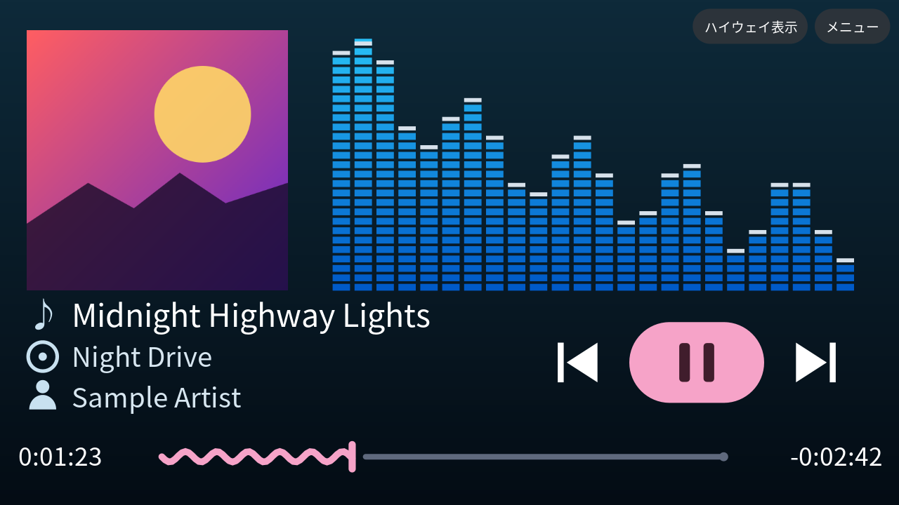
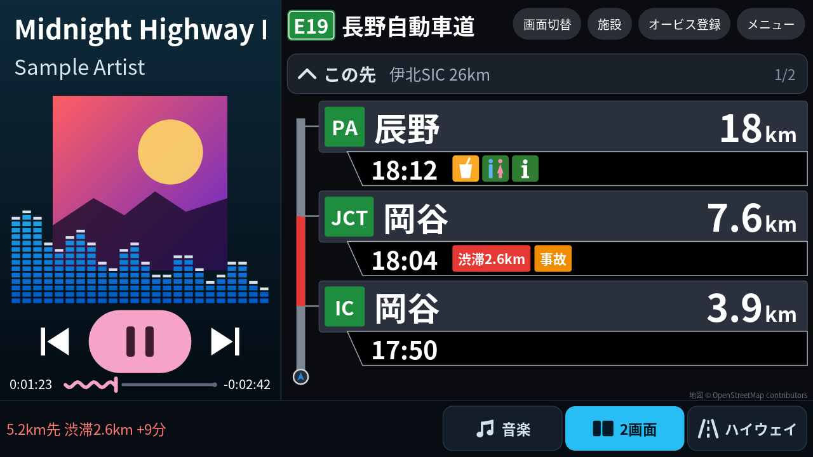
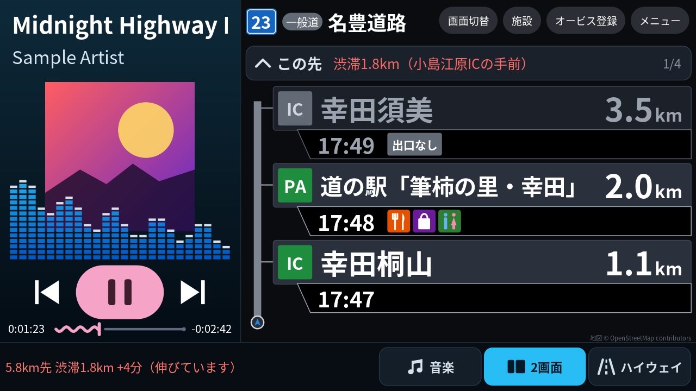
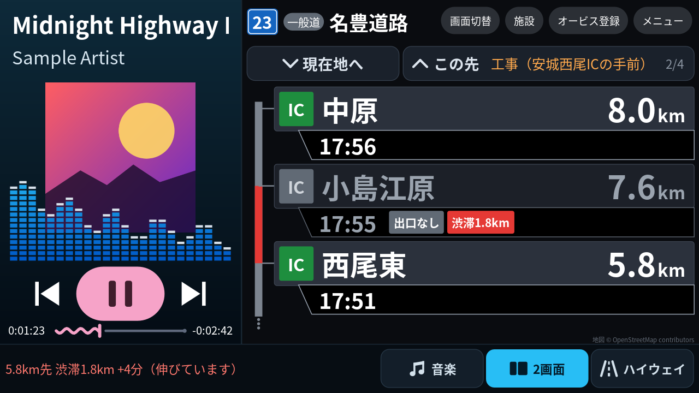
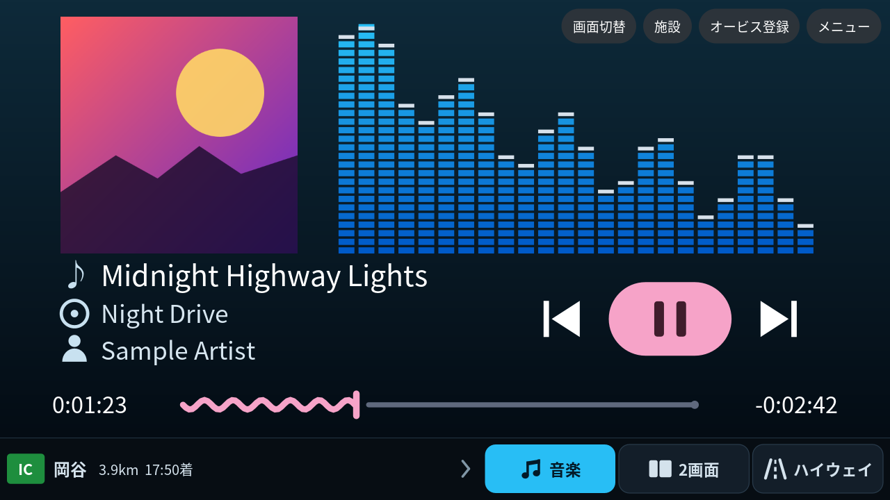
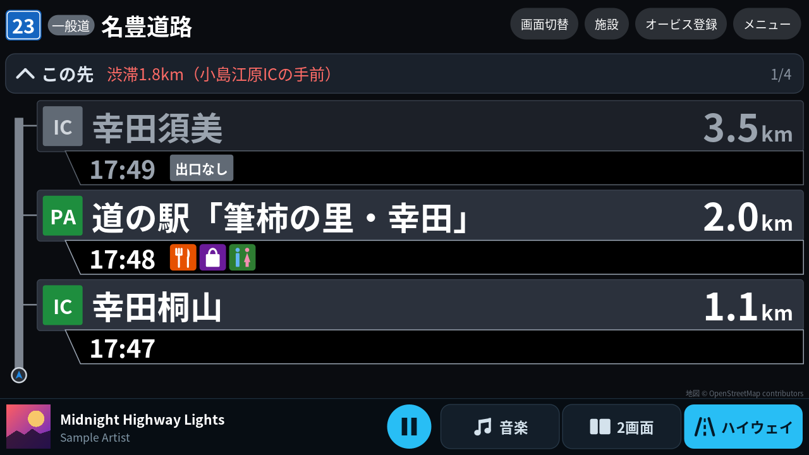
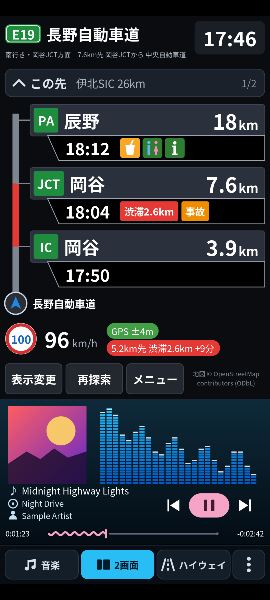

# Spectrum ハイウェイ（Spectrum ＋ ハイウェイモード / Android・Android Auto）

音楽プレーヤー表示とスペクトラムアナライザーの **Spectrum** と、カーナビの「ハイウェイモード」を 1 つにしたアプリです。

- **高速道路の外**では Spectrum（再生中の曲・ジャケット・操作・スペアナ）を全画面で表示
- **高速道路・有料道路・都市高速・主要バイパスに入ると自動で 2 画面**：左に Spectrum（スマホ縦画面と同じレイアウト）、右にハイウェイモード
  （前方の IC / JCT / SA / PA / スマートIC / 本線料金所までの距離と到着予定時刻、SA/PA の設備、ETC 専用、渋滞・事故・通行止め、オービス）
- 高速道路の間は**下部のバー**で［音楽］［2画面］［ハイウェイ］をワンタップで切替。出ると自動で Spectrum に戻ります
- **Android Auto** の車の画面とスマホの両方に対応（車速信号・ETC カード状態・航続距離も活用）

| 高速道路の外（Spectrum） | 高速道路に入ると自動で 2 画面（施設名・曲名を大きく） |
|---|---|
|  |  |
| **主要バイパス**（出口の無い IC は「出口なし」、バーに渋滞） | **［︿ この先］で先の施設・渋滞を順に表示**（［﹀ 現在地へ］で戻る） |
|  |  |
| **音楽だけにしたとき**（バーに次の施設。オービス 2km 以内は警告を優先） | **ハイウェイだけにしたとき**（バーに再生中の曲と 再生/一時停止） |
|  |  |

| スマホ縦画面の 2 画面（上下） | スマホ縦画面（ハイウェイモード） | 一覧表示（オービスも並べる設定） |
|---|---|---|
|  |  |  |

| スマホ横画面（2 画面） | スマホ縦画面（主要バイパス・名豊道路） |
|---|---|
|  |  |

※ 画像は実際の描画コード（`PlayerRenderer`・`PanelRenderer`・`ModeBarRenderer`）を PC 上で描画したものです（曲・数値はサンプル）。
車の画面の右上のボタンは Android Auto が表示する部分のイメージで、形や位置は車種・画面の大きさによって変わります（狭い画面ではアイコン）。

---

## 今回の更新（v2.1）

| ご要望 | 対応 |
|---|---|
| 表示されない IC が複数ある（実在する IC を飛ばして次の IC が出る）。蒲郡バイパスだけでなく全体的に | 全国データで原因を調べて 5 つ修正（[詳細](#v21表示されない-ic-の原因と修正)）。**片側にしか出口の無い IC** を「出口なし」として並べる、**名前に種別の無い分岐**（「豊川為当」など）・「I.C」表記の読み取り、**JCT と誤判定していたバイパスの IC**、**料金所・出口車線で本線が二手に分かれる区間**の出口（全国 85 か所 → 5 か所） |
| 同じ路線が続いているのに 1 つ先しか出ないことがある | 本線の名前が変わる地点（国道23号 → 知立バイパスなど）で、旧名と同じ名前のランプへ進んで前方経路が終わっていた → 同じ路線の本線を優先（全国 25 か所 → 10 か所。残りは本当に別路線へ分かれる所） |
| スマホでアプリを開いていないと、IC・渋滞情報・ジャケットが正しく出ない | Android は画面に出ていないアプリの GPS・通信を止めることがあるため、車の画面の表示中・操作のたびに常駐サービス（位置情報）を起動し直すように。起動できない場合も通信は保つ形で動かし、**原因を「動作状態」で表示**。ジャケットは曲情報に画像が無いアプリでも通知の画像・画像の URL から取得（[詳細](#スマホでアプリを開かずに使う)） |
| 横画面・Android Auto で表示が細かく見にくい。左側（制限速度・車速・方位）は不要。IC 名と音楽側を大きく | 横画面では左側の欄をやめて施設の一覧だけにし、**施設名・距離・到着時刻を約 1.3〜1.5 倍**に。下の自車マークの行もなくして行を高く。音楽側は 2 画面用の表示（**曲名・アーティスト・ボタンを大きく**、左側の幅も広く） |
| 先の IC や渋滞も見たいので、上部に矢印を | 一覧の上に **［︿ この先］**（押すたびに 3 件ずつ先へ）、先のページでは **［﹀ 手前へ／現在地へ］**。帯の右側に「この先の渋滞（○○IC の手前）」や次の施設、ページ番号。操作しなければ 20 秒で現在地の表示に戻ります |
| 渋滞時の到着予想の精度を | 取得のたびに渋滞を前回と照合して **最後尾が伸びている／縮んでいる速さ**を求め、**自分が最後尾に追いつく地点**から渋滞が始まるとして予測。渋滞の中では**自分の実際の進み方**を優先し、先は**渋滞の先頭の位置**まで。取得元の**遅れ時間・渋滞の速さ**をそのまま反映（[検証結果](#精度検証gradlew-coretest)：渋滞が伸びている場合の誤差 365 秒 → 2 秒、出発時に取得した渋滞情報での誤差 38.2 秒 → 37.5 秒） |

### v2.1：表示されない IC の原因と修正

蒲郡バイパスだけでなく全国の地図データ（同じデータ）で v2.0 と v2.1 を比べました。

| 全国の集計 | v2.0 | v2.1 |
|---|---|---|
| 片方向の一覧にしか出ない IC・スマートIC（もう一方では飛ばされる） | **674** | **84**（残りは反対方向の出口が別の名前の所など） |
| 7,691 地点から 30km 先までの一覧に並ぶ IC・スマートIC | 35,886 | **39,741**（+3,855） |
| 名前の誤り（「新居弁天I.CIC」「国道23号IC」「出口IC」など） | 594 | **0** |
| バイパス上の JCT（v2.0 は大半が一般道への出口の誤判定） | 940 | 378（残りは高速道路へ分かれる所。「○○方面」と表示） |
| 本線が二手に分かれる区間で、選ばなかった側の出口が抜ける | 85 か所 | **5 か所** |

例：国道23号（名豊道路）西行き — v2.0 は 幸田須美・小島江原・西中・一ツ木・今川・名古屋南 が抜け、豊川為当・幸田芦谷が JCT。
東行き — v2.0 は「国道23号IC」「新居弁天I.CIC」「篠原I.CJCT」などの誤った名前、大倉戸IC の抜け。v2.1 ではすべて正しく並びます。

原因と修正：

1. **片側の車線にしか出口が無い IC（ハーフ IC）**：反対方向では一覧から消えていた → 反対車線の同じ地点に「**出口なし**」として並べる（灰色・「出口なし」の札。降りられないので下のバーの「次の施設」には出しません）。愛知県内で 55 か所 → 16 か所（残りは反対方向に別名の出口がある所など）。
2. **名前に種別が付いていない分岐**（「豊川為当」「幸田芦谷」など、バイパスに多い）を名前として使えていなかった → 使うように。道路名しか無い分岐（「国道23号」「国道2号出口」）は「○○方面」と表示。「豊川I.C」「真岡I.C北ランプ」「大和スマートIC北」などの表記も読み取り、名前のわからない出口は「出口IC」でなく「出口」と表示。
3. **バイパスの IC を JCT と判定**（豊川為当など、一般道へ出る分岐）→ 出た先が高速道路でなければ IC に。
4. **本線の名前が変わる地点**（国道23号 → 知立バイパス）で前方経路がランプへ進んで終わっていた → 同じ路線の本線を優先。
5. **本線が二手に分かれる区間**（播但連絡道路の福崎付近のように、通過する車線と出口のある車線が分かれ、先で合流する）で、通過する側だけを見ていた → 合流する並行の車線にある IC・SA/PA も一覧に入れる（全国 85 か所 → 5 か所）。

## v2.0 の更新：Spectrum と統合

| ご要望 | 対応 |
|---|---|
| Spectrum とハイウェイモードを 1 つのアプリに | Spectrum の音声解析・曲情報・操作（12 ファイル）を**元のまま**取り込み、車の画面とスマホの画面を 1 つにまとめました（[詳細](#spectrum-との統合)） |
| 高速道路の外は Spectrum、入ったら左 Spectrum・右ハイウェイに自動切替 | ハイウェイモードの判定（地図照合）が「高速道路上」と **5 秒続いたら 2 画面**、「高速道路外」が **15 秒続いたら Spectrum に戻す**。IC のランプ・料金所・JCT・トンネル・SA/PA の停車では戻りません（走行シミュレーションで確認） |
| 左は Spectrum をスマホ縦画面のような UI で | Spectrum の縦レイアウト（240×380）が余白なく収まる幅（画面の 20〜42%）で左に配置。右は残り全部をハイウェイモードに |
| 下部に音楽 / ハイウェイの切替ボタン | 高速道路の間だけ下部に［♪ 音楽］［2画面］［ハイウェイ］。運転席に近い右側にまとめ、左側には**音楽だけのときは次の施設（オービス・通行止め・渋滞を優先）**、**ハイウェイだけのときは再生中の曲と 再生/一時停止** |
| タッチできない車でも | 同じ切替を右上の「画面切替」ボタン（Android Auto の標準ボタン）にも。メニュー（表示・再探索・一般道モード・自動切替・終了）も右上から |
| 使いやすさ | 切替時の短いフェード、ハイウェイだけの間は音声解析を止めて負荷を下げる、ハイウェイ側の画面は内容が変わったときだけ描き直す、右上のボタンと重なる時計は車の画面では省略 |

## v1.2 の更新：Android Auto に表示されない問題

| 内容 | 対応 |
|---|---|
| Android Auto の一覧（ランチャーのカスタマイズ）に出ない | 原因は Android Auto 17.7 以降の仕様（Play 以外から入れたナビ型アプリを表示しない）。アプリの宣言は正常。**Google Play の内部テストで配布できるように**し、手順を[下記](#android-auto-の一覧に表示させる重要)にまとめました |
| Play へ上げられる形に | アプリ ID を `com.example…` から自分用の ID へ（Play は `com.example` を拒否）、版番号の自動採番、アップロード鍵での署名、`.aab` の作成、内部テストへの自動公開（任意）。アプリだけを数分で作り直す **build-app** ワークフローを追加 |
| 原因がスマホで分かるように | メニュー →「**Android Auto の状態**」：インストール元・Android Auto の版・宣言の有無と対処を表示（該当するときは初回に一度だけ自動表示） |
| APK を更新するとインストールできない | これまでは毎回違うデバッグ鍵で署名されていたため。アップロード鍵を登録すると同じ鍵で署名され、上書き更新できます |
| プライバシーポリシー | Play Console の入力用に [docs/PRIVACY.md](docs/PRIVACY.md) を追加 |

## v1.1 の更新

| ご要望 | 対応 |
|---|---|
| 地図データがなかなか取得できない | **全国データ（HWDB 形式）をアプリに同梱**／**ワンタップで一括ダウンロード・更新**／**地方単位で端末内作成**。Overpass への問い合わせは「データに無い範囲だけ」に。オンライン取得もヘッジ要求（遅いサーバーを待たず別サーバーへ）・2 本並列・ストリーミング解析で高速化 |
| 任意で地図データ更新 | メニュー →「地図データ」→「最新データに更新」。起動時に 1 日 1 回、新しい版があればお知らせ（自動では更新しない） |
| 主要バイパス（名豊道路・名阪国道など）でも使いたい | IC（出口分岐）のある一般国道の区間を自動判定して対象に追加。IC の無い一般区間・交差点の多い国道は対象外 |
| リアルタイム渋滞情報（3 / 5 分間隔、ETA に反映） | **HERE / TomTom / Google** から選択。間隔は **3 分・5 分・自動**（前方に渋滞があれば 3 分・無ければ 5 分、路線が変わったら即取り直し）。到着予定・帯の色・各施設の「渋滞○km」「事故」「通行止」に反映 |
| オービス表示 | 地図データに含まれる速度取締機＋**自分で登録（ワンタップ）・CSV 取り込み**。2km 手前から上部に表示、1km・500m 手前で音声案内 |
| デモで表示されない IC / SA があった | 原因を特定して修正（下記）。再現テストを追加 |
| Android Auto 対応・車速信号の活用 | 車の画面にハイウェイモードを描画。**車速信号でトンネル内の位置誤差 31m → 1m 未満**、ETC カード未挿入の警告、航続距離と次の GS の照合 |

### 「表示されない IC / SA」の原因と修正
1. **名称の無い出口分岐を捨てていた** → 出口ランプの行き先（SA/PA 区域・別路線・一般道）と、反対車線の同じ IC 名・ランプ名・案内方面から名称と種別を補うように。
2. **出口分岐ノードが片方の車線にしか登録されていない IC**（OSM では珍しくない）→ 本線からランプが分かれる地点を「推定出口」として拾うように。
3. **上下線集約型・中央分離帯側の SA/PA**（区域が右側にある）を「進行方向の左側」ルールで除外していた → 区域が本線にかかっている・その車線から分かれるランプが区域に入る場合も、その方向の施設に。
4. **ランプ側のエッジを基準に判定**して別路線判定が狂うことがあった → 本線側を基準に。本線同士がランプ無しで分かれる JCT も検出。
5. **SA/PA の区域データが隣のタイルにあると読み込まれない**ことがあった → 前方 40km の経路沿いと、タイル境界に近い地点の隣接タイルも先読み。

---

## 主な機能

- **Spectrum（音楽）**：再生中の曲のジャケット・曲名・アルバム・アーティスト、前/次/再生・一時停止、シーク、スペクトラムアナライザー（Spectrum と同じ）。
- **画面の自動切替**：高速道路の対象エリアに入ると 2 画面、出ると Spectrum。下部のバーで手動切替も。
- **対象道路**：高速自動車国道・都市高速（`motorway`）、有料道路（`toll=yes`）、自動車専用道路（`motorroad=yes`）、**IC のある主要バイパス**（一般国道 `trunk` のうち IC が並ぶ区間）。
- **前方施設の一覧**：IC・JCT・SA・PA・スマートIC・本線料金所を近い順に（距離「3.9km」、到着予定「17:50」）。JCT で路線が変わっても同じ路線番号・名称の本線を辿ります。
- **施設情報**：ガソリンスタンド（ブランド・営業時間）、EV 充電、レストラン、軽食、コンビニ、ショップ、トイレ、案内所、シャワー、宿泊、ドッグラン、ATM。タップで詳細。
- **ETC 専用**：スマート IC、名称の「ETC専用」、出口料金所の `payment:cash=no` など。
- **進行方向判定（高精度）**：ジャイロ＋GPS＋コンパスのカルマンフィルタと HMM マップマッチング。トンネル内は推測航法（Android Auto では車速信号・車両ジャイロも使用）。
- **到着予測（高精度）**：制限速度・カーブ・料金所・運転傾向（自動学習）・現在速度・渋滞の持続推定、さらに**リアルタイム渋滞情報**。
- **オービス**：上部の赤い帯（2km 手前から）、一覧への表示（任意）、音声案内（1km・500m 手前）。
- **音声案内**：オービス接近、前方 10km 以内の渋滞（長さ・遅れ）、ETC カード未挿入、給油の目安（ナビ音声として再生し、音楽は一時的に小さく）。
- 常駐サービス（画面を消しても計測継続）、デモ走行、表示切替（大きく 3〜4 件 / 一覧 / SA・PA のみ）、SA/PA 停車中の表示保持。

---

## ビルド方法

### 必要なもの
- Android Studio（最新版推奨。JDK 17 以上同梱）
- Android 8.0（API 26）以上の実機（GPS・ジャイロ搭載）

### 手順
1. このフォルダ `HighwayMode/` を Android Studio の **Open** で開く
2. Gradle Sync を待つ（初回は数分）
3. 実機を USB 接続し **Run ▶**

```bash
./gradlew assembleDebug          # app/build/outputs/apk/debug/app-debug.apk
./gradlew :app:bundleRelease -Papp.id=io.github.yourname.highwaymode   # Google Play 用 .aab（署名は下記「Android Auto」参照）
./gradlew :core:test             # 単体テスト＋走行シミュレーションによる精度レポート
./gradlew :datatool:run --args="help"   # 地図データ作成ツール
```

構成：AGP 8.13.2 / Kotlin 2.2.21 / Gradle 8.14.3 / compileSdk・targetSdk 36 / minSdk 26。
依存ライブラリは Android Auto 用の `androidx.car.app:app` / `app-projected` 1.7.0、`androidx.core`、Spectrum の音声読み取り許可用の Shizuku（`dev.rikka.shizuku:api` / `provider` 13.1.5）のみ（演算部 `core` は Kotlin 標準ライブラリのみ）。

---

## 地図データ（いちばん大事な準備）

アプリは次の順で地図を読みます。**1 か 2 を用意すると、通信を待たずにすぐ表示されます。**

1. **アプリ同梱データ** `app/src/main/assets/hwdb/japan-highways.hwdb`（無圧縮で APK に格納し、端末にコピーせず直接読む）
2. **ダウンロードしたデータ**（メニュー →「地図データ」→「最新データに更新」）
3. **端末内で作成したデータ**（同画面の「地方を指定して端末内で作成」。Overpass から都道府県単位でまとめて取得）
4. 上記に無い範囲だけ **Overpass API からその場で取得**（設定でオフにも可。取得したタイルは 60 日キャッシュ）

### HWDB 形式
OpenStreetMap から高速道路・有料道路・主要バイパス・出口分岐・料金所・SA/PA と設備・オービスだけを抜き出し、
約 22km 四方のタイルごとに圧縮した独自形式です（`core/hwdb`）。
- 座標は OSM と同じ 1e-7 度精度・差分の可変長整数、タグはアプリが使うものだけ。
  テストデータでは **Overpass の JSON 218KB → 16KB（約 1/13、gzip した JSON の約 1/3）**、読み込みは約 8 倍速。
  全国分で数 MB〜十数 MB 程度の見込みです。
- タイル単位で途中から読めるので、全国分を入れてもメモリに全部は載せません。道路の無い海・山のタイルも「空」と記録するので通信しません。
- 各タイルに CRC32、配布ファイルに SHA-256。ダウンロードは途中再開（HTTP Range）でき、検証が通ってから差し替えます。
- 地方ごとに作ったファイルの境界タイルは、両方の地方がそろうと自動で結合して使います。

### 全国データの作り方

**A. GitHub Actions（おすすめ：PC 不要・毎週自動更新・データ同梱 APK も作成）**
1. このプロジェクトを自分の GitHub リポジトリ（**public**）に push
2. Actions タブ →「build-hwdb」→ **Run workflow**（以後は毎週月曜 3:17 に自動）
3. Releases に次が公開されます
   - `hwdb-YYYYMMDD`：`japan-highways.hwdb`、`hwdb-manifest.json`、**データ同梱 APK**（`HighwayMode-YYYYMMDD.apk`）
   - `hwdb-latest`：アプリが更新確認に使う目録（固定 URL）
4. この APK には配布元 URL（`https://github.com/<ユーザー>/<リポジトリ>/releases/download/hwdb-latest/hwdb-manifest.json`）が埋め込まれ、
   以後はアプリの「最新データに更新」で新しいデータだけを取得できます。

   ※ CI の APK はビルドごとに異なるデバッグ鍵で署名されるため、上書きインストールできないことがあります。
   固定の署名鍵を使う場合は `app/build.gradle.kts` の `signingConfig` を自分の鍵に変更してください（または手元でビルドした APK を使い、データだけ CI から取得）。

**B. PC（osmium-tool あり・数分）**
```bash
brew install osmium-tool      # macOS（Ubuntu: sudo apt install osmium-tool）
scripts/build-hwdb.sh         # → app/src/main/assets/hwdb/japan-highways.hwdb
```
Geofabrik の日本全域データ（約 2GB）から抽出して作ります。そのままビルドするとアプリに同梱されます。

**C. PC（osmium なし・Overpass から都道府県単位で取得、全国で 30〜90 分程度）**
```bash
./gradlew :datatool:run --args="overpass --regions all --out app/src/main/assets/hwdb/japan-highways.hwdb"
./gradlew :datatool:run --args="overpass --regions kanto,chubu --out kanto-chubu.hwdb"   # 地方だけ
```

**D. スマホだけで（地方単位）**：メニュー →「地図データ」→「地方を指定して端末内で作成」。通知に進み具合が出ます（1 地方 数分〜20 分）。

自分のサーバーで配布する場合は `datatool manifest --base-url <URL> --out hwdb-manifest.json japan-highways.hwdb` で目録を作り、
アプリの「配布元（目録 URL）の設定」に `hwdb-manifest.json` の URL を入れてください。

---

## 主要バイパス（IC のある一般国道）

名豊道路（国道 23 号）、名阪国道（国道 25 号）、静清バイパス、加古川・姫路バイパスなど、**一般道だが IC のある区間**を自動で対象にします（`BypassClassifier`）。

- 同じ路線（路線番号・名称）でつながる国道のうち、IC（`highway=motorway_junction`）・本線料金所・高速道路とのランプ接続がある区間を手掛かりに、
  **前後の IC の間隔が 15km 以内の区間と、最初・最後の IC の前後 1.5km** を採用します。IC が片側の車線にしか登録されていなくても、対向車線から補います。
- IC の無い一般区間や交差点の多い国道（IC の登録が無い国道）は対象外で、その手前で表示が終わります。
- 画面には青い路線番号（例「23」）と「一般道（信号・歩行者に注意）」を表示。制限速度タグが無い場合は 60km/h とみなします。
- 全国データ作成時に判定を済ませて保存するので、端末側の負担はありません。

---

## リアルタイム渋滞情報

メニュー →「渋滞情報（取得元・間隔）」で取得元・API キー・間隔を設定します。**高速道路を走行中だけ**、前方経路（最長 100km、通信量を抑える設定で 60km）に沿って問い合わせます。

| 取得元 | 取得する情報 | 無料枠の目安（2026 年 10 月時点の各社ページ） |
|---|---|---|
| HERE Traffic API v7 | 道路区間ごとの実速度・自由流速度（流れ）＋事故・工事・通行止め | Base Plan で Traffic 月 5,000 トランザクション（1 回の更新で 2 回使用） |
| TomTom Traffic（Incident Details v5） | 渋滞（長さ・遅れ秒）・事故・通行止め・工事・車線規制 | Incident Details 月 2,500 リクエスト（経路の広さにより 1 回の更新で 1〜4 回） |
| Google Routes API（computeRoutes） | 経路上の混雑区間（順調/混雑/渋滞）と渋滞を考慮した所要時間 | 「Pro」料金区分（無料枠・単価は料金ページで確認） |

- 取得間隔：**3 分 / 5 分 / 自動**（前方 40km 以内に渋滞があれば 3 分、無ければ 5 分。JCT で別路線に入るなど前回の問い合わせ範囲を外れたら最短 60 秒で取り直し）。失敗が続くと 1→2→4 分と間隔をあけます。
- 到着予測への反映：交通情報のある区間はその速度比（実速度/自由流速度）を使い、自車の現在速度（短期）・運転傾向と組み合わせます。
  情報の無い区間は従来どおり「自車の渋滞の持続推定」。取得から 10 分を過ぎると徐々に弱め、30 分で使わなくなります。
- 表示：左の帯（赤・橙）、施設の行の「渋滞2.6km」「事故」タグ、通行止めの先は「通行止」、状態チップ「5.2km先 渋滞2.6km +9分」。
- 交通情報は**進行方向と道路形状で自分の車線に対応づけ**るので、反対車線の渋滞や並行する一般道の情報は載りません。
- 日本国内での対応範囲・精度は各社で異なります。API キーは端末内にだけ保存されます。

---

## オービス（速度取締機）

- **地図データ**：OpenStreetMap の `highway=speed_camera`（全国データ・端末内作成データに含まれ、更新でまとめて最新化）。
  道路上のノードはその車線（`direction` タグも考慮）、路側のものは進行方向の左側の車線に付けます。
- **自分で登録**：走行中に「オービス登録」（スマホのメニュー、または Android Auto の画面右上）で現在地と進行方向を登録。
- **CSV 取り込み・書き出し**：メニュー →「オービス」。形式は `緯度,経度,進行方位(度),制限速度,名称`（見出し行は任意、緯度経度が逆でも判定）。
  進行方位を入れると、その向きの車線だけに付きます。
- 表示と案内：2km 手前から上部に赤い帯、1km（100km/h 以上は約 1.2km）・500m 手前で音声。一覧に並べるかは設定で選べます。
- ※ OSM の日本の取締機データは網羅的ではありません（市販のオービスデータは利用規約上アプリに同梱できないため、手持ちのデータは CSV で取り込んでください）。制限速度を守って運転してください。

---

## Spectrum との統合

### 画面の切り替わり方

| 状況 | 車の画面（Android Auto） | スマホ |
|---|---|---|
| 高速道路の外 | Spectrum を全画面（従来の Spectrum と同じ。下部のバーなし） | Spectrum ＋ 下部のバー |
| 高速道路に入って 5 秒 | **2 画面**：左に Spectrum（2 画面用の大きい縦レイアウト）、右にハイウェイモード（施設の一覧を大きく）＋ 下部のバー | 縦画面: 上にハイウェイモード・下に Spectrum ／ 横画面: 車と同じ左右 |
| 高速道路の間 | 下部のバーでいつでも［音楽］［2画面］［ハイウェイ］。選んだ画面は高速道路を出るまでそのまま | 同じ（右端の［⋮］でメニュー） |
| 高速道路を出て 15 秒 | Spectrum の全画面に戻る | Spectrum に戻る |

- 「高速道路」は、ハイウェイモードの対象（高速道路・有料道路・都市高速・IC のある主要バイパス）。判定はハイウェイモードの地図照合（上下線・ランプまで判定）をそのまま使います。
- **戻らない場面**：IC のランプ・料金所・JCT・トンネル（推測航法）・SA/PA での停車。高架下や側道の一般道で一瞬だけ高速道路と判定されても切り替わりません（3〜5 秒続かないと数えない）。
- **一般道モード**（メニュー）にすると、すぐ Spectrum に戻り、高速道路の判定を止めます。
- **設定**：スマホのメニュー →「画面の自動切替」で「2画面（既定）／ハイウェイだけ／自動で切り替えない」。車のメニューでも自動切替のオン・オフができます。
- **下部のバーの左側**：音楽だけの表示中は次の IC/SA などまでの距離と到着時刻（**オービス 2km 以内・通行止め・10km 以内の渋滞を優先**。タップで 2 画面）、2 画面の間は**前方 40km 以内の渋滞**（「5.2km先 渋滞2.6km +9分（伸びています）」）、ハイウェイだけの表示中は再生中の曲と 再生/一時停止。
- 音声案内（オービス・渋滞・ETC カード・給油）はどの画面でも流れます（音楽は一時的に小さく）。

### 車の画面の右上のボタン

| 状況 | ボタン |
|---|---|
| 高速道路の外 | **ハイウェイ表示**（手動で 2 画面に）・**メニュー** |
| 高速道路の間（バー表示中） | **画面切替**（2画面 → ハイウェイ → 音楽）・**施設**（一覧 → 詳細）・**オービス登録**・**メニュー** |

メニュー: 画面の切替 / ハイウェイの表示（大きく・一覧・SA/PA）/ 再探索 / 一般道モード / 自動切替 オン・オフ / 終了、右上に「動作状態」。
タッチ操作のできない車（ダイヤル・タッチパッド操作）でも、これらのボタンで同じ操作ができます。

### 必要な許可

| 許可 | 使い道 | 無い場合 |
|---|---|---|
| 位置情報（正確な位置） | 高速道路の判定・距離・到着予定 | 自動切替とハイウェイモードが動かない |
| マイク | Spectrum のスペアナ（再生中の音を解析。**録音はしません**） | スペアナが動かない |
| 通知へのアクセス | 曲名・ジャケット・操作（Spectrum） | 曲情報が出ない |
| 音声の読み取り（DUMP・任意） | YouTube など音声の番号を知らせないアプリのスペアナ（Shizuku で許可） | そのアプリの音は端末全体の音で解析 |
| 車速・燃料（Android Auto） | トンネル内の精度・給油の案内 | スマホのセンサーだけで判定 |

足りない許可はスマホの画面の下にボタンで出ます（Spectrum と同じ）。

### Spectrum のファイル（別スレッドでの更新を取り込むとき）

`app/src/main/java/com/example/spectrum/` には Spectrum の 12 ファイルを入れています。次の 8 ファイルは **Spectrum のものをそのまま**なので、Spectrum 側で更新したら上書きするだけで取り込めます。

`AudioSessionReceiver.kt` `Diagnostics.kt` `DiagnosticsActivity.kt` `MediaResumer.kt` `NowPlaying.kt` `SessionScanner.kt` `ShizukuHelper.kt` `SpectrumEngine.kt`

次の 4 ファイルは v2.1 で手を加えました。Spectrum 側でこれらを更新したときは、下の追加分を残して取り込んでください（上書きすると v2.1 の改善が消えます）。

| ファイル | v2.1 での追加 |
|---|---|
| `MediaTracker.kt` | ジャケットが無いときの取り直し（`heal` から `refreshArt`）、通知の画像の利用（`onPlayingNotification`・`artFromNotification`）、画像の URL（https）の読み込みと縮小（`loadArtFromUri`・`decodeSampled`） |
| `MediaListenerService.kt` | `artFromNotification(pkg)`、再生中の通知が更新されたら `MediaTracker.onPlayingNotification` を呼ぶ |
| `PlayerRenderer.kt` | 2 画面用の大きい縦レイアウト（`large`・`largePortraitLayout`、曲名を太字・アルバム名とアイコンを省略） |
| `PlayerView.kt` | `large` の受け渡し |

次の 3 ファイルは 1 つのアプリにするため、中身を統合先に移しました（Spectrum 側でこれらを変えたときは、統合先に同じ変更を入れてください）。

| Spectrum のファイル | 統合先 |
|---|---|
| `SpectrumScreen.kt`（車の画面） | `car/DualCarScreen.kt`（描画スレッド・音声解析の開始/停止・曲情報の取り直し・再生中のアプリを開く処理をそのまま移植） |
| `SpectrumCarAppService.kt` | `car/HighwayCarAppService.kt` の `onCreate`（曲情報の読み込み開始） |
| `MainActivity.kt`（スマホ） | `MainActivity.kt`（権限ボタンの並び・Shizuku の確認・通知リスナーの再接続） |

統合した画面が使っている Spectrum 側の機能は `PlayerRenderer`（`draw` / `onTap` / `setSpectrum` / `onArtTap`）、`SpectrumEngine`（`acquire` / `release` / `listeners` / `retry` / `init`）、`NowPlaying`（曲情報・`playPause`）、`MediaTracker`（`start` / `heal`）です。これらの名前や引数を変えた場合だけ、統合側の修正が必要です。
AndroidManifest.xml には Spectrum の権限・サービス・Shizuku の接続口・受信設定を統合済みです。

### 1 つのアプリにしたことによる注意

- アプリ名は「**Spectrum ハイウェイ**」（`app/src/main/res/values/strings.xml` で変更できます）。
- 別々に入れていた「Spectrum」と「ハイウェイモード」は、Android Auto の一覧に並んで紛らわしいのでアンインストールしてください（Spectrum の設定・ハイウェイモードの登録オービスは引き継がれません。オービスは先に CSV で書き出しておけば移せます）。
- アプリ ID は既定で `io.github.<GitHub のユーザー名>.highwaymode`。Spectrum を Google Play の内部テストで配っていて、**そのアプリとして更新したい**場合は、リポジトリ変数 `APP_ID` にそのアプリ ID を設定し、同じアップロード鍵で署名してください。

## Android Auto

スマホを車につなぐと、車の画面に Spectrum とハイウェイモードが表示されます（上の「画面の切り替わり方」）。

- 地図面のハイウェイモードの施設をタップすると詳細が開きます（タッチ対応の車）。
- **車両から取得して使う情報**（車種・ヘッドユニットにより一部のみ）
  - **車速信号**：速度フィルタの主な入力にし、メーターの誤差（2〜5%）は GPS 速度で自動補正。
    トンネル内の推測航法の距離精度が大きく上がります（下表）。停止判定も車速で即座に行います。
  - **車両のジャイロ**：車体固定なのでスマホの置き方に左右されません。車種ごとに異なる座標軸と向きを、スマホのジャイロ（または GPS 方位）との相関で自動判定してから使います。
  - **ETC カードの状態**：未挿入・無効なら画面と音声で警告。
  - **燃料・電池残量と航続可能距離**：前方の SA/PA の GS（EV なら充電設備）と照らして「次の○○SAで給油を」などを案内。
  - 車両の GPS：スマホの測位が止まったときの補助。
- 初回は車の画面で権限（位置情報・マイク・車速・燃料）を確認し、スマホ側で許可します。
- ナビアプリ（`NAVIGATION` カテゴリ）として登録し、地図面に描いています（経路案内は行いません）。音楽アプリの枠は画面に自由に描けないため、Spectrum と同じくナビの枠を使っています。

### スマホでアプリを開かずに使う

Android は、画面に出ていないアプリの GPS・通信・常駐を省電力のために止めることがあります。車の画面だけで使っている間、
スマホのアプリは「画面に出ていない」扱いになるため、**IC の判定（GPS）・渋滞情報（通信）・ジャケット画像**が止まることがありました。

- 車の画面が表示されている間・操作のたびに、常駐サービス（位置情報）を起動・確認します（起動できなければ間隔をあけて再試行）。
- 位置情報の常駐ができないとき（Android 14 以降で、位置情報の許可が「アプリの使用中のみ」のまま裏から起動した場合など）は、
  通信とアプリの動作を保つ形（データ同期）で常駐し、30 秒ごと・車の画面の操作のたびに位置情報の常駐へ切り替えを試みます。
- スマホを最近使ったアプリの一覧から消しても、車の画面で使っている間は止めません。
- **それでも止まる場合は、スマホの 設定 → アプリ → Spectrum ハイウェイ → 電池（バッテリー）→「制限なし」**
  （機種によっては「電池の最適化」→ すべてのアプリ →「最適化しない」）にしてください。Android の決まりで、これを設定したアプリは裏からでも常駐サービスを起動できます。
- 状態の確認：**車のメニュー → 右上の「動作状態」**、または**スマホのメニュー →「Android Auto だけで使うための設定（動作状態）」**。
  常駐サービス・GPS の受信・電池の設定・通信の制限・渋滞情報・曲情報を ○× で表示し、スマホでは設定画面を開くボタンも出ます。
  車の画面だけで使っていて GPS が止まっているときは、ハイウェイ側の上部にも「スマホの GPS を受信できません」と出ます。
- ジャケット：曲情報に画像を入れないアプリでも、再生中の通知の画像や画像の URL（https）から取得し、取りこぼしても 4 秒ごとに取り直します。

### Android Auto の一覧に表示させる（重要）

**APK を直接インストールしたままでは、Android Auto の一覧（「ランチャーのカスタマイズ」を含む）に表示されません。**
Android Auto 17.7 以降（2026 年秋）は、Car App Library で作ったアプリ（このアプリのようなナビ型）を
「提供元不明のアプリ」の設定では通さなくなり、**Google Play からインストールしたもの（内部テスト配布を含む）だけ**を表示します。
アプリのマニフェスト（Android Auto 用の宣言）は正しく入っていても、この確認で除外されます。

スマホのメニュー →「**Android Auto の状態**」で、インストール元・Android Auto の版・宣言の有無と、必要な対処を確認できます。

実車で使うには、次の **A**（Google Play の内部テストで自分に配布）を行ってください。審査はなく、費用は開発者登録の 25 米ドル（1 回だけ）です。

#### A. Google Play Console の内部テストで配布する

**1. アップロード鍵を作る（PC で 1 回だけ）**

Android Studio に付属の `keytool` で作ります（Windows の例。パスワードは 2 回聞かれます）:

```bat
"C:\Program Files\Android\Android Studio\jbr\bin\keytool.exe" -genkeypair -v -keystore upload.jks -alias upload -keyalg RSA -keysize 2048 -validity 10000
```

`upload.jks` とパスワードは大切に保管してください（GitHub には置かない）。

**2. GitHub に鍵を登録して AAB を作る**

`upload.jks` を base64 の文字列にします:

```powershell
# Windows（PowerShell）: クリップボードにコピーされる
[Convert]::ToBase64String([IO.File]::ReadAllBytes("upload.jks")) | Set-Clipboard
# Mac: base64 -i upload.jks | pbcopy　／　Linux: base64 -w0 upload.jks
```

リポジトリの **Settings → Secrets and variables → Actions → New repository secret** で登録:

| 名前 | 値 |
|---|---|
| `UPLOAD_KEYSTORE_BASE64` | 上でコピーした文字列 |
| `UPLOAD_KEYSTORE_PASSWORD` | キーストアのパスワード |
| `UPLOAD_KEY_ALIAS` | `upload` |
| `UPLOAD_KEY_PASSWORD` | 鍵のパスワード（キーストアと同じなら同じ値） |

**Actions → build-app → Run workflow**（数分）。終わったら実行結果の **Artifacts** から `HighwayMode-app` をダウンロードし、中の **`HighwayMode.aab`** を使います。
アプリ ID は `io.github.<GitHub のユーザー名>.highwaymode` になります（実行ログの「アプリ ID」に表示。Google Play は `com.example` で始まる ID を受け付けないため変更しました。別の ID にしたいときはリポジトリ変数 `APP_ID` を設定）。
毎週の build-hwdb でも、最新の地図データを同梱した `.aab` がリリースに添付されます。

**3. Play Console でアプリを作る**

1. [Play Console](https://play.google.com/console/signup) でデベロッパー登録（個人。本人確認あり、登録料 25 米ドル）
2. **アプリを作成**：アプリ名「ハイウェイモード」、既定の言語「日本語」、「アプリ」「無料」を選び、宣言に同意
3. **テストとリリース → 詳細設定 → フォーム ファクタ → フォーム ファクタを追加 → Android Auto** を選び、規約に同意
4. **テストとリリース → テスト → 内部テスト → テスター** タブで、メーリングリストを作って**スマホで使っている Google アカウント**のメールアドレスを追加して保存
5. 同じ画面の **新しいリリースを作成** → 「Play アプリ署名」は Google に任せる（既定）→ `HighwayMode.aab` をアップロード → **次へ → 保存して公開**
   - プライバシーポリシーの URL などを求められたら `https://github.com/<ユーザー名>/<リポジトリ名>/blob/main/docs/PRIVACY.md` を使えます。
6. テスター タブの **「リンクをコピー」**（テスト参加用の URL）をスマホで開き、「テスターになる」→ Play ストアのページから**インストール**（反映まで数分〜1 時間ほど）

**4. スマホと車で**

1. 先に、APK で入れた古い「ハイウェイモード」をアンインストール（アプリ ID が変わったため別のアプリ扱い。登録したオービスはメニュー →「オービス」→ CSV 書き出しで移せます。渋滞情報の API キーは入れ直し）
2. Play ストアから入れたハイウェイモードを一度起動して権限を許可
3. Android Auto の設定 →「ランチャーのカスタマイズ」で **ハイウェイモード** がオンになっているか確認 → 車につなぐ

**更新するとき**：build-app（または毎週の build-hwdb）でできた `.aab` を「内部テスト → 新しいリリースを作成」で上げると、スマホの Play ストアから更新できます。
自動化したい場合は、Play Console API 用のサービスアカウントの JSON をシークレット `PLAY_SERVICE_ACCOUNT_JSON` に登録すると、ワークフローが内部テストへ自動で公開します（最初の 1 回は上の手順 5 で手動アップロードが必要）。

#### B. PC の Desktop Head Unit（DHU）で動作確認する（開発用）

Google 公式の Android Auto エミュレーターで、PC の画面を車の画面として使えます（[公式手順](https://developer.android.com/training/cars/testing/dhu)）。

1. Android Studio の SDK Manager → SDK Tools →「Android Auto Desktop Head Unit Emulator」をインストール（`<SDK>/extras/google/auto/`）
2. スマホの Android Auto 設定 →「バージョン」を 10 回タップ → 右上メニュー「ヘッドユニット サーバーを起動」
3. スマホを USB でつなぎ、`adb forward tcp:5277 tcp:5277` → `desktop-head-unit` を起動

※ Android Auto の新しい確認が DHU にも適用されるかは Google 側の設定次第のため、表示されない場合は A の方法を使ってください。
※ 一般公開（製品版トラック）するには Android for Cars のアプリ品質審査が必要です。内部テストは審査なしで、登録したテスター（最大 100 人）だけが使えます。

---

## 使い方

1. 起動すると位置情報（**正確な位置**）・マイク（スペアナ用）・通知の許可を求めます。曲名を出すには画面下の「通知アクセスを許可」から設定します。
2. スマホを車に固定してください（向きは自動で学習。Android Auto で車速信号が使える場合は置き方の影響が小さくなります）。
3. 高速道路・有料道路・主要バイパスに入ると自動で 2 画面になり、ハイウェイモードの表示が始まります。

| ボタン | 動作 |
|---|---|
| 下部のバー［音楽］［2画面］［ハイウェイ］ | 画面の切替（高速道路を出ると自動で音楽に戻る） |
| 下部のバー［⋮］ | メニュー：表示の切替／再探索／デモ走行／**画面の自動切替**／**音楽（Spectrum）の設定と診断**／一般道モード／運転傾向リセット／**地図データ**／**渋滞情報**／**オービス**／**Android Auto だけで使うための設定（動作状態）**／Android Auto の状態／このアプリについて／終了 |
| ［︿ この先］（一覧の上） | さらに先の施設を 3 件ずつ表示。帯には「この先の渋滞（○○IC の手前）」または次の施設とページ番号 |
| ［﹀ 手前へ／現在地へ］ | 手前のページへ（操作しなければ 20 秒で現在地の表示へ戻る） |
| 表示変更・再探索（スマホ縦画面のハイウェイ側。横画面・車ではメニューから） | 「大きく3〜4件」→「一覧」→「SA/PAのみ」／マップマッチングをやり直す |
| 施設の行をタップ | 設備の詳細、出口番号、方面、ETC 専用の根拠、手前の渋滞・事故、地図で開く |
| ジャケットをタップ（音楽側） | 再生中の音楽アプリを開く |
| 音楽側の何もない場所を 20 回連続タップ | Spectrum の診断画面（曲情報の取得元の選択など） |

- **デモ走行**：実際の地図データ上を模擬走行（長野道 岡谷→中央道、中央道 談合坂、東名 海老名、首都高湾岸線、名神 京都東、現在地付近）。始めて数秒で 2 画面に切り替わるので、自動切替の確認にも使えます。
- **一般道モード**：高架の高速道路の真下を走るときなど、判定を止めたい場合に。

---

## 仕組み

コアロジックはすべて `core/`（Android 非依存の Kotlin）にあり、JVM 上でテストできます。

### 1. 進行方向の判定（`core/heading`, `core/match`, `core/speed`, `core/vehicle`）
- **方位のカルマンフィルタ**：ジャイロの角速度を重力方向へ射影した「鉛直軸まわりの回転率」で予測し、GPS ドップラー方位（遅延補償つき）で更新。停車中にジャイロのバイアスを推定。コンパスは方位が不確かなときだけ（取り付け角は自動学習）。Android Auto で車両ジャイロが使える場合は、軸を自動判定してからそちらで予測。
- **HMM マップマッチング**：状態＝有向エッジ上の位置＋「高速道路外」。観測＝位置の距離×方位の一致、遷移＝経路距離と「速度×時間」の差。上下線・ランプ・暫定 2 車線の向きまで判定。
- **トンネル内の推測航法**：推定車速で道路に沿って進め、分岐ではジャイロ方位と道路形状の一致で判定。車速は加速度センサーの前後成分（取付向きを複素最小二乗で推定）、Android Auto では**車速信号（倍率を GPS で学習）**。

### 2. 到着予測（`core/eta`）
前方経路を 50m セルに分け、セルごとの速度を積分します。
1. 自由流速度 = min(制限速度 × 運転傾向比, カーブ速度 √(横加速度×半径), 料金所 20km/h)
2. 運転傾向：順調な区間の「実速度 / 制限速度」を速度帯ごとに学習（約 1 時間の指数忘却）
3. 交通情報は「1m あたりの所要時間」で扱います。**渋滞・混雑**（速度比 0.6 未満）は、渋滞の中は誰でも同じように進むので**実際の速さ**を使います（HERE はその速さ、TomTom は「80km/h での所要時間 ＋ 遅れ時間」、Google は 80km/h × 速度比）。**流れが少し悪い程度**は、取得元の遅れを自分の自由流の速さ（運転のくせ）に足します。
4. **渋滞の伸び縮み**（`traffic/JamModel.kt`）：取得のたびに渋滞（隣り合う渋滞・混雑はまとめる）を前回の取得結果と照合し（先頭＝ボトルネックの位置が近いものを同じ渋滞とみなす）、最後尾の動く速さを求めます（位置のずれ 250m 以下は揺れとして無視、毎回の値を平均）。
   予測では、**自分が最後尾に追いつく地点**（渋滞が無い場合の所要時間と最後尾の動きから繰り返し計算）から渋滞が始まるとみなし、伸びた分は最後尾付近と同じ流れ、縮んだ分は順調、着く前に解消するなら渋滞なしにします（最長 30 分先・伸びは長さの 1.5 倍 + 2km まで）。
5. **渋滞の中**：近く（〜2km）は自分の直近 2 分の実際の進み方、その先は交通情報の流れ、**渋滞の先頭を過ぎたら順調**。交通情報に今の渋滞が載っていない（古い・範囲外）ときは、自分の流れが「既に渋滞を走った距離」に応じた長さ続くとみなします。
6. 現在速度とのずれは近く（約 1.5km、渋滞中は 0.3km）だけに反映。加速 0.8 / 減速 0.9 m/s² の制約で速度曲線を整えて台形積分。表示は平滑化＋ヒステリシス。

### 3. 施設の抽出（`core/facility`, `core/route`）
出口分岐はその車線上にだけあるので進行方向別に付きます。名称・種別が無い場合や分岐ノードが無い場合はランプの行き先と反対車線から推定（上記「原因と修正」）。
片側にしか出口の無い IC は、反対車線の同じ地点に「出口なし」として付けます。前方経路は分岐で同じ路線の本線を優先し、本線が二手に分かれて合流する区間では、選ばなかった側の出口も含めます。
SA/PA は左側・本線にかかる・その車線からランプで入れる、のいずれかでその方向の施設に。設備は区域内（ノードなら中心から約 260m）の POI から集計。

### 4. 地図データ（`core/hwdb`, `core/net`, `datatool`）
HWDB の読み書き・都道府県単位の一括取得（Overpass、ヘッジ要求・ストリーミング解析）・配布目録・途中再開ダウンロード。
`datatool` は osmium で絞った OSM XML から全国データを作るか、Overpass から都道府県ごとに取得して作ります。

### 5. 渋滞情報（`core/traffic`）
各社の応答（HERE のシェイプ、TomTom の GeoJSON、Google の encoded polyline）を共通形式にし、40m ごとに区切って
「近く（18m 以内）で進行方位が合う有向エッジ」に対応づけ、前方経路の 50m セルの速度比と出来事（渋滞・事故・通行止め…）にします。

---

## 精度検証（`./gradlew :core:test`）

合成した高速道路網（上下線分離 60km、トンネル 5km、JCT、SA、スマートIC、料金所）上で、
実機相当のノイズ（GPS のランダムウォーク誤差＋白色雑音、トンネルで受信断、ジャイロ・加速度のバイアスと雑音、車内磁気のゆがみ、運転者の速度ゆらぎ）を与えて評価しています。

| 項目 | 結果 |
|---|---|
| 上下線（走行車線）の判定 | 100%（8,629/8,629 回） |
| 方位誤差 RMS（GPS 受信中） / 5km トンネル内の最大 | 0.19° / 0.25° |
| 道路上の位置誤差 RMS（GPS 受信中） | 2.8m |
| トンネル 5km 通過中の位置誤差 最大 | スマホのみ **31m** → Android Auto 車速信号あり **0.8m** |
| 車速信号の倍率学習（メーター +3%） | 0.9706（真値 0.9709） |
| 車両ジャイロの軸の自動判定 | z 軸・逆符号を相関 0.99 で判定し使用 |
| GPS 遮断中の JCT 分岐 | ランプ進入・本線直進とも正しく判定 |
| 対面通行区間の向き判定 | 誤り 0/1,909 回 |

到着予測の平均絶対誤差（秒）

| 条件 | 1〜5km | 5〜15km | 15〜40km | 全体 |
|---|---|---|---|---|
| 順調（スマホのみ） | 2.3 | 5.9 | 18.5 | 12.2 |
| 順調（Android Auto 車速信号あり） | 2.0 | 2.3 | 6.2 | **4.3** |
| 渋滞 3km・交通情報なし（遭遇してから推定） | 11.8 | 85.0 | 138.2 | 107.6 |
| 渋滞 3km・**交通情報あり**（出発時に取得） | 5.7 | 22.2 | 51.6 | **37.5** |
| （参考）距離÷現在速度、渋滞あり | 60.9 | 200.4 | 1461.0 | 921.0 |

渋滞の伸び縮み・渋滞の中（`JamEtaTest`、制限 100km/h の道路。40km 先までの所要時間。「実際」は加減速つきで走らせた値）

| 条件 | 実際 | 本アプリ | 伸び縮みを考えない場合 |
|---|---|---|---|
| 25〜30km の渋滞（15km/h）の最後尾が 12km/h で手前に伸びている | 2,539 秒 | **2,541 秒** | 2,174 秒（6 分早すぎ） |
| 同じ渋滞の最後尾が 14km/h で縮んでいる | 1,602 秒 | **1,602 秒** | 2,174 秒（10 分遅すぎ） |
| 取得から 6 分たった情報（その間に伸びた分を見込む） | 3,239 秒 | **3,239 秒** | — |
| 27〜30km の渋滞が着く前に解消する | 1,440 秒 | **1,440 秒** | — |
| 遅れ 440 秒（自由流 80km/h 基準）の 3.3km の渋滞。自分の自由流は 100km/h | 遅れ 470 秒 | 遅れ **485 秒** | — |
| 前回と今回の取得結果から求めた最後尾の動き（実際の地図データ上） | −3.33 m/s | **−3.33 m/s** | — |

画面の自動切替（`DualModeTest`、同じ合成道路網を下り 0.5km → 46.5km 走行）

| 項目 | 結果 |
|---|---|
| 高速道路と判定されてから 2 画面になるまで | 5.0 秒（走り出してから 6.3 秒） |
| 走行中（JCT・5km トンネルの推測航法を含む）に音楽画面へ戻ってしまった回数 | **0 回** |
| 高速道路を離れ始めてから音楽画面に戻るまで | 18.3 秒（道路から外れたと判定されるまで約 3 秒＋15 秒） |
| 高架下で 3 秒だけ高速道路と判定 / ランプで 10 秒外れる / 並走中に 1 秒だけ当てはまる | 切り替わらない / 戻らない / 外にいた時間は通算 |
| 画面の区画（800×480・1024×600・1280×480・1280×720・1920×720・2400×900） | Spectrum は縦長で画面の 21〜33%、ハイウェイ側は 55% 以上、重なりなし |

そのほかのテスト：名称の無い出口・分岐ノードの無い IC・上下集約型 SA・ランプ無しの JCT の検出、オービスの車線判定（道路上・路側・登録方位）、
主要バイパス区間の判定、HWDB の読み書き・境界タイルの結合・APK 内のオフセット読み、途中再開ダウンロード（SHA-256 検証）、
Overpass のヘッジ要求、各社の交通情報の解析と車線への対応づけ、CSV 取り込み、オービス音声のタイミング、
実際の地図データでの前方の IC の並び（国道23号 名豊道路・知立バイパスの上下線、播但連絡道路 福崎付近の並行車線）（全 57 件）。

---

## 制限事項・注意

- 地図・施設・設備・ETC 専用・オービスの情報は OpenStreetMap の登録内容に依存します（登録が無い・古い場合は表示されません）。
- 主要バイパスは IC の登録がある区間だけが対象です。バイパスの側道（並行する一般道）を走っていると、本線と誤判定することがあります（「一般道モード」で回避）。
- 渋滞情報の対応範囲・更新頻度・精度は取得元によります。API の利用料・無料枠は各社の最新の料金ページを確認してください。
- Android Auto で取得できる車両情報（車速・ETC カード・燃料・ジャイロ）は車種・ヘッドユニットによって異なります。
- 車の画面の下部バーと［︿ この先］はタッチ操作です。タッチできない車では右上の「画面切替」「施設」ボタンを使ってください。
- 渋滞の伸び縮みは、2 回以上の取得結果から求めます（最初の取得では伸び縮みなしとして予測）。取得元の渋滞の区切りが粗いと、動きを小さめに見積もることがあります。
- 「出口なし」は OpenStreetMap で片側にしか出口が登録されていない IC に付きます。実際には両方向に出口があるのに片側しか登録されていない場合も「出口なし」と表示されます。
- Android Auto が右上のボタンの領域を表示範囲として知らせない車では、ハイウェイ側の見出しの右側を空けて重なりを避けています（車種によっては少し重なることがあります）。
- 公開の Overpass API は混雑することがあります。全国データの同梱・ダウンロードを推奨します。
- 運転中に画面を注視・操作しないでください。安全運転を最優先にしてください。

---

## ファイル構成

```
HighwayMode/
├─ core/                    Android 非依存の演算モジュール（JVM でテスト可能）
│  └─ src/main/kotlin/.../core/
│     ├─ geo/ json/ osm/    地理計算、ストリーミング JSON、Overpass クエリ・解析
│     ├─ graph/             有向道路グラフ、路線継続性、主要バイパス判定（BypassClassifier）
│     ├─ facility/          IC/JCT/SA/PA/SIC/料金所/オービスの抽出
│     ├─ heading/ speed/ match/   方位フィルタ、車速フィルタ、HMM マップマッチング
│     ├─ route/ eta/        前方経路、到着予測
│     ├─ hwdb/              地図データ形式（HWDB）、作成、配布目録、ダウンロード
│     ├─ net/               HTTP、Overpass ヘッジ要求
│     ├─ traffic/           渋滞情報（HERE / TomTom / Google）と車線への対応づけ、渋滞の伸び縮み（JamModel）
│     ├─ camera/            オービス CSV・音声案内のタイミング
│     ├─ vehicle/           車両情報（車速信号の倍率学習、車両ジャイロの軸判定）
│     ├─ engine/            全体の統合（HighwayEngine）と表示用スナップショット
│     ├─ dual/              画面の自動切替の判定（HighwayPresence）と区画割り（DualGeometry）
│     └─ sim/               走行シミュレータ（テスト・デモ走行）
├─ app/                     Android アプリ
│  └─ src/main/java/
│   ├─ com/example/spectrum/   Spectrum（音声解析・曲情報・操作・描画。元のまま 12 ファイル）
│   └─ com/example/highwaymode/
│     ├─ MainActivity.kt / TrackingService.kt   スマホの画面（Spectrum とハイウェイを自動切替）
│     ├─ engine/            センサー・GPS 入力、エンジン実行スレッド、デモ走行、動作状態の確認（RunDiagnostics）
│     ├─ data/              地図データ管理（HWDB・タイル・ダウンロード/作成サービス）、設定、オービス登録
│     ├─ traffic/           渋滞情報の定期取得
│     ├─ alerts/            音声案内
│     ├─ dual/              画面構成の共有（DualMode）、下部の切替バー（ModeBarRenderer）
│     ├─ car/               Android Auto（DualCarScreen: Spectrum＋ハイウェイの車の画面、メニュー、動作状態、車両情報、診断）
│     └─ ui/                描画（PanelRenderer）、スマホの 2 画面（DualView）、設定画面、詳細
├─ datatool/                PC・CI 用の地図データ作成ツール
├─ scripts/build-hwdb.sh    PC で全国データを作るスクリプト
├─ scripts/ci-app-env.sh    CI 用：アプリ ID・版番号・アップロード鍵の準備
├─ docs/PRIVACY.md          プライバシーポリシー（Play Console 用）
└─ .github/workflows/
   ├─ build-data.yml        毎週の全国データ作成・公開・データ同梱 APK / AAB
   └─ build-app.yml         アプリだけを作り直す（公開済みの最新データを同梱、数分）
```

## 出典・ライセンス
- 地図データ © OpenStreetMap contributors（[ODbL](https://opendatacommons.org/licenses/odbl/)）。画面右下に表記。HWDB ファイルは OSM の派生データベースなので、配布する場合も ODbL に従ってください。
- データ取得：[Overpass API](https://wiki.openstreetmap.org/wiki/Overpass_API)、[Geofabrik](https://download.geofabrik.de/asia/japan.html)（日本全域の抽出）
- 交通情報：[HERE Traffic API](https://www.here.com/docs/bundle/traffic-api-v7-api-reference/page/index.html)、[TomTom Traffic API](https://docs.tomtom.com/traffic-api/documentation/tomtom-maps/v1/traffic-incidents/incident-details)、[Google Routes API](https://developers.google.com/maps/documentation/routes)
- Android Auto：[Android for Cars App Library](https://developer.android.com/training/cars/apps)
- Spectrum の音声読み取りの許可：[Shizuku](https://github.com/RikkaApps/Shizuku-API)（Apache License 2.0）
