# Spectrum ハイウェイ（Spectrum ＋ ハイウェイモード / Android・Android Auto）

音楽プレーヤー表示とスペクトラムアナライザーの **Spectrum** と、カーナビの「ハイウェイモード」を 1 つにしたアプリです。

- **高速道路の外**では Spectrum（再生中の曲・ジャケット・操作・スペアナ）を全画面で表示
- **高速道路・有料道路・都市高速・主要バイパスに入ると自動で 2 画面**：左に Spectrum、右にハイウェイモード（幅は 4 : 5）
  （前方の IC / JCT / SA / PA / スマートIC / 本線料金所までの距離と到着予定時刻、SA/PA の設備、ETC 専用、渋滞・事故・通行止め、オービス）
- 高速道路の間は**下部のバー**で［音楽］［2画面］［ハイウェイ］をワンタップで切替。出ると自動で Spectrum に戻ります
- **Android Auto** の車の画面とスマホの両方に対応（車速信号・ETC カード状態・航続距離も活用）

| 高速道路の外（Spectrum） | 高速道路に入ると自動で 2 画面（施設名・曲名を大きく） |
|---|---|
| 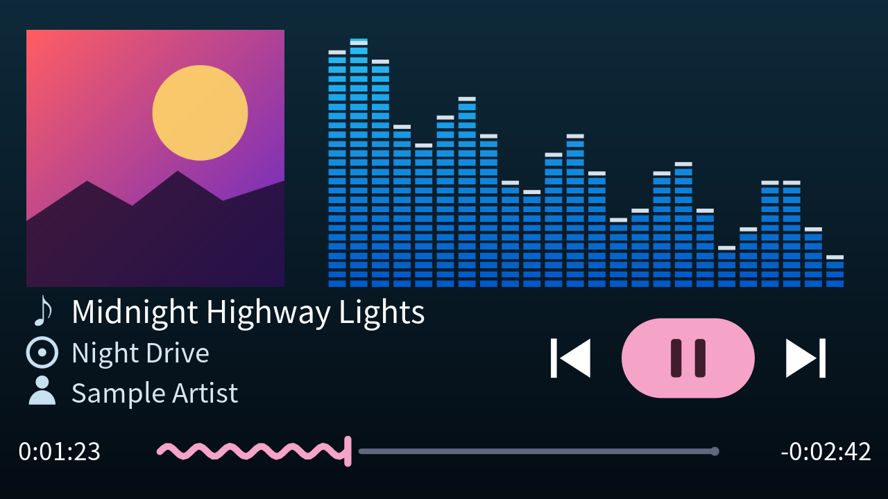 | 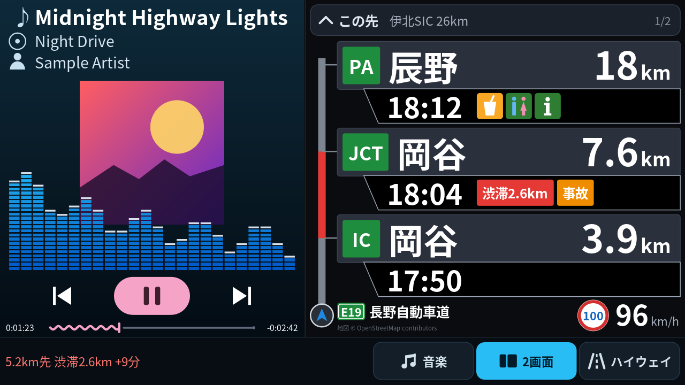 |
| **主要バイパス**（出口の無い IC は「出口なし」、右下に制限速度と車速） | **［︿ この先］で先の施設・渋滞を順に表示**（上の［現在地へ］・下の［﹀ 手前へ］で戻る） |
| 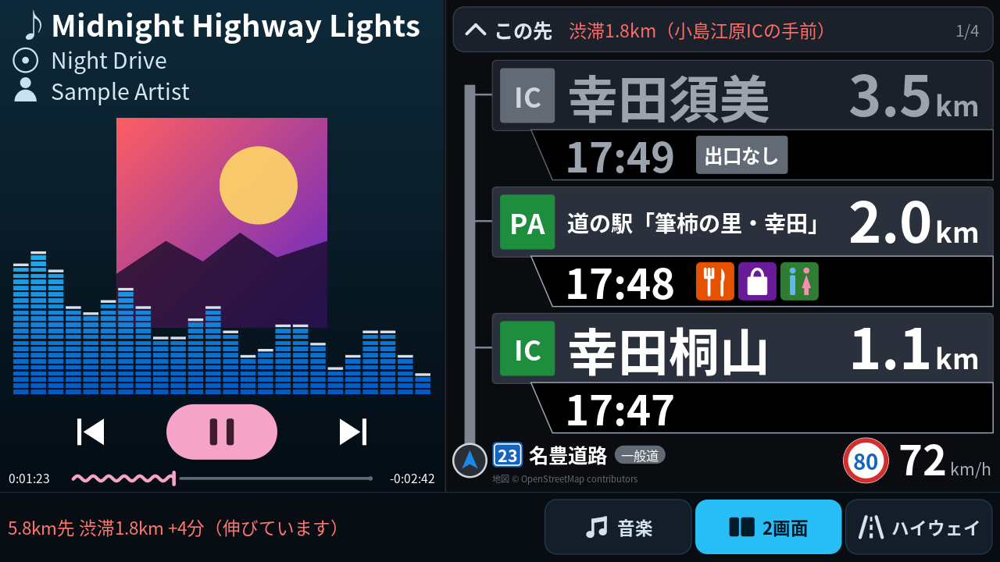 | 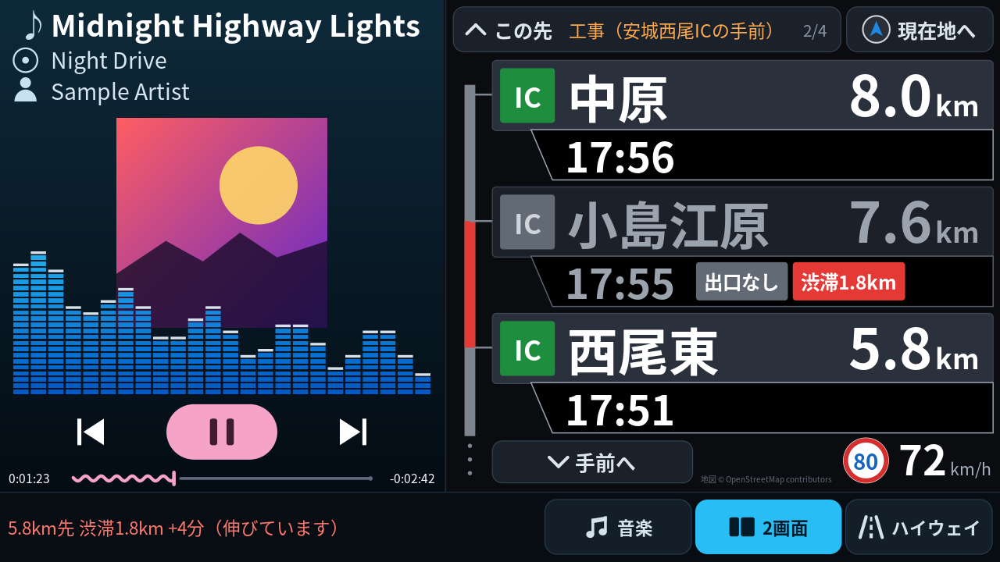 |
| **音楽だけにしたとき**（バーに次の施設。オービス 2km 以内は警告を優先） | **ハイウェイだけにしたとき**（右＝運転席側に施設、左に渋滞の詳細・この先の路線・制限速度と車速） |
| 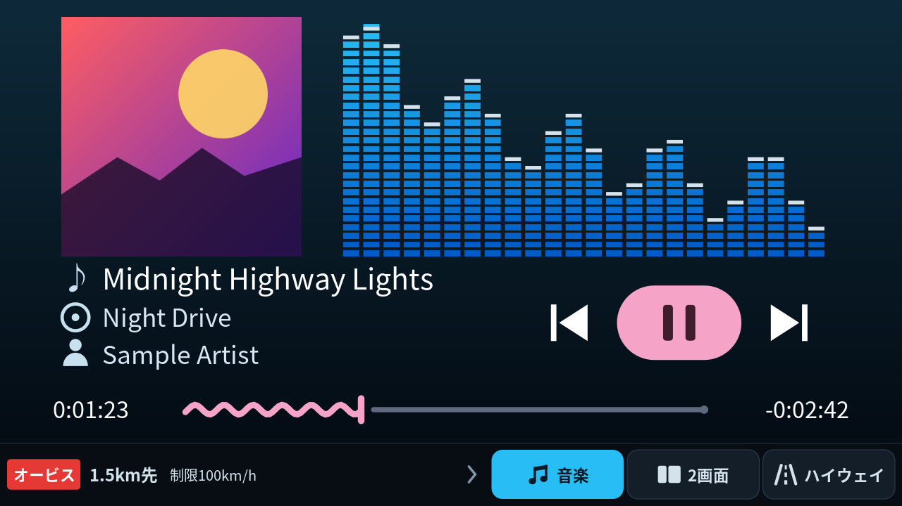 | 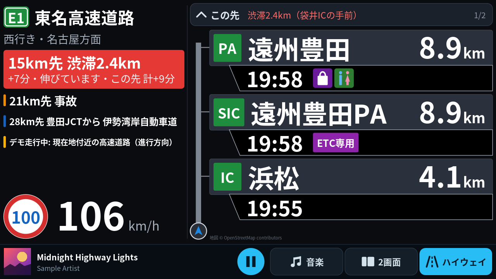 |

| スマホ縦画面の 2 画面（上下） | スマホ縦画面（ハイウェイモード） | 一覧表示（オービスも並べる設定） |
|---|---|---|
| 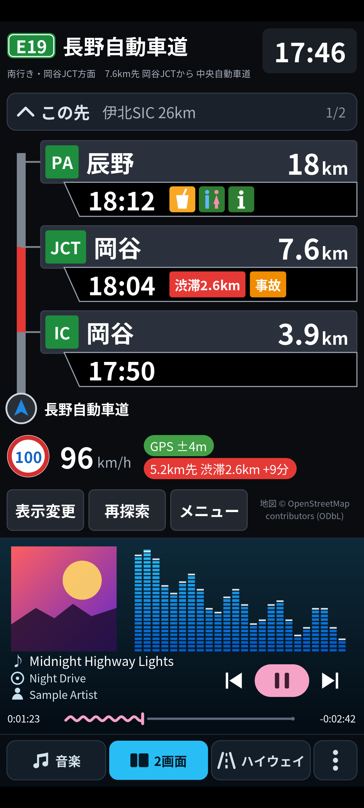 | 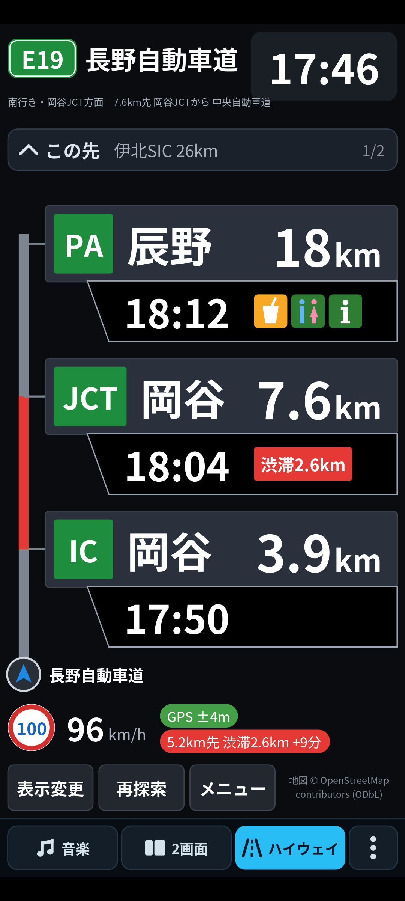 | 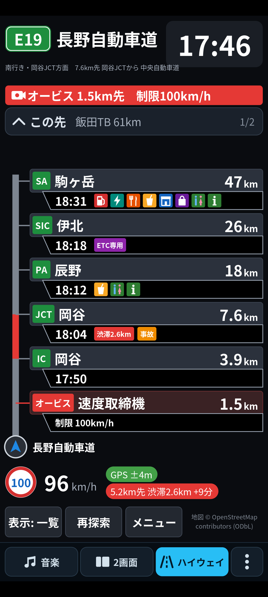 |

| スマホ横画面（2 画面） | スマホ縦画面（主要バイパス・名豊道路） |
|---|---|
| 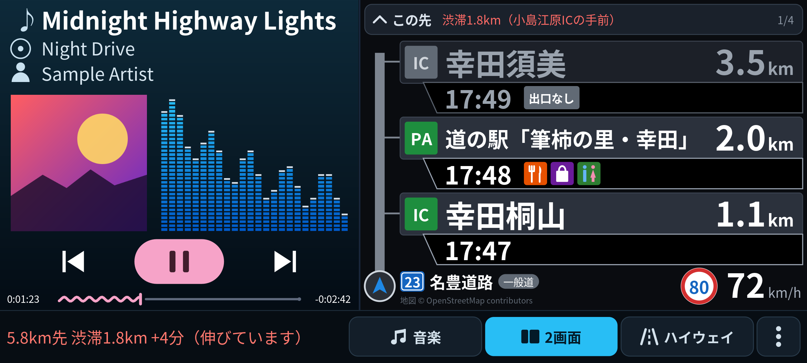 | 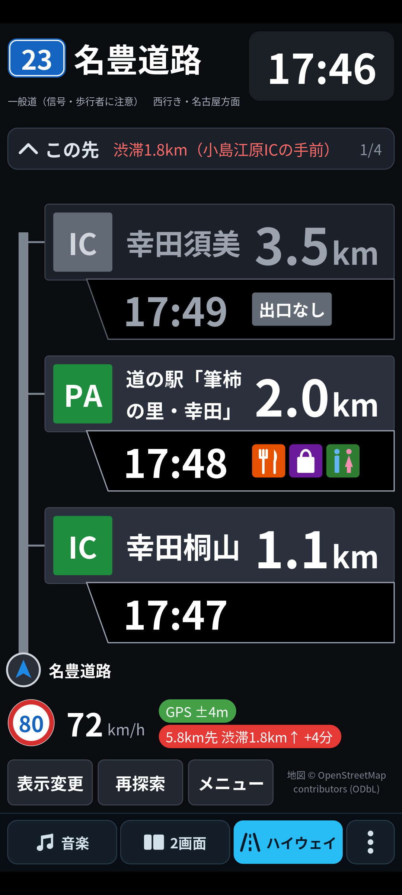 |

※ 画像は実際の描画コード（`PlayerRenderer`・`PanelRenderer`・`ModeBarRenderer`）を PC 上で描画したものです（曲・数値はサンプル）。
車の画面の右上のボタンは Android Auto が表示する部分のイメージで、形や位置は車種・画面の大きさによって変わります（狭い画面ではアイコン）。

---

## 今回の更新（v2.10）

| ご要望 | 対応 |
|---|---|
| 速さが遅すぎて、ほとんど動きが変わらないように見える。もっと速く俊敏に。上がる速さと下がる速さを別にするなど工夫して | v2.9 で、なめらかにするために解析の値を時間でならしすぎていました（下がるのに 0.2 秒以上かかり、拍の合間でもほとんど下がらない）。v2.10 では**上がる・下がるを別に**しました。**上がるときは約 0.025 秒ですぐ**目標へ（拍でパッと上がる）、**下がるときは一定の速さ**（画面の高さで毎秒 2〜2.5 本分。昔のスペアナのように、すっと落ちる）。解析のならしは FFT のばらつきを抑える程度に弱め、カーオーディオ 3 種も上がる速さを 2〜3 倍にしました。合成した曲で比べると、高さの揺れ幅は v2.9 の約 2 倍、1 フレームあたりの動きは約 5 倍です |
| バーの高さが高すぎて、再生中はほとんど上に張り付いている。メリハリが出るように | 高さの付け方を作り直しました。これまでは「その瞬間いちばん大きい帯」を天井にしていたので、どの帯も天井近くになりがちでした。v2.10 は、**帯ごとに「最近 1 秒の平均からどれだけ大きいか」を強く（2 倍に）反映**し、周波数ごとの差は弱めます。**ずっと鳴っている音は中ほど（6 割前後）に落ち着き、拍や音の立ち上がりだけが天井まで上がり、拍の合間は下がります**。全体の基準は最近いちばん大きい帯（下がるのは毎秒 6 dB）で、曲の静かな部分は全体を低くします。カーオーディオ 3 種の入力の伸び（v2.7 から 1.1〜1.2 倍にしていた）も 1.0〜1.05 倍にしました |
| 音楽の全画面表示で、画面の端のスペースが広すぎる。もう少し隅も使うように（横に広げて比率がおかしくならないように） | 横画面（車の全画面・スマホの横画面）の配置は、これまで幅を 400 に決めて画面に収めていたので、横に長い画面（車の 1920×720 など）では左右に大きな余白が出ていました。v2.10 から、**配置の幅を画面の比率に合わせ**（高さはそのまま）、**横に長い分はスペアナ・曲名・シークを横に広げ、操作ボタンは右端に寄せます**。ジャケット・文字・ボタンは大きさも形もそのまま（伸ばさない）です。端の余白も少し詰めました |

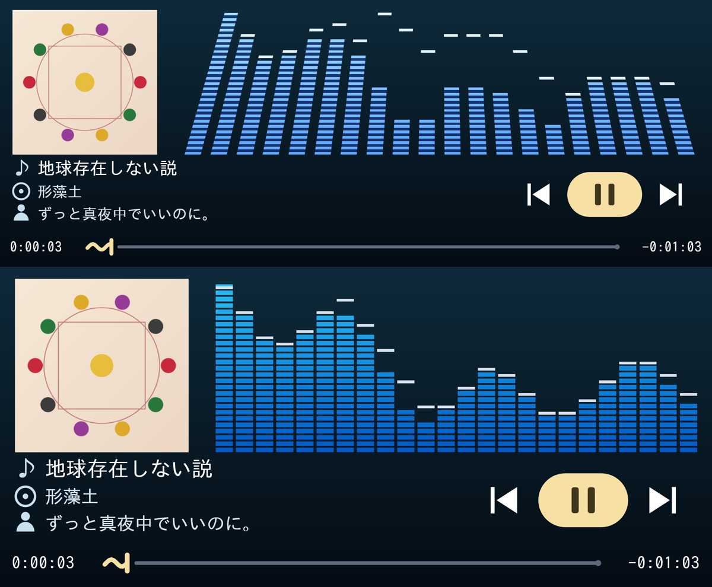

| 動きの比べ（合成した曲での、低音・中音・高音の 3 本の高さ。横 = 4 秒、上の線が天井） |
|---|
| 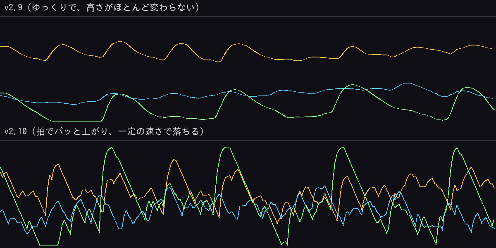 |

- 動き・高さの変更は、すべての表示の種類に効きます（針のメーターは v2.8 からの入力の作り方のまま、強弱に合わせて振れます）。
- 実際の曲での見え方は、合成した曲とは違う可能性があります。速すぎる・低すぎるなどあれば教えてください（下がる速さ・強弱の強さを数字で調整できます）。
- 画像は描画のコードを PC で描いたものです（ジャケットは見本の絵）。`./gradlew :core:test`：69 件すべて成功。

## v2.9 の更新

| ご要望 | 対応 |
|---|---|
| 曲を再生していないときに、いちばん下のブロックが表示される。再生していないときは出さないで | カーオーディオ（ステレオ）の**いちばん下の段（いつも点灯していた床の段）を、音が出ている間だけ点灯**にしました。あわせて、ミラーのいちばん小さなバー（音が無くても出ていた細い線）と中央の線、なめらかなバー・ライン・ドットも、**音が出ていないときは何も描かない**ようにしました（針のメーターは、針を左に置いて表示したまま） |
| カーオーディオのスペアナは 2 つで 1 つのブロックのように見せているが、2 つに分けずに 1 つに統合して | **カーオーディオ（ステレオ）の左右 2 本の組を 1 本にまとめ、9 本の幅の広いバー**にしました |
| 設定画面のスペアナの見本の方が動きがいい。実際のスペアナもそのように動くように | 動きの違いを、音楽を合成して実際と同じ計算（端末の解析 → 画面）で調べました。実際の画面は、解析の値が 25ms ごとに変わるたびにバーが**カクッと跳ね**、拍の合間に**0 まで落ちて**いました（1 フレームあたりの動きが見本の約 5 倍、細かいちらつきが約 28 倍）。v2.9 では、①解析で**隣の帯とならし**（山の形がなめらかにつながる）、②**時間でならし**（上がるのは速く、下がるのはゆっくり）、③いちばん大きい帯の基準を**ゆっくり下げる**（拍の合間に全体が少し下がる）、④画面のバーを**ばねの動き**で目標へ動かす（速さが続くので、見本のように丸く上がって下がる）ようにしました。拍にはついていきます（細かいちらつきは約 1/5 に） |
| 針の表示で、以前は 2 つ表示されていたが、曲を再生すると 1 つしか表示されなくなる。再生中でも 2 つに | v2.8 で、縦長の区画ではメーターを 1 つにして大きくしていました（再生中はジャケットの下の縦長の区画になるため 1 つに）。v2.9 からは**いつも 2 つ（左 = 低音・右 = 高音）**表示します。横に並べるか縦に積むかは、メーターが大きくなる方を選びます |
| カーオーディオのスペアナをもう一度見直し、より忠実に・見やすく | 動画のコマを拡大して測り直しました。**ブルー**（動画 4）は、段が細かく**約 30 段**あったので 14 段 → 約 30 段に（区画が小さいときは見やすさのため 16 段まで減らします）。**ステレオ**（動画 3）は**15 段＋床**、段は**二重線**（上下の細い線が明るく、間が少し暗い）。どちらも、光っている段の間が**うっすら光る**（青・青緑のもや）のを、点灯しているところだけバーと同じ幅で描きました（枠のようにははみ出しません）。色も動画から測り直し、ブルーは明るい水色がかった青、ステレオは下から白っぽい水色・水色・青にしました |

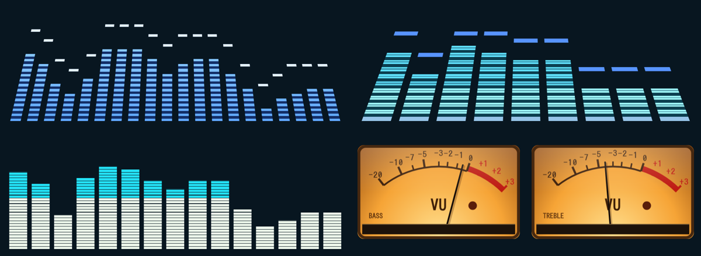

| スマホの音楽の画面（左からカーオーディオのブルー・ステレオ・イコライザー、アナログメーター） |
|---|
| 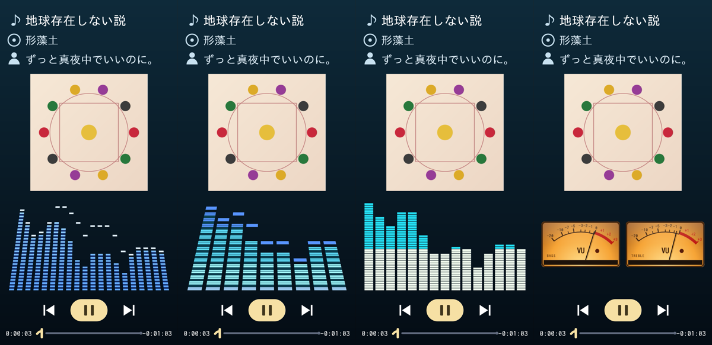 |

| 動きの比べ（合成した曲での、低音・中音・高音の 3 本の高さの変わり方。横 = 4 秒） |
|---|
| 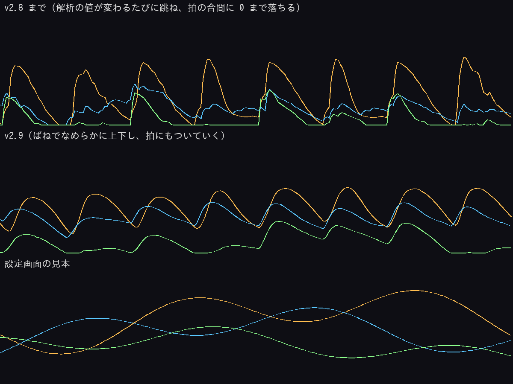 |

- 動きの変更（②〜④）は、すべての表示の種類に効きます（LED（標準）も、見本のようになめらかになります）。v2.10 で、遅すぎる・高すぎるとのことで作り直しました。
- 画像は描画のコードを PC で描いたものです（ジャケットは見本の絵）。動きは、合成した曲を実際と同じ計算に通して確かめました（実際の曲では違って見える可能性があります）。`./gradlew :core:test`：69 件すべて成功。

## v2.8 の更新

| ご要望 | 対応 |
|---|---|
| カーオーディオ風のスペアナにある枠や、ブロックの表示領域のようなものは不要。初めからあるスペアナ（LED）のように、ブロックをそのまま表示してほしい | LED（標準）以外のすべての表示で、**表示窓（枠・紫の板・ガラスの映り込み）と、消えている段（ブロックの表示領域）を描かないようにしました**。カーオーディオ 3 種の飾り（赤い矢印・赤い点線・左右の目盛り・周波数の文字）と、ラインの方眼、ドットの消えている LED もなくしました。LED と同じように、**音楽の画面の背景の上に、点灯しているブロックだけ**を描きます。窓の余白がなくなった分、ブロックは区画いっぱいに大きくなりました |
| LED 以外のテーマの色合いが赤や紫っぽくて、とても見にくい。見やすく・分かりやすく、よく再現されたテーマに | 色を見直しました。**音楽の画面の背景は、どの表示も LED と同じ**紺色に（紫がかった灰色をやめた）。**ピーク（バーの上の印）は、ピンクをやめてバーの色を白に寄せた色**に。ブルー照明のメーターの**針はピンク → 白**、赤い目盛りは青い板の上でよく見える明るい朱色にしました。カーオーディオ 3 種は、動画から測った本数・段の数・台形の形・色・動き・ピークの動き（v2.7）はそのままに、暗い背景の上でよく見えるよう段を少し明るく・太くしました |
| 針のテーマで、表示の幅の問題か、針がほとんど端に張り付いて見える。もっとダイナミックに（針の動きも俊敏に、動作も軽快に） | 原因は、針の入力にバーの高さ（いつも上の方にあり、1 で切られている）をそのまま使っていたことでした。v2.8 からは、**1 で切る前の強さを使い、「最近 2 秒の平均より、いまの音がどれだけ大きいか」を、最近のばらつきで割って VU の目盛りに写します**。平均の音で目盛りの中ほど（-1.5）、**拍で右へ、拍の合間で左へ大きく振れ**、曲の音量や設定の「高さ」によらず端に張り付きません（試しの曲の計算で、右の端にいる時間は 1〜3%）。針は**約 0.05 秒で振れる**ようにさらに速くし（v2.6 は約 0.07 秒）、鳴り始めの 1 秒は平均を早く合わせて振り切れたままにならないようにしました。縦長の区画では、**メーターを 1 つにして大きく**表示します（横に広い区画は今までどおり低音・高音の 2 つ） |

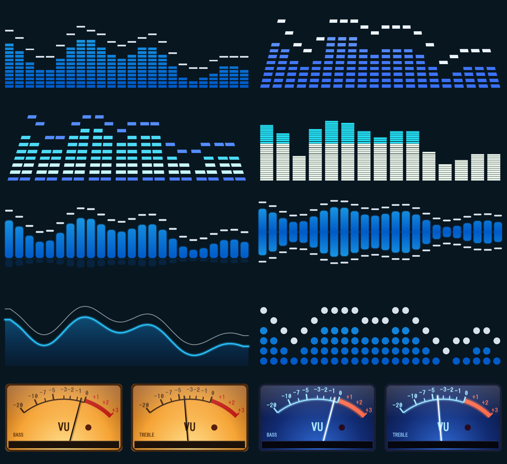

| スマホの音楽の画面（左からカーオーディオのブルー・ステレオ・イコライザー、アナログメーターのアンバー照明・ブルー照明） |
|---|
| 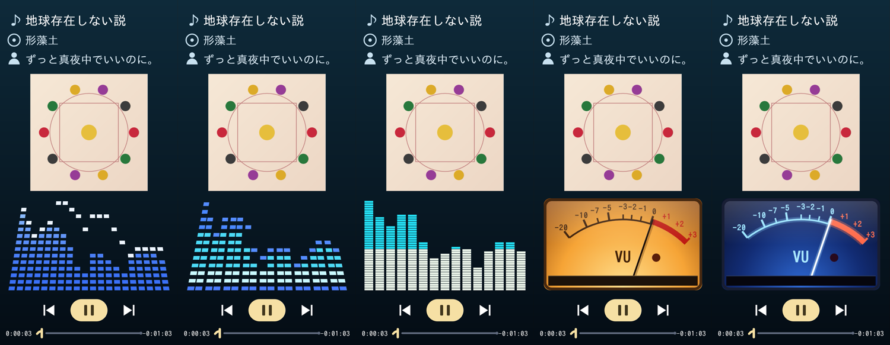 |

| 針の動き（試しの曲を 0.1 秒ごとに描いたもの。左が低音・右が高音） |
|---|
| 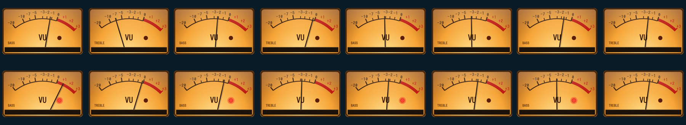 |

- 描くものが減ったので、描画も軽くなっています（表示窓・消えている段・にじみを描かない）。
- 保存する表示の種類の番号は変えていません（前の版で選んでいた表示がそのまま使われます）。
- 画像は描画のコードを PC で描いたものです（ジャケットは見本の絵）。`./gradlew :core:test`：69 件すべて成功。

## v2.7 の更新

| ご要望 | 対応 |
|---|---|
| スペアナのデザインを、添付の動画（x.com の投稿の動画 2〜4）のような昔のカーオーディオに忠実に。本数・動きなどが違う | 動画を 1 コマずつ見て、**3 つの表示それぞれの本数・段の数・色・動き・ピークの動き**を測り、**3 つのテーマ**として再現しました（設定 →「音楽（スペアナ）」→「表示の種類」。音楽の画面でスペアナを長押ししても切り替わります） |
| ・動画 4（2DIN の MD/CD デッキ） | **カーオーディオ（ブルー）**: 紫の画面に、**奥へすぼまる 20 本 × 14 段**の青いバー。**白いピークはバーから離れると、ふわっと上へ浮かんで消えます**（動画で測った速さ: 1 秒で高さの約 1/3）。消えている段は赤紫にうっすら。下に周波数（60〜16k）、右上に赤い矢印の線、左右に小さなレベルの目盛り。v2.6 の「カーオーディオ」はこれに置き換えました |
| ・動画 3（2DIN の CD/カセットデッキ） | **カーオーディオ（ステレオ）**: **9 つの帯を左右 2 本ずつ（18 本 × 11 段）**、奥へすぼまる格子の上に。段は下が白っぽい水色・中ほどが水色・上が青、**いちばん下の段はいつも点灯**。**青いピークは少し止まってから落ちます**。上に赤い点線、下に緑の周波数、左右に斜めの飾りの目盛り |
| ・動画 2（カセットのグラフィックイコライザー） | **カーオーディオ（イコライザー）**: 蛍光表示管の**幅の広い 15 本**のバー。**下半分が白・上が水色**、消えている部分は下が黄土色・上が暗い青緑にうっすら。細い線の集まりで、**とても素早く動きます** |
| ・動き | バーの上がり下がりを、表示ごとに動画に合わせました（上がるのは速く、落ちるのは一定の速さ。ブルー・ステレオは約 0.45 秒、イコライザーは約 0.2 秒で一番上から下まで）。本物はよく振れて上の方まで届くので、入力も少し大きめにしています |

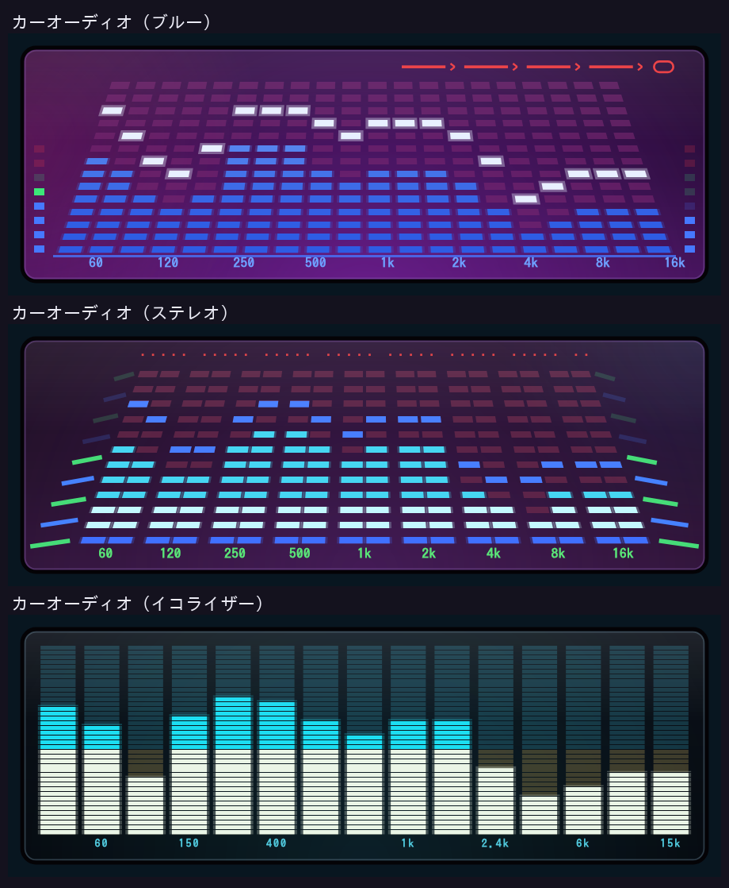

| スマホの音楽の画面（左からブルー・ステレオ・イコライザー） |
|---|
| 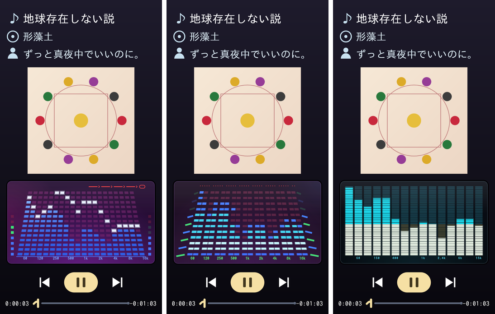 |

- 色の設定が標準の青のときは、動画の表示と同じ色で描きます。ほかの色を選ぶと、点灯している段だけその色になります（消えている段・ピークはそのまま）。
- 奥へすぼまる形は、平らに描いた絵を射影変換で台形に写して描いています。段は画面の上で等間隔に並べ（本物と同じ）、1 本を 1 回で描く軽さはそのままです（`CarAudioPainter`）。
- 右上のボタンと一覧が重なる件は v2.6.1 で直しました（[v2.6.1 の更新](#v261-の更新)）。
- 画像は描画のコードを PC で描いたものです（ジャケットは見本の絵）。`./gradlew :core:test`：69 件すべて成功。

## v2.6.1 の更新

| ご要望 | 対応 |
|---|---|
| 右上のボタンが出ると IC 一覧は下がるが、ボタンの高さ分まで下がらずボタンと重なる。ボタンの高さ分下がるように | これまでは、Android Auto が知らせてくる「表示範囲の上端」の分だけ一覧を下げていました。お使いの車では、この値がボタンの下端より小さく知らされていたため、下げ方が足りずに重なっていました。v2.6.1 からは、**知らせてくる値・「安定した範囲」の上端・ボタンの大きさの見積もり（上の余白＋ボタン＋すき間 ＝ 約 80dp。車の画面の密度で換算）のうち、いちばん大きい値まで下げます**。それでも重なる車のために、設定 →「Android Auto・電池」→「**右上のボタンが出たときに一覧を下げる量**」（自動／少し多め ＋16dp／多め ＋32dp）を付けました。開発者向け設定の「車の画面の表示範囲（確認用）」で、車が知らせてきた範囲と下げた量を確認・コピーできます |
| スペアナのデザインを、添付の動画（x.com の投稿）のような昔のカーオーディオに忠実に | この作業環境からは x.com を開けず、動画を確認できませんでした。動画を見られるようになったら（または動画の画面の画像を送っていただいたら）、スペアナの本数・動きを合わせて作ります |

## v2.6 の更新

| ご要望 | 対応 |
|---|---|
| スペアナが思っていたのと少し違った。添付の画像のような昔のカーオーディオのスペアナ表示を、背景色を変えてもいいので見やすく再現して | 写真の表示（2000 年代のカーオーディオ）を再現した**「カーオーディオ」**を作りました（v2.5 の「レトロ（蛍光表示管）」を置き換え。レトロを選んでいた場合はこれになります）。暗い紫の**表示窓**（左下から紫の光がにじむ）に、**斜めに傾いた細い段の青いバー**、**ピンクのピーク**（少し止まってから落ちる）、左の**目盛り**、下の**映り込み**（縮めて薄く）を描きます。消えている段もかすかに見えます。音楽の画面の背景も、表示窓が引き立つ**紫がかった暗い灰色**にしました（LED（標準）はこれまでの青） |
| 他のテーマもこれに近づけられるなら再現して（針のテーマは特に。針の動きももっと俊敏に） | LED（標準）以外のすべての表示を、**同じ表示窓の中**に描くようにしました（ピークはどれもピンク系。なめらかなバーは映り込みつき、ラインは方眼つき、ドットは液晶のような LED マトリクス）。針のメーターは**照明付きのカーオーディオのメーター**に作り直し、「**アンバー照明**」（暖かい色の照明・黒い針）と「**ブルー照明**」（青い照明・ピンクの光る針）にしました。**針は約 4 倍の速さ**で振れます（v2.5 は約 0.3 秒かけて振れていたのを約 0.07 秒に）。拍に合わせてよく振れるよう、その帯の最大値と平均を混ぜて動かします |
| 一部のテーマでスペアナとアルバムアートが被っている（送った画像） | 原因は、スマホの縦画面（と車の 2 画面の縦長の区画）で、**ジャケットの下半分にスペアナを重ねる配置**だったことでした（LED は鳴っている段だけを描くので目立ちませんでしたが、消えている段や表示窓を描く表示では、ジャケットの上にマス目が出ていました）。v2.6 から**どの表示でも、ジャケットの下にスペアナを置き、重ねません**（ジャケットの大きさは画面の高さに合わせます） |
| Google マップの案内を下道（一般道）でも表示 | 高速道路の外でも、Google マップでナビ中は**音楽の画面のスペアナの上に案内の帯**（緑の帯に、**曲がる方向の矢印・案内地点までの距離・案内の文**）を出すようにしました。スマホでも車の画面でも出ます。矢印は Google マップの通知の矢印の画像を使い、読めないときは案内の文（右折・左折・斜め右・U ターンなど）から描きます。スマホでは帯を押すと Google マップを開きます。設定 →「Google マップのナビ連携」→「**音楽の画面にナビの案内を出す**」でオン・オフ（[詳細](#google-マップのナビ連携)） |

| 写真を再現した「カーオーディオ」と、ブルー照明のメーター（スマホ。Google マップでナビ中） | 車の画面（全画面。ナビ中は上に案内の帯） |
|---|---|
| 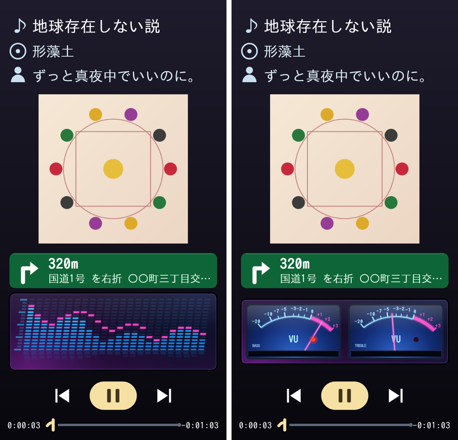 | 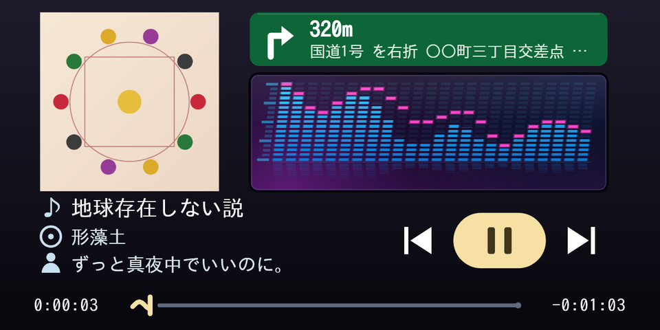 |

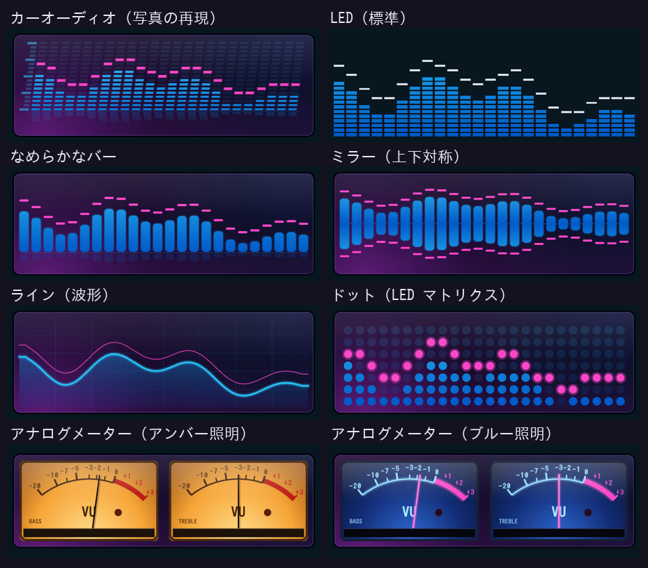

- 前の版の設定はそのまま引き継ぎます（v2.5 の「レトロ」は「カーオーディオ」に、「アナログメーター（クラシック）」は「アンバー照明」に、「ブラック」は「ブルー照明」になります。色・高さの設定もそのまま）。
- 設定の「Google マップのナビに合わせる」は「**ハイウェイの一覧をナビに合わせる**」に名前を変えました（中身は同じ。案内の帯とは別にオン・オフできます）。
- 画像は描画のコード（`PlayerRenderer`・`SpectrumPainter`）を PC で描いたものです（ジャケットは見本の絵、曲・案内はサンプル）。
- `./gradlew :core:test`：69 件すべて成功。

## v2.5 の更新

| ご要望 | 対応 |
|---|---|
| スペアナの「ジャケットの色」で、色の数が少なく標準の青になってしまうものが多い。色のバリエーションを増やして表現力を高める | 原因は、これまでの色の選び方が「鮮やかで面積の多い色」だけを探していて、**暗い・淡い・白黒のジャケットでは色が見つからず青にしていた**ことでした。v2.5 はジャケットの色合いを 24 に分けて（15° ごと）鮮やかさ・明るさで重みを付けて数え、いちばん多い色の周りの**平均の色合い・鮮やかさ・明るさをそのまま使います**（深い赤のジャケットは深い赤、淡い水色のジャケットは淡い水色、くすんだ緑はくすんだ緑）。暗いジャケットに少しだけある鮮やかな色（ネオンの文字など）も拾い、**白黒・灰色のジャケットは、わずかな色味（セピア・青み）を残した銀色**にします。青になるのはジャケットが無いときだけです |
| 固定する色も増やす。カラーコードを入力して、その色で表示する | 決まった色を **5 色 → 12 色**に増やしました（青・水色・青緑・緑・黄緑・黄色・ゴールド・オレンジ・赤・ピンク・紫・白）。低音から高音へ色が変わる**虹色**も選べます。**「カラーコード」**を選ぶと `#RRGGBB` を入れてその色で表示します（`#F80` の省略形、`0xFF8800`、全角の `＃` も可。入れている間に見本の色が変わります）。色は、グラデーションの見本を並べた画面から選びます |
| 色を変えても、元の青のように若干グラデーションが入るように | **すべての色を、標準の青と同じ「下が濃く深い色 → 上が明るい色」のグラデーション**にしました。ジャケットの色・カラーコードの色は、その色を中ほどにして、下は少し濃く鮮やかに、上は明るく、色合いも少しずらします（青の「深い青 → 水色寄りの青」と同じ向き）。暗すぎる色・淡すぎる色は、暗い背景で見えるように明るさを補います |
| Shizuku での音声の読み取りの許可を、表の設定へ（有効にする手順も） | 設定 →「音楽（スペアナ）」→**「音声の読み取り（Shizuku）」**に移しました。押すと、いまの状態と**有効にする手順**（Shizuku を入れる → 開発者向けオプションとワイヤレス デバッグを有効にする → Shizuku を開始 → このアプリに許可）を表示し、Shizuku が動いていればその場で許可できます（ふだんは不要。スペアナが動かない音楽アプリがあるときに） |
| 渋滞情報の取得元・API キーの入力などを表の設定へ（API キーの発行手順も。おすすめは TomTom Traffic） | 設定 →**「渋滞情報（リアルタイム）」**に移しました。取得元の一番上を **TomTom Traffic（おすすめ）** にし、**「API キーの取り方」**で取得元ごとの手順（TomTom なら 開発者サイトで登録 → Dashboard の Keys でキーをコピー → 貼り付け → 確かめる）を表示します。新しく**「キーを確かめる」**（1 回だけ問い合わせて、使えるか・使えない理由をわかりやすく表示）と**「いまの状態」**（最後に取得した時刻、取得できないときはその理由）を付けました（[詳細](#リアルタイム渋滞情報)） |
| 地図データのバージョン（最終更新日時）を表示。それ以外の地図データの細かい設定（配布元など）は開発者向け設定に | 設定 →「地図データ」の一番上に**「地図データの版（作成日時）」**（例「2026年11月4日 0:05 作成（全国・…）」）を出し、配布元の最新版と比べた結果（「配布元の最新版と同じです」「新しい版があります」）も添えます。表の設定は「版・最新の地図データに更新・起動時の確認」だけにし、配布元（目録 URL）・Overpass サーバー・オンライン取得・キャッシュ・地方を指定して作成などは開発者向け設定のままです |
| スペアナの種類を増やし、テーマとして設定で変えられるように（昔のオーディオ風・針のメーターなど。需要を考えて工夫して） | **8 種類**から選べるようにしました。音楽プレーヤーやカーオーディオでよく見かける表示から、昔のコンポ・カーステレオの**蛍光表示管（レトロ）**、アンプの**針のメーター（VU メーター）**2 種、なめらかなバー・ミラー・ライン・ドット（LED マトリクス）を加えています。設定 →「音楽（スペアナ）」の**動く見本**を見ながら選べ、**音楽の画面でスペアナを長押し**しても順に切り替わります（運転前にすぐ試せるように）。どの種類も、選んだ色・高さの設定が効き、スマホと車の画面の両方に出ます（[詳細](#スペアナの表示の種類と色)） |
| Google マップのナビを共有。ナビの経路に合わせて先の IC などを表示、JCT で乗り換えるときは乗り換え先の路線を表示、降りる IC までを表示 | 新しく**「Google マップのナビ連携」**を付けました。Google マップでルートを決めてナビをしている間、**ナビの通知（次の案内）を読み取り**、ハイウェイの一覧をナビの経路に合わせます。① 次の案内が JCT の乗り換えなら、**JCT の先を案内の路線・方面へ**（例: 豊田JCT で東名の東京方面へ → 東名の IC が並ぶ）、② 次の案内が IC で降りるものなら、**その IC に「ここで降りる」を付けて、その先は出しません**。通知へのアクセス（曲名と同じ許可）だけで使え、読み取った内容は保存・送信しません。設定 →「Google マップのナビ連携」でオン・オフ（[詳細](#google-マップのナビ連携)） |
| その他、UI・UX が良くなるもの | ナビ連携の表示（一覧の「ここで降りる」「ナビ ○○方面」の印、降りる IC の名前の枠を青く、音楽だけの表示中の下のバーに「降りる」、施設の詳細に案内）、スペアナの長押しでの切り替え、設定画面のスペアナの動く見本・色の見本、渋滞情報の「キーを確かめる」「いまの状態」、地図データの版の表示、レトロ表示のピークをゆっくり落とす（蛍光表示管らしく）、メーターがジャケットと重なる画面ではジャケットの下に置く、など |

スペアナの色（太字は標準）

| 色 | 内容 |
|---|---|
| **青（標準）** | 深い青 → 水色寄りの青（これまでと同じ） |
| ジャケットの色 | 曲ごとにジャケットの色（v2.5 で暗い・淡い・白黒のジャケットにも対応）。ジャケットが無いときは青 |
| 水色・青緑・緑・黄緑・黄色・ゴールド・オレンジ・赤・ピンク・紫・白 | 決まった色（どれも下が濃く上が明るいグラデーション） |
| 虹色 | 低音の赤 → 高音の紫（帯ごとに色が変わる） |
| カラーコード | `#RRGGBB` で指定した色（その色を中ほどにしたグラデーション） |

- 前の版の設定（色・高さ）はそのまま引き継ぎます（v2.4 の「ジャケットの色」を選んでいた場合も、そのまま新しい選び方になります）。
- `./gradlew :core:test`：69 件すべて成功（ナビ連携のテスト `NavGuideTest` を 4 件追加：案内の文の照合、JCT で案内の路線へ進む、降りる IC を名前で見つける、エンジンが降りる IC までを表示する）。

## v2.4 の更新

| ご要望 | 対応 |
|---|---|
| 右上のボタンが出て IC 一覧が下がった後、ボタンが消えても下がったまま。ボタンが隠れたら画面いっぱいに戻す | 原因は、車（Android Auto の版）によっては、ボタンが隠れても「表示範囲が元に戻った」という知らせが来ないことでした（v2.3 はこの知らせを待って戻していた）。v2.4 は知らせが来なくても、**最後の操作（画面のタップ・右上のボタン・画面の表示）から約 10 秒たったら、ボタンは隠れたとみなして画面いっぱいに戻します**（Android Auto がボタンを隠すのと同じ時間）。触ってボタンが出たら、また一覧をボタンの下へずらします。ずらす・戻すときは**約 0.2 秒でなめらかに**動かすので、一覧が飛んで見えません。知らせてくる車では、これまでどおり知らせが来た時点ですぐ戻ります |
| メニューの画面の項目が多く見にくい。1 つの設定画面を作って、見やすく分かりやすく | 下部のバーの［⋮］（スマホ縦画面のハイウェイ側は［設定］）で、**1 つの設定画面**を開くようにしました。項目を内容ごとのまとまり（**操作／画面の切り替え／ハイウェイの表示／スマホの画面／音楽（スペアナ）／音声案内／オービス／地図データ／Android Auto・電池／権限／その他**）に分け、各行に**いまの値**（水色）と短い説明を出します。選ぶと**すぐ反映**（保存ボタンなし）、スマホと車の画面の両方に効きます。よく使う「道路を再探索・一般道モード・終了」は一番上に大きなボタンで（[詳細](#設定画面)） |
| 公開に向けて、裏の設定・開発者向けの設定を項目から消す。開発者向けの設定は音楽画面を 20 回タップで表示し、パスワードを設定 | 通常の設定画面から外して**開発者向け設定**にまとめました（Spectrum の診断画面・音声の読み取り（Shizuku）・デモ走行・渋滞情報の取得元と API キー・地図データの細かい設定・Android Auto の状態（インストール元）・動作状態の詳細）。**音楽の画面の何もない場所を 20 回続けてタップ → パスワード**で開きます（これまでの Spectrum の診断画面と同じ操作。パスワードはご指定のもの）。コードにはパスワードの文字そのものは書かず、SHA-256（元に戻せない変換）の値だけを入れています。戻ると閉じ、次に開くときはまたパスワードが必要です（[詳細](#開発者向け設定)） |
| ほかにも設定できる項目を増やす（需要や使いやすさを考えて） | 下の 10 項目を追加しました |

追加した設定（太字は標準の値）

| 設定 | 選べるもの | 使いどころ |
|---|---|---|
| 高速道路を出てから音楽に戻るまで | **15 秒（標準）**・30 秒・1 分 | 高架下・側道・トンネルの出口などで、何度も音楽の画面に戻ってしまうとき |
| 到着予定の表示 | **到着時刻（17:50）**・残り時間（あと12分） | 何分後に着くかで見たいとき（ハイウェイの一覧・下のバー・車の施設一覧・通知。施設の詳細には両方を表示） |
| スマホの画面の向き | **自動**・縦に固定・横に固定 | スマホを車に固定したとき、揺れで向きが変わらないように |
| スマホの画面を消さない | **いつも**・高速道路を走行中だけ・端末の設定どおり | 一般道では画面を消して電池を減らしたいとき |
| スペアナの色 | **青**・ジャケットの色に合わせる・緑・オレンジ・ピンク・白 | 好みの色に。「ジャケットの色」は曲ごとにジャケットの色相に変わる（スマホと車の両方） |
| スペアナの高さ | 控えめ・**標準**・高め | 音が小さくバーが低い・高すぎるとき |
| 音声案内を種類ごとに | オービス・渋滞・ETC カード・給油（それぞれオン・オフ） | これまでは「渋滞・ETC・給油」が 1 つの設定だった。渋滞は渋滞情報を使う設定のときだけ表示 |
| 音声案内の音量・話す速さ・テスト再生 | **標準**・やや小さく・小さく ／ ゆっくり・**標準**・速め | 音楽に対して案内の声が大きすぎる・速すぎるとき（合図の音も同じ音量に） |
| 電池の節約 | **オン**・オフ | 充電しながら使うので、いつも毎秒測位したいとき（オフにすると、離れた一般道・停車中も毎秒） |
| 権限の確認 | 位置情報・マイク・通知へのアクセス・通知の表示 | 許可したかどうかを一覧で確認し、その場で許可 |

- 前の版の設定はそのまま引き継ぎます（音声案内の「渋滞・ETC カード・給油」は、これまでの 1 つの設定の値をそれぞれの初期値にします。渋滞情報の API キーもそのまま）。
- 渋滞情報の取得元・API キーを開発者向け設定に移したのは、公開版の利用者は API キーを持っていないためです（設定済みの渋滞情報はこれまでどおり使われます）。v2.5 で、API キーの取り方の手順を付けて通常の設定画面に戻しました。
- `./gradlew :core:test`：65 件すべて成功（電池の節約をオフにしたとき・音楽に戻るまでの時間を変えたときのテストを追加）。
- 直前のコミットで消えていた GitHub Actions のワークフロー（`.github/workflows/build-app.yml`・`build-data.yml`）を元に戻しました（内容は v2.3 と同じ。消えたままだと Actions に build-app が出ません）。

## v2.3 の更新

| ご要望 | 対応 |
|---|---|
| 画面を切り替えたときなどにスペアナが止まる（曲は流れている）。たまにカクつく。全体的に軽く | 止まる原因を 3 つ直しました。① 音声の解析が読めなくなった（他のアプリに解析を取られた・音声の経路が変わった）ときに**付け直す**（読めない間はバーを下げ、止まったように見せない）、② 解析を止めて再開するとき、前の解析が終わってから付ける（同じ音声に 2 つ付くと後の方は読めない）、③ 重い dumpsys の読み取り（DUMP 権限があるとき）を**別スレッド**にして解析を止めない。軽くするため、スペアナの段を**1 本 1 回で描く**（1 フレームの描画の回数を約 750 → 約 70 に）、ジャケットの縮小・色の計算を別スレッドに、車の画面の描画を**決まった間隔**（30fps）で行い描画スレッドの優先度を上げ、毎フレームの作り直し（背景・時刻の文字など）をやめました。バーの動きは経過時間で計算するので、描く間隔が多少ぶれても動きは同じです |
| 到着予想時刻が小さい。ハイウェイだけの表示が細長く見にくい。IC などは運転席側の右側に。渋滞の詳細などを出してもよい | **ハイウェイだけの表示（横に長い画面）を 2 列に**：右（運転席側）に施設の一覧、左に**走行中の路線と方向・渋滞の詳細**（位置・長さ・遅れ・伸び縮み・この先の合計の遅れ）・**事故や工事**・**この先の路線**（JCT で別の道路へ）・オービスや ETC カードの注意・**制限速度と車速（大きく）**。2 画面の右側は見出しの段をやめて（路線名は下の段、自車の横へ）行を高くしました。**到着予定時刻は約 1.4〜1.7 倍**（v2.2 比）に |
| 右上のボタン（画面切替・施設・オービス登録・メニュー）が消えたり消えなかったりする。操作したら出て、数秒で消えるように。ボタンのために画面の上端を下げない | ボタンは Android Auto が出し入れします（**操作すると出て、約 10 秒操作が無いと隠れる**。この時間はアプリからは変えられません）。消えなかった原因の 1 つ、**画面の作り直しのたびにボタンが出直す**のをやめました（作り直すのは、ボタンの組み合わせが変わるときだけ）。画面は**いつも上端から描き**、ボタンが出ている間だけ、施設の一覧の列をボタンの下へずらします（隠れたら元に戻る） |
| 解像度が低く文字が読みにくい | 文字そのものを大きく（上の 2 つ）。小さな色付きの文字は映像の圧縮でにじむので、左の欄の補足は**白い文字＋色の印**に。もう 1 つ、**Android Auto の映像の解像度**が低いことがあります（[下記](#文字をくっきりさせる)） |

## v2.2 の更新

| ご要望 | 対応 |
|---|---|
| 2 画面の比率が原因で見づらい（Spectrum は細く小さい、ハイウェイは横に細長く文字が小さい）。5:5 か 4:5 に | **Spectrum 4 : ハイウェイ 5** に。ハイウェイ側は施設名の段を高くして**施設名を約 1.25 倍**（v2.1 比）に、見出し・帯を少し低くして行を高く |
| Spectrum 側の表示が変わった。曲名・アルバム名・アーティスト名を以前のように | 2 画面用の表示を作り直し、**曲名・アルバム名・アーティスト名をアイコン付きで大きく**表示（曲名は太字）。区画の形に合わせて、横長ならジャケットとスペアナを横に並べ、縦長なら従来の縦画面と同じくジャケットにスペアナを重ねる。全画面の Spectrum は従来のまま |
| 先の IC を表示したとき、手前へ戻るボタンは下、現在地へ戻るボタンは［この先］の横に | 先のページでは、上の帯の右に **［現在地へ］**（自車マーク付き）、一覧の下（自車の位置）に **［﹀ 手前へ］** |
| 制限速度・現在の車速が消えた。右下（黄色枠の位置）に表示を | 横画面のハイウェイ側の**右下**に、走行中の区間の**制限速度の標識と車速**（km/h）。制限速度が標識の登録から分からず道路の種別から推定したときは「推定」と添える |
| 電池の消費を減らしたい（位置情報でも消耗） | **高速道路から 3km 以上離れた一般道では GPS を 10 秒ごと**（センサーも止める）、**停車が続いたら 15 秒〜1 分ごと**に。高速道路上と高速道路の近くを走っている間は従来どおり毎秒。ほかに、スマホでアプリを裏にしたときの音声解析の停止、描画の回数の削減（[詳細](#電池の節約)） |
| Amazon Music で Shizuku を使わなくてもスペアナを | 音声の番号を知らせないアプリで無音が続くと、**再生中の音声を自動で探して**解析する（Shizuku 不要。見つかるまで数秒〜1 分ほど。見つけた番号は覚えておき次からすぐ使う）（[詳細](#スペアナの解析する音声)） |
| アプリでは IC が出ているのに、Android Auto 側では「高速道路外」と出る | 車の画面は、画面の状態の通知（開始・停止）を受けて最新の状態を受け取っていたため、Android Auto の状態によっては古い状態のまま描き続けることがあった → **描くたびにエンジンの最新の状態を読む**ように（スマホの画面と必ず同じ内容） |

## v2.1 の更新

| ご要望 | 対応 |
|---|---|
| 表示されない IC が複数ある（実在する IC を飛ばして次の IC が出る）。蒲郡バイパスだけでなく全体的に | 全国データで原因を調べて 5 つ修正（[詳細](#v21表示されない-ic-の原因と修正)）。**片側にしか出口の無い IC** を「出口なし」として並べる、**名前に種別の無い分岐**（「豊川為当」など）・「I.C」表記の読み取り、**JCT と誤判定していたバイパスの IC**、**料金所・出口車線で本線が二手に分かれる区間**の出口（全国 85 か所 → 5 か所） |
| 同じ路線が続いているのに 1 つ先しか出ないことがある | 本線の名前が変わる地点（国道23号 → 知立バイパスなど）で、旧名と同じ名前のランプへ進んで前方経路が終わっていた → 同じ路線の本線を優先（全国 25 か所 → 10 か所。残りは本当に別路線へ分かれる所） |
| スマホでアプリを開いていないと、IC・渋滞情報・ジャケットが正しく出ない | Android は画面に出ていないアプリの GPS・通信を止めることがあるため、車の画面の表示中・操作のたびに常駐サービス（位置情報）を起動し直すように。起動できない場合も通信は保つ形で動かし、**原因を「動作状態」で表示**。ジャケットは曲情報に画像が無いアプリでも通知の画像・画像の URL から取得（[詳細](#スマホでアプリを開かずに使う)） |
| 横画面・Android Auto で表示が細かく見にくい。左側（制限速度・車速・方位）は不要。IC 名と音楽側を大きく | 横画面では左側の欄をやめて施設の一覧だけにし、**施設名・距離・到着時刻を約 1.3〜1.5 倍**に。下の自車マークの行もなくして行を高く。音楽側は 2 画面用の表示（**曲名・アーティスト・ボタンを大きく**、左側の幅も広く） |
| 先の IC や渋滞も見たいので、上部に矢印を | 一覧の上に **［︿ この先］**（押すたびに 3 件ずつ先へ）、先のページでは **［﹀ 手前へ／現在地へ］**。帯の右側に「この先の渋滞（○○IC の手前）」や次の施設、ページ番号。操作しなければ 20 秒で現在地の表示に戻ります |
| 渋滞時の到着予想の精度を | 取得のたびに渋滞を前回と照合して **最後尾が伸びている／縮んでいる速さ**を求め、**自分が最後尾に追いつく地点**から渋滞が始まるとして予測。渋滞の中では**自分の実際の進み方**を優先し、先は**渋滞の先頭の位置**まで。取得元の**遅れ時間・渋滞の速さ**をそのまま反映（[検証結果](#精度検証gradlew-coretest)：渋滞が伸びている場合の誤差 365 秒 → 2 秒、出発時に取得した渋滞情報での誤差 38.2 秒 → 37.5 秒） |

### v2.1：表示されない IC の原因と修正

蒲郡バイパスだけでなく全国の地図データ（同じデータ）で v2.0 と v2.1 を比べました。

| 全国の集計 | v2.0 | v2.1 |
|---|---|---|
| 片方向の一覧にしか出ない IC・スマートIC（もう一方では飛ばされる） | **674** | **84**（残りは反対方向の出口が別の名前の所など） |
| 7,691 地点から 30km 先までの一覧に並ぶ IC・スマートIC | 35,886 | **39,741**（+3,855） |
| 名前の誤り（「新居弁天I.CIC」「国道23号IC」「出口IC」など） | 594 | **0** |
| バイパス上の JCT（v2.0 は大半が一般道への出口の誤判定） | 940 | 378（残りは高速道路へ分かれる所。「○○方面」と表示） |
| 本線が二手に分かれる区間で、選ばなかった側の出口が抜ける | 85 か所 | **5 か所** |

例：国道23号（名豊道路）西行き — v2.0 は 幸田須美・小島江原・西中・一ツ木・今川・名古屋南 が抜け、豊川為当・幸田芦谷が JCT。
東行き — v2.0 は「国道23号IC」「新居弁天I.CIC」「篠原I.CJCT」などの誤った名前、大倉戸IC の抜け。v2.1 ではすべて正しく並びます。

原因と修正：

1. **片側の車線にしか出口が無い IC（ハーフ IC）**：反対方向では一覧から消えていた → 反対車線の同じ地点に「**出口なし**」として並べる（灰色・「出口なし」の札。降りられないので下のバーの「次の施設」には出しません）。愛知県内で 55 か所 → 16 か所（残りは反対方向に別名の出口がある所など）。
2. **名前に種別が付いていない分岐**（「豊川為当」「幸田芦谷」など、バイパスに多い）を名前として使えていなかった → 使うように。道路名しか無い分岐（「国道23号」「国道2号出口」）は「○○方面」と表示。「豊川I.C」「真岡I.C北ランプ」「大和スマートIC北」などの表記も読み取り、名前のわからない出口は「出口IC」でなく「出口」と表示。
3. **バイパスの IC を JCT と判定**（豊川為当など、一般道へ出る分岐）→ 出た先が高速道路でなければ IC に。
4. **本線の名前が変わる地点**（国道23号 → 知立バイパス）で前方経路がランプへ進んで終わっていた → 同じ路線の本線を優先。
5. **本線が二手に分かれる区間**（播但連絡道路の福崎付近のように、通過する車線と出口のある車線が分かれ、先で合流する）で、通過する側だけを見ていた → 合流する並行の車線にある IC・SA/PA も一覧に入れる（全国 85 か所 → 5 か所）。

## v2.0 の更新：Spectrum と統合

| ご要望 | 対応 |
|---|---|
| Spectrum とハイウェイモードを 1 つのアプリに | Spectrum の音声解析・曲情報・操作（12 ファイル）を**元のまま**取り込み、車の画面とスマホの画面を 1 つにまとめました（[詳細](#spectrum-との統合)） |
| 高速道路の外は Spectrum、入ったら左 Spectrum・右ハイウェイに自動切替 | ハイウェイモードの判定（地図照合）が「高速道路上」と **5 秒続いたら 2 画面**、「高速道路外」が **15 秒続いたら Spectrum に戻す**。IC のランプ・料金所・JCT・トンネル・SA/PA の停車では戻りません（走行シミュレーションで確認） |
| 左は Spectrum をスマホ縦画面のような UI で | Spectrum の縦レイアウト（240×380）が余白なく収まる幅（画面の 20〜42%）で左に配置。右は残り全部をハイウェイモードに |
| 下部に音楽 / ハイウェイの切替ボタン | 高速道路の間だけ下部に［♪ 音楽］［2画面］［ハイウェイ］。運転席に近い右側にまとめ、左側には**音楽だけのときは次の施設（オービス・通行止め・渋滞を優先）**、**ハイウェイだけのときは再生中の曲と 再生/一時停止** |
| タッチできない車でも | 同じ切替を右上の「画面切替」ボタン（Android Auto の標準ボタン）にも。メニュー（表示・再探索・一般道モード・自動切替・終了）も右上から |
| 使いやすさ | 切替時の短いフェード、ハイウェイだけの間は音声解析を止めて負荷を下げる、ハイウェイ側の画面は内容が変わったときだけ描き直す、右上のボタンと重なる時計は車の画面では省略 |

## v1.2 の更新：Android Auto に表示されない問題

| 内容 | 対応 |
|---|---|
| Android Auto の一覧（ランチャーのカスタマイズ）に出ない | 原因は Android Auto 17.7 以降の仕様（Play 以外から入れたナビ型アプリを表示しない）。アプリの宣言は正常。**Google Play の内部テストで配布できるように**し、手順を[下記](#android-auto-の一覧に表示させる重要)にまとめました |
| Play へ上げられる形に | アプリ ID を `com.example…` から自分用の ID へ（Play は `com.example` を拒否）、版番号の自動採番、アップロード鍵での署名、`.aab` の作成、内部テストへの自動公開（任意）。アプリだけを数分で作り直す **build-app** ワークフローを追加 |
| 原因がスマホで分かるように | メニュー →「**Android Auto の状態**」：インストール元・Android Auto の版・宣言の有無と対処を表示（該当するときは初回に一度だけ自動表示） |
| APK を更新するとインストールできない | これまでは毎回違うデバッグ鍵で署名されていたため。アップロード鍵を登録すると同じ鍵で署名され、上書き更新できます |
| プライバシーポリシー | Play Console の入力用に [docs/PRIVACY.md](docs/PRIVACY.md) を追加 |

## v1.1 の更新

| ご要望 | 対応 |
|---|---|
| 地図データがなかなか取得できない | **全国データ（HWDB 形式）をアプリに同梱**／**ワンタップで一括ダウンロード・更新**／**地方単位で端末内作成**。Overpass への問い合わせは「データに無い範囲だけ」に。オンライン取得もヘッジ要求（遅いサーバーを待たず別サーバーへ）・2 本並列・ストリーミング解析で高速化 |
| 任意で地図データ更新 | メニュー →「地図データ」→「最新データに更新」。起動時に 1 日 1 回、新しい版があればお知らせ（自動では更新しない） |
| 主要バイパス（名豊道路・名阪国道など）でも使いたい | IC（出口分岐）のある一般国道の区間を自動判定して対象に追加。IC の無い一般区間・交差点の多い国道は対象外 |
| リアルタイム渋滞情報（3 / 5 分間隔、ETA に反映） | **HERE / TomTom / Google** から選択。間隔は **3 分・5 分・自動**（前方に渋滞があれば 3 分・無ければ 5 分、路線が変わったら即取り直し）。到着予定・帯の色・各施設の「渋滞○km」「事故」「通行止」に反映 |
| オービス表示 | 地図データに含まれる速度取締機＋**自分で登録（ワンタップ）・CSV 取り込み**。2km 手前から上部に表示、1km・500m 手前で音声案内 |
| デモで表示されない IC / SA があった | 原因を特定して修正（下記）。再現テストを追加 |
| Android Auto 対応・車速信号の活用 | 車の画面にハイウェイモードを描画。**車速信号でトンネル内の位置誤差 31m → 1m 未満**、ETC カード未挿入の警告、航続距離と次の GS の照合 |

### 「表示されない IC / SA」の原因と修正
1. **名称の無い出口分岐を捨てていた** → 出口ランプの行き先（SA/PA 区域・別路線・一般道）と、反対車線の同じ IC 名・ランプ名・案内方面から名称と種別を補うように。
2. **出口分岐ノードが片方の車線にしか登録されていない IC**（OSM では珍しくない）→ 本線からランプが分かれる地点を「推定出口」として拾うように。
3. **上下線集約型・中央分離帯側の SA/PA**（区域が右側にある）を「進行方向の左側」ルールで除外していた → 区域が本線にかかっている・その車線から分かれるランプが区域に入る場合も、その方向の施設に。
4. **ランプ側のエッジを基準に判定**して別路線判定が狂うことがあった → 本線側を基準に。本線同士がランプ無しで分かれる JCT も検出。
5. **SA/PA の区域データが隣のタイルにあると読み込まれない**ことがあった → 前方 40km の経路沿いと、タイル境界に近い地点の隣接タイルも先読み。

---

## 主な機能

- **Spectrum（音楽）**：再生中の曲のジャケット・曲名・アルバム・アーティスト、前/次/再生・一時停止、シーク、スペクトラムアナライザー（**10 種類の表示**：LED・**カーオーディオ 3 種**（ブルー・ステレオ・イコライザー。昔のカーオーディオの表示の再現）・なめらかなバー・ミラー・ライン・ドット・アナログメーター 2 種（アンバー照明・ブルー照明）。色はジャケットの色・12 色・虹色・カラーコード）。
- **画面の自動切替**：高速道路の対象エリアに入ると 2 画面、出ると Spectrum。下部のバーで手動切替も。
- **対象道路**：高速自動車国道・都市高速（`motorway`）、有料道路（`toll=yes`）、自動車専用道路（`motorroad=yes`）、**IC のある主要バイパス**（一般国道 `trunk` のうち IC が並ぶ区間）。
- **前方施設の一覧**：IC・JCT・SA・PA・スマートIC・本線料金所を近い順に（距離「3.9km」、到着予定「17:50」）。JCT で路線が変わっても同じ路線番号・名称の本線を辿ります。
- **Google マップのナビ連携**：Google マップでナビ中は、音楽の画面に次の案内（矢印・距離・案内の文）を出し（一般道でも。v2.6）、高速道路では JCT の乗り換え先の路線へ進み、降りる IC までを表示します（v2.5）。
- **施設情報**：ガソリンスタンド（ブランド・営業時間）、EV 充電、レストラン、軽食、コンビニ、ショップ、トイレ、案内所、シャワー、宿泊、ドッグラン、ATM。タップで詳細。
- **ETC 専用**：スマート IC、名称の「ETC専用」、出口料金所の `payment:cash=no` など。
- **進行方向判定（高精度）**：ジャイロ＋GPS＋コンパスのカルマンフィルタと HMM マップマッチング。トンネル内は推測航法（Android Auto では車速信号・車両ジャイロも使用）。
- **到着予測（高精度）**：制限速度・カーブ・料金所・運転傾向（自動学習）・現在速度・渋滞の持続推定、さらに**リアルタイム渋滞情報**。
- **オービス**：上部の赤い帯（2km 手前から）、一覧への表示（任意）、音声案内（1km・500m 手前）。
- **音声案内**：オービス接近、前方 10km 以内の渋滞（長さ・遅れ）、ETC カード未挿入、給油の目安（ナビ音声として再生し、音楽は一時的に小さく）。
- 常駐サービス（画面を消しても計測継続）、デモ走行、表示切替（大きく 3〜4 件 / 一覧 / SA・PA のみ）、SA/PA 停車中の表示保持。

---

## ビルド方法

### 必要なもの
- Android Studio（最新版推奨。JDK 17 以上同梱）
- Android 8.0（API 26）以上の実機（GPS・ジャイロ搭載）

### 手順
1. このフォルダ `HighwayMode/` を Android Studio の **Open** で開く
2. Gradle Sync を待つ（初回は数分）
3. 実機を USB 接続し **Run ▶**

```bash
./gradlew assembleDebug          # app/build/outputs/apk/debug/app-debug.apk
./gradlew :app:bundleRelease -Papp.id=io.github.yourname.highwaymode   # Google Play 用 .aab（署名は下記「Android Auto」参照）
./gradlew :core:test             # 単体テスト＋走行シミュレーションによる精度レポート
./gradlew :datatool:run --args="help"   # 地図データ作成ツール
```

構成：AGP 8.13.2 / Kotlin 2.2.21 / Gradle 8.14.3 / compileSdk・targetSdk 36 / minSdk 26。
依存ライブラリは Android Auto 用の `androidx.car.app:app` / `app-projected` 1.7.0、`androidx.core`、Spectrum の音声読み取り許可用の Shizuku（`dev.rikka.shizuku:api` / `provider` 13.1.5）のみ（演算部 `core` は Kotlin 標準ライブラリのみ）。

---

## 地図データ（いちばん大事な準備）

アプリは次の順で地図を読みます。**1 か 2 を用意すると、通信を待たずにすぐ表示されます。**

1. **アプリ同梱データ** `app/src/main/assets/hwdb/japan-highways.hwdb`（無圧縮で APK に格納し、端末にコピーせず直接読む）
2. **ダウンロードしたデータ**（設定 →「地図データ」→「最新の地図データに更新」）
3. **端末内で作成したデータ**（開発者向け設定の「地方を指定して端末内で作成」。Overpass から都道府県単位でまとめて取得）
4. 上記に無い範囲だけ **Overpass API からその場で取得**（開発者向け設定でオフにも可。取得したタイルは 60 日キャッシュ）

### HWDB 形式
OpenStreetMap から高速道路・有料道路・主要バイパス・出口分岐・料金所・SA/PA と設備・オービスだけを抜き出し、
約 22km 四方のタイルごとに圧縮した独自形式です（`core/hwdb`）。
- 座標は OSM と同じ 1e-7 度精度・差分の可変長整数、タグはアプリが使うものだけ。
  テストデータでは **Overpass の JSON 218KB → 16KB（約 1/13、gzip した JSON の約 1/3）**、読み込みは約 8 倍速。
  全国分で数 MB〜十数 MB 程度の見込みです。
- タイル単位で途中から読めるので、全国分を入れてもメモリに全部は載せません。道路の無い海・山のタイルも「空」と記録するので通信しません。
- 各タイルに CRC32、配布ファイルに SHA-256。ダウンロードは途中再開（HTTP Range）でき、検証が通ってから差し替えます。
- 地方ごとに作ったファイルの境界タイルは、両方の地方がそろうと自動で結合して使います。

### 全国データの作り方

**A. GitHub Actions（おすすめ：PC 不要・毎週自動更新・データ同梱 APK も作成）**
1. このプロジェクトを自分の GitHub リポジトリ（**public**）に push
2. Actions タブ →「build-hwdb」→ **Run workflow**（以後は毎週月曜 3:17 に自動）
3. Releases に次が公開されます
   - `hwdb-YYYYMMDD`：`japan-highways.hwdb`、`hwdb-manifest.json`、**データ同梱 APK**（`HighwayMode-YYYYMMDD.apk`）
   - `hwdb-latest`：アプリが更新確認に使う目録（固定 URL）
4. この APK には配布元 URL（`https://github.com/<ユーザー>/<リポジトリ>/releases/download/hwdb-latest/hwdb-manifest.json`）が埋め込まれ、
   以後はアプリの「最新データに更新」で新しいデータだけを取得できます。

   ※ CI の APK はビルドごとに異なるデバッグ鍵で署名されるため、上書きインストールできないことがあります。
   固定の署名鍵を使う場合は `app/build.gradle.kts` の `signingConfig` を自分の鍵に変更してください（または手元でビルドした APK を使い、データだけ CI から取得）。

**B. PC（osmium-tool あり・数分）**
```bash
brew install osmium-tool      # macOS（Ubuntu: sudo apt install osmium-tool）
scripts/build-hwdb.sh         # → app/src/main/assets/hwdb/japan-highways.hwdb
```
Geofabrik の日本全域データ（約 2GB）から抽出して作ります。そのままビルドするとアプリに同梱されます。

**C. PC（osmium なし・Overpass から都道府県単位で取得、全国で 30〜90 分程度）**
```bash
./gradlew :datatool:run --args="overpass --regions all --out app/src/main/assets/hwdb/japan-highways.hwdb"
./gradlew :datatool:run --args="overpass --regions kanto,chubu --out kanto-chubu.hwdb"   # 地方だけ
```

**D. スマホだけで（地方単位）**：開発者向け設定 →「地図データ（詳細）」→「地方を指定して端末内で作成」。通知に進み具合が出ます（1 地方 数分〜20 分）。

自分のサーバーで配布する場合は `datatool manifest --base-url <URL> --out hwdb-manifest.json japan-highways.hwdb` で目録を作り、
アプリの開発者向け設定の「配布元（目録 URL）」に `hwdb-manifest.json` の URL を入れてください。

---

## 主要バイパス（IC のある一般国道）

名豊道路（国道 23 号）、名阪国道（国道 25 号）、静清バイパス、加古川・姫路バイパスなど、**一般道だが IC のある区間**を自動で対象にします（`BypassClassifier`）。

- 同じ路線（路線番号・名称）でつながる国道のうち、IC（`highway=motorway_junction`）・本線料金所・高速道路とのランプ接続がある区間を手掛かりに、
  **前後の IC の間隔が 15km 以内の区間と、最初・最後の IC の前後 1.5km** を採用します。IC が片側の車線にしか登録されていなくても、対向車線から補います。
- IC の無い一般区間や交差点の多い国道（IC の登録が無い国道）は対象外で、その手前で表示が終わります。
- 画面には青い路線番号（例「23」）と「一般道（信号・歩行者に注意）」を表示。制限速度タグが無い場合は 60km/h とみなします。
- 全国データ作成時に判定を済ませて保存するので、端末側の負担はありません。

---

## リアルタイム渋滞情報

設定 →**「渋滞情報（リアルタイム）」**で取得元・API キー・間隔を設定します（v2.5 から通常の設定画面。v2.4 は開発者向け設定）。使うには、取得元の開発者サイトで**自分の API キー**を作って入れる必要があります（**おすすめは TomTom Traffic**。無料で始められます）。**高速道路を走行中だけ**、前方経路（最長 100km、通信量を抑える設定で 60km）に沿って問い合わせます。

| 取得元 | 取得する情報 | 無料枠の目安（2026 年 10 月時点の各社ページ） |
|---|---|---|
| **TomTom Traffic（おすすめ）**（Incident Details v5） | 渋滞（長さ・遅れ秒）・事故・通行止め・工事・車線規制 | Incident Details 月 2,500 リクエスト（経路の広さにより 1 回の更新で 1〜4 回） |
| HERE Traffic API v7 | 道路区間ごとの実速度・自由流速度（流れ）＋事故・工事・通行止め | Base Plan で Traffic 月 5,000 トランザクション（1 回の更新で 2 回使用） |
| Google Routes API（computeRoutes） | 経路上の混雑区間（順調/混雑/渋滞）と渋滞を考慮した所要時間 | 「Pro」料金区分（無料枠・単価は料金ページで確認。従量課金） |

**TomTom の API キーの作り方**（設定の「API キーの取り方」でも同じ手順を表示し、［サイトを開く］で開発者サイトを開けます）

1. TomTom の開発者サイト（developer.tomtom.com）を開き、**Register**（無料登録）でアカウントを作る（メールアドレスの確認があります）
2. ログインして **Dashboard**（My Dashboard）→ **Keys** を開く。最初からある「My first API key」か、「Create key」で作ったキーを使う（使える API に Traffic が含まれていることを確認）
3. キーの文字列をコピーし、設定の「API キー」に貼り付けて保存する
4. 「**キーを確かめる**」で「使えます」と出れば完了（使えないときは、キーの誤り・使えない API・回数の超過などの理由を表示）

- 使う回数の目安：高速道路を走行中だけ、3〜5 分ごとに 1〜4 回（1 時間で 12〜80 回ほど。一般道・停車中は問い合わせません）。無料の回数・条件は変わることがあるので、各社の料金ページで確認してください。
- HERE・Google を選んだときは、それぞれの手順（HERE: Access Manager でアプリと API キーを作る、Google: Cloud コンソールで Routes API を有効にしてキーを作る）を表示します。
- 取得間隔：**3 分 / 5 分 / 自動**（前方 40km 以内に渋滞があれば 3 分、無ければ 5 分。JCT で別路線に入るなど前回の問い合わせ範囲を外れたら最短 60 秒で取り直し）。失敗が続くと 1→2→4 分と間隔をあけます。設定の「いまの状態」に、最後に取得した時刻か、取得できない理由を出します。
- 到着予測への反映：交通情報のある区間はその速度比（実速度/自由流速度）を使い、自車の現在速度（短期）・運転傾向と組み合わせます。
  情報の無い区間は従来どおり「自車の渋滞の持続推定」。取得から 10 分を過ぎると徐々に弱め、30 分で使わなくなります。
- 表示：左の帯（赤・橙）、施設の行の「渋滞2.6km」「事故」タグ、通行止めの先は「通行止」、状態チップ「5.2km先 渋滞2.6km +9分」。
- 交通情報は**進行方向と道路形状で自分の車線に対応づけ**るので、反対車線の渋滞や並行する一般道の情報は載りません。
- 日本国内での対応範囲・精度は各社で異なります。API キーは端末内にだけ保存され、リポジトリやアプリには入っていません。

---

## オービス（速度取締機）

- **地図データ**：OpenStreetMap の `highway=speed_camera`（全国データ・端末内作成データに含まれ、更新でまとめて最新化）。
  道路上のノードはその車線（`direction` タグも考慮）、路側のものは進行方向の左側の車線に付けます。
- **自分で登録**：走行中に「オービス登録」（スマホの 設定 →「オービス」→「登録した地点」、または Android Auto の画面右上）で現在地と進行方向を登録。
- **CSV 取り込み・書き出し**：設定 →「オービス」→「登録した地点」。形式は `緯度,経度,進行方位(度),制限速度,名称`（見出し行は任意、緯度経度が逆でも判定）。
  進行方位を入れると、その向きの車線だけに付きます。
- 表示と案内：2km 手前から上部に赤い帯、1km（100km/h 以上は約 1.2km）・500m 手前で音声。一覧に並べるか・音声で知らせるかは設定で選べます。
- ※ OSM の日本の取締機データは網羅的ではありません（市販のオービスデータは利用規約上アプリに同梱できないため、手持ちのデータは CSV で取り込んでください）。制限速度を守って運転してください。

---

## Google マップのナビ連携

Google マップでルートを決めてナビをしている間、次の 2 つを行います（v2.5・v2.6）。設定 →「Google マップのナビ連携」で、それぞれオン・オフ（標準はどちらもオン）。

- **音楽の画面に案内の帯**（v2.6）：スペアナの上に、緑の帯で**曲がる方向の矢印・案内地点までの距離・案内の文**（例「320m　国道1号 を右折 …」）。**高速道路の外（一般道）でも**、スマホでも車の画面でも出ます。スマホでは帯を押すと Google マップを開きます（設定「音楽の画面にナビの案内を出す」）
- **ハイウェイの一覧をナビの経路に合わせる**（v2.5）：前方の IC・JCT・SA・PA を、ナビの経路どおりに並べます（設定「ハイウェイの一覧をナビに合わせる」。下の表）

| 場面 | 表示 |
|---|---|
| ナビの次の案内が JCT での乗り換え（例「豊田JCT で 東名高速道路 東京方面へ」） | JCT の先を、**案内の路線・方面へ進む経路**にして並べます（いつもは同じ路線を優先するので、乗り換えない側が出ていた）。JCT の行に「ナビ 東名高速道路…」 |
| ナビの次の案内が IC で降りる（例「豊田IC で出口へ」） | その IC に「**ここで降りる**」を付け、名前の枠を青くします。**その先の施設は出しません**。音楽だけの表示中は、20km 以内になると下のバーに「降りる」とその IC |
| ハイウェイだけの表示（横に長い画面） | 左の欄に「○○IC で降ります（12km）」「ナビ: 東名高速道路 東京方面」 |
| 施設の詳細（スマホ・車） | 「Google マップの案内で、ここで降ります」など |
| ナビをしていない・連携をオフ | これまでどおり（同じ路線を先まで） |

仕組み

- Google マップのナビの通知から、**次の案内の文と案内地点までの距離**（と、帯に出す矢印の画像）を読み取ります（通知へのアクセス＝曲名と同じ許可。新しい許可は要りません）。Google マップは案内を独自の表示で出すことがあるので、その表示の文字も読みます。
- 帯の矢印は、通知の矢印の画像（1 色の図形のとき）を白くして使います。読めないとき・アプリのアイコンなどのときは、案内の文の言葉（右折・左折・斜め右/左・右/左方向・U ターン・直進・目的地）から矢印を描きます。帯は案内が 10 分以上更新されないと消えます。
- 案内の言い回しは版・言語で変わるので、文を細かく解釈せず、**前方の経路にある施設の名前（○○JCT・○○IC）、分岐の先の道路の名前・路線番号（E1 など）、ランプの行き先（○○方面）が案内の文に出てくるか**で照合します（`core/route/NavGuide.kt`）。案内地点までの距離が分かれば、その付近の施設・分岐だけを見ます。
- 案内地点までの距離は、受け取ってから走った距離を差し引いて使います。10 分以上案内が更新されないときは使いません。
- 読み取った内容は保存・送信しません（[プライバシーポリシー](docs/PRIVACY.md)）。

注意

- Google マップの通知に出るのは**次の案内だけ**です。降りる IC が分かるのは、次の案内が「降りる」になったとき（途中で JCT を乗り換えるなら、その JCT を過ぎたあと）です。それまでは、乗り換え先の路線を先まで表示します。
- このアプリは Android Auto に「ナビを始めた」とは知らせないので（知らせると、ほかのアプリのナビが止められることがある）、このアプリが Google マップのナビを止めることはないはずです。Android Auto に接続中に Google マップがスマホに案内の通知を出すか、車の画面でこのアプリを表示している間も読み取れるかは、実機で確認中です。
- 合わないときは、開発者向け設定 →「Google マップのナビ連携（確認用）」で、受け取った通知の文字・矢印の画像を読み取れたか・照合の結果を確認・コピーできます（それをもとに照合を直せます）。

---

## Spectrum との統合

### 画面の切り替わり方

| 状況 | 車の画面（Android Auto） | スマホ |
|---|---|---|
| 高速道路の外 | Spectrum を全画面（従来の Spectrum と同じ。下部のバーなし） | Spectrum ＋ 下部のバー |
| 高速道路に入って 5 秒 | **2 画面**：左に Spectrum（2 画面用の表示。曲名・アルバム名・アーティスト名を大きく）、右にハイウェイモード（施設の一覧を大きく、右下に制限速度と車速）、幅は 4 : 5 ＋ 下部のバー | 縦画面: 上にハイウェイモード・下に Spectrum ／ 横画面: 車と同じ左右 |
| 高速道路の間 | 下部のバーでいつでも［音楽］［2画面］［ハイウェイ］。選んだ画面は高速道路を出るまでそのまま | 同じ（右端の［⋮］で設定画面） |
| 高速道路を出て 15 秒（設定で 30 秒・1 分も） | Spectrum の全画面に戻る | Spectrum に戻る |

- 「高速道路」は、ハイウェイモードの対象（高速道路・有料道路・都市高速・IC のある主要バイパス）。判定はハイウェイモードの地図照合（上下線・ランプまで判定）をそのまま使います。
- **戻らない場面**：IC のランプ・料金所・JCT・トンネル（推測航法）・SA/PA での停車。高架下や側道の一般道で一瞬だけ高速道路と判定されても切り替わりません（3〜5 秒続かないと数えない）。
- **一般道モード**（スマホの設定の一番上・車のメニュー）にすると、すぐ Spectrum に戻り、高速道路の判定を止めます。
- **設定**：スマホの 設定 →「画面の切り替え」で「2画面（既定）／ハイウェイだけ／自動で切り替えない」と、高速道路を出てから音楽に戻るまで（15 秒・30 秒・1 分）。車のメニューでも自動切替のオン・オフができます。
- **下部のバーの左側**：音楽だけの表示中は次の IC/SA などまでの距離と到着時刻（**オービス 2km 以内・通行止め・10km 以内の渋滞を優先**。タップで 2 画面）、2 画面の間は**前方 40km 以内の渋滞**（「5.2km先 渋滞2.6km +9分（伸びています）」）、ハイウェイだけの表示中は再生中の曲と 再生/一時停止。
- 音声案内（オービス・渋滞・ETC カード・給油）はどの画面でも流れます（音楽は一時的に小さく）。

### スペアナの表示の種類と色

設定 →「音楽（スペアナ）」→「表示の種類」で選びます（動く見本を見ながら選べます）。**音楽の画面でスペアナを長押し**しても、順に切り替わります。スマホと車の画面の両方に出ます。

| 表示の種類 | 見た目 |
|---|---|
| LED（標準） | 段に分かれた LED のバー（v2.4 までと同じ） |
| なめらかなバー | 光るなめらかなバーと白いピーク、下にうっすら映り込み |
| ミラー（上下対称） | 中央から上下に広がる光るバー |
| ライン（波形） | 周波数の山を光る線で描く（ピークは白っぽい線） |
| ドット（LED マトリクス） | 丸い LED を並べた液晶のような表示 |
| **カーオーディオ（ブルー）**（v2.7） | 昔の 2DIN デッキの表示。奥へすぼまる 20 本 × 約 30 段の細い段の青いバー。白いピークはバーから離れると上へ浮かんで消える |
| **カーオーディオ（ステレオ）**（v2.7） | 奥へすぼまる 9 本の幅の広いバー（v2.9 で左右 2 本を 1 本に）× 15 段＋床の段。二重線の段で、下が白っぽい水色・中ほどが水色・上が青。床の段は音が出ている間だけ点灯。青いピークは止まってから落ちる |
| **カーオーディオ（イコライザー）**（v2.7） | 蛍光表示管のグラフィックイコライザー。幅の広い 15 本のバー（下半分が白・上が水色）が素早く動く |
| アナログメーター（アンバー照明） | 暖かい色の照明のメーター（黒い針・VU の目盛り）。左（上）が低音（BASS）・右（下）が高音（TREBLE）の 2 つ |
| アナログメーター（ブルー照明） | 青い照明に白い光る針のメーター。夜の車内向け |

- v2.8 から、どの表示も表示窓（枠）や消えている段を描かず、LED と同じ背景の上にバー（ブロック）だけを描きます。
- 針は**俊敏に**振れます（v2.8。ばね・ダンパーの動きで約 0.05 秒で目標に届き、少しだけ行き過ぎる）。入力は「最近 2 秒の平均より、いまの音がどれだけ大きいか」で、拍に合わせて大きく振れ、端に張り付きません。
- 色（ジャケットの色・12 色・虹色・カラーコード）と高さの設定は、どの表示にも効きます。ピークはバーの色を白に寄せた色です。カーオーディオ 3 種は、色の設定が標準の青なら動画の表示と同じ色、ほかの色なら点灯している段がその色になります。アンバー照明の目盛り板は照明の色のままです。
- v2.6 から、どの画面の配置でもジャケットとスペアナは重なりません（縦長の画面ではジャケットの下にスペアナ）。
- どの表示も、1 本（1 列）を 1 回で描くか、目盛り板などを画像として 1 回だけ作っておき、毎フレームの作り直しをしません（`SpectrumPainter`）。

### 車の画面の右上のボタン

| 状況 | ボタン |
|---|---|
| 高速道路の外 | **ハイウェイ表示**（手動で 2 画面に）・**メニュー** |
| 高速道路の間（バー表示中） | **画面切替**（2画面 → ハイウェイ → 音楽）・**施設**（一覧 → 詳細）・**オービス登録**・**メニュー** |

メニュー: 画面の切替 / ハイウェイの表示（大きく・一覧・SA/PA）/ 再探索 / 一般道モード / 自動切替 オン・オフ / 終了、右上に「動作状態」。
タッチ操作のできない車（ダイヤル・タッチパッド操作）でも、これらのボタンで同じ操作ができます。

- ボタンは Android Auto が出し入れします。**画面を操作すると出て、約 10 秒操作が無いと隠れます**（ダイヤル操作でボタンが選ばれている間は隠れません）。
- 画面はいつも上端から描き、ボタンが出ている間だけ、ハイウェイの施設の一覧をボタンの下へずらします（約 0.2 秒でなめらかに動かす）。
- ボタンが隠れたら画面いっぱいに戻します。隠れたことを表示範囲の知らせで伝えてこない車もあるので（v2.3 で一覧が下がったままになった原因）、v2.4 からは**最後の操作（タップ・右上のボタン・画面の表示）から約 10 秒たったら、知らせが無くても戻します**。
- ボタンの位置を知らせてこない車では、ボタンが出ている間（最後の操作から約 10 秒）だけ、一番上の段（［︿ この先］）の右側を空けます。
- 下げる量は、Android Auto が知らせる表示範囲の上端・安定した範囲の上端・ボタンの大きさの見積もり（約 80dp）のうち大きいほう（v2.6.1。知らせてくる値が小さい車でボタンと重なっていたため）。足りない車は、設定 →「Android Auto・電池」→「右上のボタンが出たときに一覧を下げる量」で多めにできます。

### 文字をくっきりさせる

Android Auto は、車の画面に送る映像の解像度を車と決めます（800×480・1280×720・1920×1080 など）。車の画面がもっと細かく表示できても、低い解像度で送っていると、拡大されて文字がぼやけます。

- Android Auto の**開発者向け設定**（スマホの Android Auto の設定で、いちばん下の「バージョン」を 10 回ほど続けてタップすると開けるようになり、右上の︙ から開く）の「**動画の解像度**（Video resolution）」で、より高い解像度（720p・1080p）を選べます。
- 車が対応している解像度だけが使えます。対応していない場合は元の解像度になるか、画面が映らなくなることがあります（そのときは設定を元に戻して、つなぎ直してください）。
- 解像度を上げると、スマホの負担（描画・映像の圧縮）が増え、古いスマホでは動きが重くなることがあります。

### 必要な許可

| 許可 | 使い道 | 無い場合 |
|---|---|---|
| 位置情報（正確な位置） | 高速道路の判定・距離・到着予定 | 自動切替とハイウェイモードが動かない |
| マイク | Spectrum のスペアナ（再生中の音を解析。**録音はしません**） | スペアナが動かない |
| 通知へのアクセス | 曲名・ジャケット・操作（Spectrum）、Google マップのナビ連携（v2.5） | 曲情報が出ない・ナビ連携が動かない |
| 音声の読み取り（DUMP・任意） | 音声の番号を知らせないアプリのスペアナを確実に（Shizuku で許可）。**通常は不要**（自動で探すため） | 再生中の音声を自動で探して解析 |
| 車速・燃料（Android Auto） | トンネル内の精度・給油の案内 | スマホのセンサーだけで判定 |

足りない許可はスマホの画面の下にボタンで出ます（Spectrum と同じ）。設定 →「権限」でも、許可したかどうかの確認と許可ができます。Shizuku（音声の読み取り）は、設定 →「音楽（スペアナ）」→「音声の読み取り（Shizuku）」で、有効にする手順を見ながら許可できます（v2.5。v2.4 は開発者向け設定）。

### スペアナの解析する音声

Android Auto 接続中は、音楽の音が端末全体の出力を通らないことがあるため、音楽アプリごとの音声（オーディオセッション）を解析します。番号の分かり方は次の順です。

1. 音楽アプリが知らせた番号（イコライザー用のお知らせ。Spotify・YouTube Music など多くのアプリ）
2. 音声の読み取り（DUMP 権限・Shizuku で許可した場合）で読み取った番号
3. **自動で探した番号**（v2.2）：番号を知らせないアプリ（Amazon Music など）で、再生中なのに 2.5 秒以上無音が続くと、
   Android が新しい順に割り当てる音声の番号をさかのぼって、音が出ているものを探します（音の大きさを測るだけで録音はしません。必要な権限はマイクのみ）。
   見つかった番号はアプリごとに覚えておき、次からはすぐ使います。音が出なくなったら（アプリが再生の仕組みを作り直したとき）自動で探し直します。
   見つからないときは 30 秒 → 1 分 → 2 分 → 5 分と間隔をあけて再び探します（電池のため）。状態は Spectrum の診断画面（開発者向け設定から開く）の「自動で見つけた音声」で確認できます。
4. 端末全体の出力音

### Spectrum のファイル（別スレッドでの更新を取り込むとき）

`app/src/main/java/com/example/spectrum/` には Spectrum の 12 ファイルと、v2.2 で追加した `SessionProber.kt`、v2.4 で追加した `SpectrumStyle.kt`（スペアナの表示の種類・色・高さの設定。v2.5 で表示の種類・色を追加）、v2.5 で追加した `SpectrumPainter.kt`（表示の種類ごとの描画。v2.6 で表示窓・照明付きメーターに作り直し）・v2.7 で追加した `CarAudioPainter.kt`（昔のカーオーディオの 3 つの表示）・`ArtPalette.kt`（ジャケットから色を選ぶ）・`NotificationHooks.kt`（受け取った通知をナビ連携へ渡す口）、v2.6 で追加した `Guidance.kt`（音楽の画面に出すカーナビの次の案内）を入れています。次の 6 ファイルは **Spectrum のものをそのまま**なので、Spectrum 側で更新したら上書きするだけで取り込めます。

`AudioSessionReceiver.kt` `Diagnostics.kt` `MediaResumer.kt` `NowPlaying.kt` `SessionScanner.kt` `ShizukuHelper.kt`

次の 6 ファイルは手を加えました。Spectrum 側でこれらを更新したときは、下の追加分を残して取り込んでください（上書きすると改善が消えます）。

| ファイル | 追加（版） |
|---|---|
| `MediaTracker.kt` | ジャケットが無いときの取り直し（`heal` から `refreshArt`）、通知の画像の利用（`onPlayingNotification`・`artFromNotification`）、画像の URL（https）の読み込みと縮小（`loadArtFromUri`・`decodeSampled`）（v2.1） |
| `MediaListenerService.kt` | `artFromNotification(pkg)`、再生中の通知が更新されたら `MediaTracker.onPlayingNotification` を呼ぶ（v2.1）。受け取った通知・消えた通知を `NotificationHooks` へも渡す（v2.5。Google マップのナビ連携用） |
| `PlayerRenderer.kt` | 2 画面用の表示（`large`・`splitLayout`：曲名・アルバム名・アーティスト名をアイコン付きで大きく）、描き直しの間隔を決める `animating`（v2.2。v2.1 の `largePortraitLayout` は廃止）。スペアナの段を模様（`ledShaderFor`）で 1 本 1 回で描く、経過時間で動かす、ジャケットの縮小・色の計算を別スレッドで（`prepareArt`・`artShown`）、背景・時刻の文字・文字の幅を使い回す（v2.3）。バーの色・高さを設定から（`updateBarColors`・`SpectrumStyle`。段の模様は色が変わったときだけ作り直す）（v2.4）。スペアナの描画を `SpectrumPainter` に移して表示の種類を選べるように、ジャケットの色を `ArtPalette` で選ぶ（`artBarReady`）、帯ごとの色（虹色）、ピークを少し止めてから落とす（`peakHoldUntil`）、メーターをジャケットの下に置く、長押しの場所の判定（`isSpectrumAt`）（v2.5）。縦画面・2 画面の縦長の区画でジャケットとスペアナを重ねない配置（`portraitLayout`・`splitLayout`）、表示の種類に合わせた背景、カーナビの案内の帯（`drawGuidance`・`onGuideTap`）（v2.6） |
| `PlayerView.kt` | `large` の受け渡し（v2.1）、見えている間だけ音声を解析（`onVisibilityAggregated`）、描き直しを再生中 60fps・一時停止中 15fps まで（v2.2）、20 回タップしたときの処理を差し替えられるように（`onSecretTap`。統合したアプリではパスワード → 開発者向け設定）（v2.4）。スペアナの長押し（`onSpectrumLongPress`。統合したアプリでは表示の種類を順に切り替える）（v2.5）、案内の帯のタップ（`onGuideTap`）（v2.6） |
| `SpectrumEngine.kt` | 自動で探した番号（`probedSessions`・`maybeProbe`・`forgetProbed`）、曲情報に添えられた番号（`sessionFromExtras`）、dumpsys の読み取りを必要なときだけに（`scanIfNeeded`）、無音の検知（`Analyzer.lastAudibleAt`）（v2.2）。解析スレッドの世代（`generation`・`alive`。止めるときに画面のスレッドで待たない、前の解析が終わってから付ける）、読めない状態が続いたら付け直す、dumpsys を別スレッドで（`scanExecutor`）、読み取り結果の配列の使い回し（v2.3） |
| `DiagnosticsActivity.kt` | 「自動で見つけた音声」の行（v2.2）、説明の文（開発者向け設定から開く）（v2.4） |

次の 3 ファイルは 1 つのアプリにするため、中身を統合先に移しました（Spectrum 側でこれらを変えたときは、統合先に同じ変更を入れてください）。

| Spectrum のファイル | 統合先 |
|---|---|
| `SpectrumScreen.kt`（車の画面） | `car/DualCarScreen.kt`（描画スレッド・音声解析の開始/停止・曲情報の取り直し・再生中のアプリを開く処理をそのまま移植） |
| `SpectrumCarAppService.kt` | `car/HighwayCarAppService.kt` の `onCreate`（曲情報の読み込み開始） |
| `MainActivity.kt`（スマホ） | `MainActivity.kt`（権限ボタンの並び・Shizuku の確認・通知リスナーの再接続） |

統合した画面が使っている Spectrum 側の機能は `PlayerRenderer`（`draw` / `onTap` / `setSpectrum` / `onArtTap`）、`SpectrumEngine`（`acquire` / `release` / `listeners` / `retry` / `init`）、`NowPlaying`（曲情報・`playPause`）、`MediaTracker`（`start` / `heal`）です。これらの名前や引数を変えた場合だけ、統合側の修正が必要です。
AndroidManifest.xml には Spectrum の権限・サービス・Shizuku の接続口・受信設定を統合済みです。

### 1 つのアプリにしたことによる注意

- アプリ名は「**Spectrum ハイウェイ**」（`app/src/main/res/values/strings.xml` で変更できます）。
- 別々に入れていた「Spectrum」と「ハイウェイモード」は、Android Auto の一覧に並んで紛らわしいのでアンインストールしてください（Spectrum の設定・ハイウェイモードの登録オービスは引き継がれません。オービスは先に CSV で書き出しておけば移せます）。
- アプリ ID は既定で `io.github.<GitHub のユーザー名>.highwaymode`。Spectrum を Google Play の内部テストで配っていて、**そのアプリとして更新したい**場合は、リポジトリ変数 `APP_ID` にそのアプリ ID を設定し、同じアップロード鍵で署名してください。

## Android Auto

スマホを車につなぐと、車の画面に Spectrum とハイウェイモードが表示されます（上の「画面の切り替わり方」）。

- 地図面のハイウェイモードの施設をタップすると詳細が開きます（タッチ対応の車）。
- **車両から取得して使う情報**（車種・ヘッドユニットにより一部のみ）
  - **車速信号**：速度フィルタの主な入力にし、メーターの誤差（2〜5%）は GPS 速度で自動補正。
    トンネル内の推測航法の距離精度が大きく上がります（下表）。停止判定も車速で即座に行います。
  - **車両のジャイロ**：車体固定なのでスマホの置き方に左右されません。車種ごとに異なる座標軸と向きを、スマホのジャイロ（または GPS 方位）との相関で自動判定してから使います。
  - **ETC カードの状態**：未挿入・無効なら画面と音声で警告。
  - **燃料・電池残量と航続可能距離**：前方の SA/PA の GS（EV なら充電設備）と照らして「次の○○SAで給油を」などを案内。
  - 車両の GPS：スマホの測位が止まったときの補助。
- 初回は車の画面で権限（位置情報・マイク・車速・燃料）を確認し、スマホ側で許可します。
- ナビアプリ（`NAVIGATION` カテゴリ）として登録し、地図面に描いています（経路案内は行いません）。音楽アプリの枠は画面に自由に描けないため、Spectrum と同じくナビの枠を使っています。

### スマホでアプリを開かずに使う

Android は、画面に出ていないアプリの GPS・通信・常駐を省電力のために止めることがあります。車の画面だけで使っている間、
スマホのアプリは「画面に出ていない」扱いになるため、**IC の判定（GPS）・渋滞情報（通信）・ジャケット画像**が止まることがありました。

- 車の画面が表示されている間・操作のたびに、常駐サービス（位置情報）を起動・確認します（起動できなければ間隔をあけて再試行）。
- 位置情報の常駐ができないとき（Android 14 以降で、位置情報の許可が「アプリの使用中のみ」のまま裏から起動した場合など）は、
  通信とアプリの動作を保つ形（データ同期）で常駐し、30 秒ごと・車の画面の操作のたびに位置情報の常駐へ切り替えを試みます。
- スマホを最近使ったアプリの一覧から消しても、車の画面で使っている間は止めません。
- **それでも止まる場合は、スマホの 設定 → アプリ → Spectrum ハイウェイ → 電池（バッテリー）→「制限なし」**
  （機種によっては「電池の最適化」→ すべてのアプリ →「最適化しない」）にしてください。Android の決まりで、これを設定したアプリは裏からでも常駐サービスを起動できます。
- 状態の確認：**車のメニュー → 右上の「動作状態」**、または**スマホの 設定 →「Android Auto・電池」→「スマホを開かずに Android Auto で使う」**（行に「問題ありません」または確認が必要な項目を表示）。
  常駐サービス・GPS の受信・電池の設定・通信の制限・渋滞情報・曲情報を ○× で表示し、スマホでは設定画面を開くボタンも出ます。
  車の画面だけで使っていて GPS が止まっているときは、ハイウェイ側の上部にも「スマホの GPS を受信できません」と出ます。
- ジャケット：曲情報に画像を入れないアプリでも、再生中の通知の画像や画像の URL（https）から取得し、取りこぼしても 4 秒ごとに取り直します。
- 車の画面は、描くたびにエンジンの最新の状態を読みます（v2.2）。スマホの画面と車の画面で、高速道路の判定や施設の一覧が食い違うことはありません。

### 電池の節約

v2.2 から、高速道路の判定に影響しない場面では GPS とセンサーの使い方を減らします（設定 →「スマホを開かずに Android Auto で使う」の「電池の節約」で現在の段階を確認できます）。v2.4 から、設定 →「Android Auto・電池」→「電池の節約」をオフにすると、いつも毎秒測位します（充電しながら使うときなど）。

| 場面 | GPS の測位 | センサー |
|---|---|---|
| 高速道路上（渋滞で止まっていても）・高速道路から 3km 以内を走行中・地図データの読み込み中 | 毎秒（従来どおり） | 使う |
| 高速道路の近く・SA/PA で 1 分以上停車 | 15 秒ごと（10 分以上停車で 1 分ごと） | 使う（動き出しを検知したらすぐ毎秒に戻す） |
| 高速道路から 3km 以上離れた一般道 | 10 秒ごと（GPS は測位の合間に休む） | 止める |
| 同上で 2 分以上停車 | 1 分ごと | 止める |

- 「高速道路」はハイウェイモードの対象の道路（主要バイパスを含む）。時速 100km でも 3km 進む間に 10 回以上測位するので、高速道路に入る前に毎秒の測位に戻ります。
- 動き出しは、端末の「動き出し」の検知（対応端末）と、停車中のセンサーの揺れで知り、15 秒だけ毎秒測位して本当に走り出したか確かめます（スマホを持って歩いただけなら元に戻ります）。
- そのほか：スマホでアプリを裏にした・画面を消したときは Spectrum の音声解析を止める（設定 →「スマホの画面」→「画面を消さない」を「高速道路を走行中だけ」にすると、一般道ではスマホの画面が消えるので、さらに電池が減りにくくなります）、スマホの音楽画面の描き直しを再生中 60fps（120Hz の画面でも）・一時停止中 15fps まで、車の画面を再生中 30fps・一時停止中 15fps に、
  衛星の状態の受信を毎秒測位の間だけに、dumpsys による音声の番号の読み取り（DUMP 権限がある場合）を番号が分かっている間は 30 秒ごとに。
- 走り終わったら、通知の「停止」か設定の一番上の「終了」で常駐サービスを止めると、GPS を完全に止められます。

### Android Auto の一覧に表示させる（重要）

**APK を直接インストールしたままでは、Android Auto の一覧（「ランチャーのカスタマイズ」を含む）に表示されません。**
Android Auto 17.7 以降（2026 年秋）は、Car App Library で作ったアプリ（このアプリのようなナビ型）を
「提供元不明のアプリ」の設定では通さなくなり、**Google Play からインストールしたもの（内部テスト配布を含む）だけ**を表示します。
アプリのマニフェスト（Android Auto 用の宣言）は正しく入っていても、この確認で除外されます。

開発者向け設定 →「**Android Auto の状態**」で、インストール元・Android Auto の版・宣言の有無と、必要な対処を確認できます（Google Play 以外から入れた場合は、初回に一度だけ自動で表示）。

実車で使うには、次の **A**（Google Play の内部テストで自分に配布）を行ってください。審査はなく、費用は開発者登録の 25 米ドル（1 回だけ）です。

#### A. Google Play Console の内部テストで配布する

**1. アップロード鍵を作る（PC で 1 回だけ）**

Android Studio に付属の `keytool` で作ります（Windows の例。パスワードは 2 回聞かれます）:

```bat
"C:\Program Files\Android\Android Studio\jbr\bin\keytool.exe" -genkeypair -v -keystore upload.jks -alias upload -keyalg RSA -keysize 2048 -validity 10000
```

`upload.jks` とパスワードは大切に保管してください（GitHub には置かない）。

**2. GitHub に鍵を登録して AAB を作る**

`upload.jks` を base64 の文字列にします:

```powershell
# Windows（PowerShell）: クリップボードにコピーされる
[Convert]::ToBase64String([IO.File]::ReadAllBytes("upload.jks")) | Set-Clipboard
# Mac: base64 -i upload.jks | pbcopy　／　Linux: base64 -w0 upload.jks
```

リポジトリの **Settings → Secrets and variables → Actions → New repository secret** で登録:

| 名前 | 値 |
|---|---|
| `UPLOAD_KEYSTORE_BASE64` | 上でコピーした文字列 |
| `UPLOAD_KEYSTORE_PASSWORD` | キーストアのパスワード |
| `UPLOAD_KEY_ALIAS` | `upload` |
| `UPLOAD_KEY_PASSWORD` | 鍵のパスワード（キーストアと同じなら同じ値） |

**Actions → build-app → Run workflow**（数分）。終わったら実行結果の **Artifacts** から `HighwayMode-app` をダウンロードし、中の **`HighwayMode.aab`** を使います。
アプリ ID は `io.github.<GitHub のユーザー名>.highwaymode` になります（実行ログの「アプリ ID」に表示。Google Play は `com.example` で始まる ID を受け付けないため変更しました。別の ID にしたいときはリポジトリ変数 `APP_ID` を設定）。
毎週の build-hwdb でも、最新の地図データを同梱した `.aab` がリリースに添付されます。

**3. Play Console でアプリを作る**

1. [Play Console](https://play.google.com/console/signup) でデベロッパー登録（個人。本人確認あり、登録料 25 米ドル）
2. **アプリを作成**：アプリ名「ハイウェイモード」、既定の言語「日本語」、「アプリ」「無料」を選び、宣言に同意
3. **テストとリリース → 詳細設定 → フォーム ファクタ → フォーム ファクタを追加 → Android Auto** を選び、規約に同意
4. **テストとリリース → テスト → 内部テスト → テスター** タブで、メーリングリストを作って**スマホで使っている Google アカウント**のメールアドレスを追加して保存
5. 同じ画面の **新しいリリースを作成** → 「Play アプリ署名」は Google に任せる（既定）→ `HighwayMode.aab` をアップロード → **次へ → 保存して公開**
   - プライバシーポリシーの URL などを求められたら `https://github.com/<ユーザー名>/<リポジトリ名>/blob/main/docs/PRIVACY.md` を使えます。
6. テスター タブの **「リンクをコピー」**（テスト参加用の URL）をスマホで開き、「テスターになる」→ Play ストアのページから**インストール**（反映まで数分〜1 時間ほど）

**4. スマホと車で**

1. 先に、APK で入れた古い「ハイウェイモード」をアンインストール（アプリ ID が変わったため別のアプリ扱い。登録したオービスは 設定 →「オービス」→「登録した地点」→ CSV 書き出しで移せます。渋滞情報の API キーは入れ直し）
2. Play ストアから入れたハイウェイモードを一度起動して権限を許可
3. Android Auto の設定 →「ランチャーのカスタマイズ」で **ハイウェイモード** がオンになっているか確認 → 車につなぐ

**更新するとき**：build-app（または毎週の build-hwdb）でできた `.aab` を「内部テスト → 新しいリリースを作成」で上げると、スマホの Play ストアから更新できます。
自動化したい場合は、Play Console API 用のサービスアカウントの JSON をシークレット `PLAY_SERVICE_ACCOUNT_JSON` に登録すると、ワークフローが内部テストへ自動で公開します（最初の 1 回は上の手順 5 で手動アップロードが必要）。

#### B. PC の Desktop Head Unit（DHU）で動作確認する（開発用）

Google 公式の Android Auto エミュレーターで、PC の画面を車の画面として使えます（[公式手順](https://developer.android.com/training/cars/testing/dhu)）。

1. Android Studio の SDK Manager → SDK Tools →「Android Auto Desktop Head Unit Emulator」をインストール（`<SDK>/extras/google/auto/`）
2. スマホの Android Auto 設定 →「バージョン」を 10 回タップ → 右上メニュー「ヘッドユニット サーバーを起動」
3. スマホを USB でつなぎ、`adb forward tcp:5277 tcp:5277` → `desktop-head-unit` を起動

※ Android Auto の新しい確認が DHU にも適用されるかは Google 側の設定次第のため、表示されない場合は A の方法を使ってください。
※ 一般公開（製品版トラック）するには Android for Cars のアプリ品質審査が必要です。内部テストは審査なしで、登録したテスター（最大 100 人）だけが使えます。

---

## 使い方

1. 起動すると位置情報（**正確な位置**）・マイク（スペアナ用）・通知の許可を求めます。曲名を出すには画面下の「通知アクセスを許可」から設定します。
2. スマホを車に固定してください（向きは自動で学習。Android Auto で車速信号が使える場合は置き方の影響が小さくなります）。
3. 高速道路・有料道路・主要バイパスに入ると自動で 2 画面になり、ハイウェイモードの表示が始まります。

| ボタン | 動作 |
|---|---|
| 下部のバー［音楽］［2画面］［ハイウェイ］ | 画面の切替（高速道路を出ると自動で音楽に戻る） |
| 下部のバー［⋮］ | **設定画面**（[下記](#設定画面)）。一番上に［道路を再探索］［一般道モード］［終了］ |
| ［︿ この先］（一覧の上） | さらに先の施設を 3 件ずつ表示。帯には「この先の渋滞（○○IC の手前）」または次の施設とページ番号 |
| ［﹀ 手前へ／現在地へ］ | 手前のページへ（操作しなければ 20 秒で現在地の表示へ戻る） |
| 表示変更・再探索・設定（スマホ縦画面のハイウェイ側。横画面は設定、車はメニューから） | 「大きく3〜4件」→「一覧」→「SA/PAのみ」／マップマッチングをやり直す／設定画面 |
| 施設の行をタップ | 設備の詳細、出口番号、方面、ETC 専用の根拠、手前の渋滞・事故、地図で開く |
| ジャケットをタップ（音楽側） | 再生中の音楽アプリを開く |
| スペアナを長押し（音楽側） | スペアナの**表示の種類**を順に切り替え（LED → なめらかなバー → … → カーオーディオ → アナログメーター） |
| 案内の帯をタップ（音楽側。Google マップでナビ中） | Google マップを開く（スマホ） |
| 音楽側の何もない場所を 20 回連続タップ | パスワードを入れて**開発者向け設定**（Spectrum の診断画面もここから） |

- **デモ走行**（開発者向け設定）：実際の地図データ上を模擬走行（長野道 岡谷→中央道、中央道 談合坂、東名 海老名、首都高湾岸線、名神 京都東、現在地付近）。始めて数秒で 2 画面に切り替わるので、自動切替の確認にも使えます。
- **一般道モード**：高架の高速道路の真下を走るときなど、判定を止めたい場合に。

### 設定画面

下部のバーの［⋮］（スマホ縦画面のハイウェイ側は［設定］）で開きます。選ぶと**すぐ反映**し（保存ボタンはありません）、スマホと車の画面の両方に効きます。各行の水色の文字が**いまの値**です。

| まとまり | 項目 |
|---|---|
| 操作 | ［道路を再探索］（上下線を取り違えたとき）・［一般道モード］（オン/オフ）・［終了］（常駐を止めて閉じる。確認あり） |
| 画面の切り替え | 高速道路に入ったときの画面（2画面／ハイウェイだけ／自動で切り替えない）・高速道路を出てから音楽に戻るまで（15 秒／30 秒／1 分） |
| ハイウェイの表示 | 表示の種類（大きく／一覧／SA・PA だけ）・到着予定の表示（到着時刻／残り時間）・施設の一覧にオービスも並べる |
| Google マップのナビ連携 | 音楽の画面にナビの案内を出す（オン/オフ。v2.6）・ハイウェイの一覧をナビに合わせる（オン/オフ）・いまの状態（降りる IC・乗り換え先） |
| スマホの画面 | 画面の向き（自動／縦に固定／横に固定）・画面を消さない（いつも／高速道路を走行中だけ／端末の設定どおり） |
| 音楽（スペアナ） | 動く見本（押すと表示の種類を選ぶ。背景も音楽の画面と同じ色）・表示の種類（10 種類）・色（ジャケットの色／12 色／虹色／カラーコード）・高さ（控えめ／標準／高め）・音声の読み取り（Shizuku。有効にする手順つき。v2.5 で開発者向け設定から移動） |
| 渋滞情報（リアルタイム）（v2.5 で開発者向け設定から移動） | 取得元（TomTom Traffic（おすすめ）／HERE／Google）・API キー・API キーの取り方（手順と開発者サイト）・キーを確かめる・取得間隔・通信量を抑える・いまの状態 |
| 音声案内 | オービスの接近・前方の渋滞（渋滞情報を使う設定のときだけ表示）・ETC カードの未挿入・給油・充電の目安（それぞれオン/オフ）・音量・話す速さ・テスト再生 |
| オービス | 登録した地点（件数。現在地の登録・CSV の取り込み/書き出し・付近の削除・すべて削除） |
| 地図データ | **地図データの版（作成日時。配布元の最新版と比べた結果も）**（v2.5）・最新の地図データに更新（進み具合を表示）・起動時に新しい地図データを確認する |
| Android Auto・電池 | スマホを開かずに Android Auto で使う（電池の設定と動作状態。問題が無ければ「問題ありません」）・右上のボタンが出たときに一覧を下げる量（自動／少し多め／多め。v2.6.1）・電池の節約（オン/オフ） |
| 権限 | 位置情報（正確な位置）・マイク・通知へのアクセス・通知の表示（許可済み／未許可。押すと許可の確認か端末の設定） |
| その他 | 到着予定の学習をリセット・このアプリについて（版） |

### 開発者向け設定

公開版の設定画面には出さない項目です（v2.5 で、音声の読み取り（Shizuku）と渋滞情報は通常の設定画面に移しました）。**音楽の画面の何もない場所を 20 回続けてタップ**すると、パスワードを聞かれます（パスワードは開発者が決めたもの。README には書きません）。合っていれば開き、戻ると閉じます（次に開くときはまたパスワード）。

| まとまり | 項目 |
|---|---|
| Spectrum（音楽） | Spectrum の診断画面（曲情報の取得元の選択・音声の解析の状態） |
| 走行のテスト | デモ走行（開始／停止） |
| Google マップのナビ連携（確認用）（v2.5） | 最後に受け取ったナビの通知（通知の文字と部品の名前・読み取った距離と案内・照合の結果。コピーできる） |
| 地図データ（詳細） | 端末内のデータ・読み込み中のタイル・キャッシュ、更新・作成の進み具合、地方を指定して端末内で作成、中止、オンライン取得のオン/オフ、配布元（目録 URL）、Overpass サーバー、キャッシュの削除、ダウンロード・作成したデータの削除 |
| Android Auto | Android Auto の状態（一覧に出ないとき）・動作状態（詳細）・車の画面の表示範囲（確認用。v2.6.1） |

- パスワードを変えるときは、`ui/DevSettingsActivity.kt` の `PASSWORD_SHA256` を新しいパスワードの SHA-256 に置き換えます（PC なら `echo -n "新しいパスワード" | sha256sum`、Windows の PowerShell なら下の 1 行）。
  ```powershell
  [BitConverter]::ToString([Security.Cryptography.SHA256]::Create().ComputeHash([Text.Encoding]::UTF8.GetBytes("新しいパスワード"))).Replace("-","").ToLower()
  ```
- パスワードはアプリの中だけで確かめる簡易的な鍵です（公開版の利用者が誤って開かないようにするためのもの）。

---

## 仕組み

コアロジックはすべて `core/`（Android 非依存の Kotlin）にあり、JVM 上でテストできます。

### 1. 進行方向の判定（`core/heading`, `core/match`, `core/speed`, `core/vehicle`）
- **方位のカルマンフィルタ**：ジャイロの角速度を重力方向へ射影した「鉛直軸まわりの回転率」で予測し、GPS ドップラー方位（遅延補償つき）で更新。停車中にジャイロのバイアスを推定。コンパスは方位が不確かなときだけ（取り付け角は自動学習）。Android Auto で車両ジャイロが使える場合は、軸を自動判定してからそちらで予測。
- **HMM マップマッチング**：状態＝有向エッジ上の位置＋「高速道路外」。観測＝位置の距離×方位の一致、遷移＝経路距離と「速度×時間」の差。上下線・ランプ・暫定 2 車線の向きまで判定。
- **トンネル内の推測航法**：推定車速で道路に沿って進め、分岐ではジャイロ方位と道路形状の一致で判定。車速は加速度センサーの前後成分（取付向きを複素最小二乗で推定）、Android Auto では**車速信号（倍率を GPS で学習）**。

### 2. 到着予測（`core/eta`）
前方経路を 50m セルに分け、セルごとの速度を積分します。
1. 自由流速度 = min(制限速度 × 運転傾向比, カーブ速度 √(横加速度×半径), 料金所 20km/h)
2. 運転傾向：順調な区間の「実速度 / 制限速度」を速度帯ごとに学習（約 1 時間の指数忘却）
3. 交通情報は「1m あたりの所要時間」で扱います。**渋滞・混雑**（速度比 0.6 未満）は、渋滞の中は誰でも同じように進むので**実際の速さ**を使います（HERE はその速さ、TomTom は「80km/h での所要時間 ＋ 遅れ時間」、Google は 80km/h × 速度比）。**流れが少し悪い程度**は、取得元の遅れを自分の自由流の速さ（運転のくせ）に足します。
4. **渋滞の伸び縮み**（`traffic/JamModel.kt`）：取得のたびに渋滞（隣り合う渋滞・混雑はまとめる）を前回の取得結果と照合し（先頭＝ボトルネックの位置が近いものを同じ渋滞とみなす）、最後尾の動く速さを求めます（位置のずれ 250m 以下は揺れとして無視、毎回の値を平均）。
   予測では、**自分が最後尾に追いつく地点**（渋滞が無い場合の所要時間と最後尾の動きから繰り返し計算）から渋滞が始まるとみなし、伸びた分は最後尾付近と同じ流れ、縮んだ分は順調、着く前に解消するなら渋滞なしにします（最長 30 分先・伸びは長さの 1.5 倍 + 2km まで）。
5. **渋滞の中**：近く（〜2km）は自分の直近 2 分の実際の進み方、その先は交通情報の流れ、**渋滞の先頭を過ぎたら順調**。交通情報に今の渋滞が載っていない（古い・範囲外）ときは、自分の流れが「既に渋滞を走った距離」に応じた長さ続くとみなします。
6. 現在速度とのずれは近く（約 1.5km、渋滞中は 0.3km）だけに反映。加速 0.8 / 減速 0.9 m/s² の制約で速度曲線を整えて台形積分。表示は平滑化＋ヒステリシス。

### 3. 施設の抽出（`core/facility`, `core/route`）
出口分岐はその車線上にだけあるので進行方向別に付きます。名称・種別が無い場合や分岐ノードが無い場合はランプの行き先と反対車線から推定（上記「原因と修正」）。
片側にしか出口の無い IC は、反対車線の同じ地点に「出口なし」として付けます。前方経路は分岐で同じ路線の本線を優先し、本線が二手に分かれて合流する区間では、選ばなかった側の出口も含めます。
SA/PA は左側・本線にかかる・その車線からランプで入れる、のいずれかでその方向の施設に。設備は区域内（ノードなら中心から約 260m）の POI から集計。

### 4. 地図データ（`core/hwdb`, `core/net`, `datatool`）
HWDB の読み書き・都道府県単位の一括取得（Overpass、ヘッジ要求・ストリーミング解析）・配布目録・途中再開ダウンロード。
`datatool` は osmium で絞った OSM XML から全国データを作るか、Overpass から都道府県ごとに取得して作ります。

### 5. 渋滞情報（`core/traffic`）
各社の応答（HERE のシェイプ、TomTom の GeoJSON、Google の encoded polyline）を共通形式にし、40m ごとに区切って
「近く（18m 以内）で進行方位が合う有向エッジ」に対応づけ、前方経路の 50m セルの速度比と出来事（渋滞・事故・通行止め…）にします。

---

## 精度検証（`./gradlew :core:test`）

合成した高速道路網（上下線分離 60km、トンネル 5km、JCT、SA、スマートIC、料金所）上で、
実機相当のノイズ（GPS のランダムウォーク誤差＋白色雑音、トンネルで受信断、ジャイロ・加速度のバイアスと雑音、車内磁気のゆがみ、運転者の速度ゆらぎ）を与えて評価しています。

| 項目 | 結果 |
|---|---|
| 上下線（走行車線）の判定 | 100%（8,629/8,629 回） |
| 方位誤差 RMS（GPS 受信中） / 5km トンネル内の最大 | 0.19° / 0.25° |
| 道路上の位置誤差 RMS（GPS 受信中） | 2.8m |
| トンネル 5km 通過中の位置誤差 最大 | スマホのみ **31m** → Android Auto 車速信号あり **0.8m** |
| 車速信号の倍率学習（メーター +3%） | 0.9706（真値 0.9709） |
| 車両ジャイロの軸の自動判定 | z 軸・逆符号を相関 0.99 で判定し使用 |
| GPS 遮断中の JCT 分岐 | ランプ進入・本線直進とも正しく判定 |
| 対面通行区間の向き判定 | 誤り 0/1,909 回 |

到着予測の平均絶対誤差（秒）

| 条件 | 1〜5km | 5〜15km | 15〜40km | 全体 |
|---|---|---|---|---|
| 順調（スマホのみ） | 2.3 | 5.9 | 18.5 | 12.2 |
| 順調（Android Auto 車速信号あり） | 2.0 | 2.3 | 6.2 | **4.3** |
| 渋滞 3km・交通情報なし（遭遇してから推定） | 11.8 | 85.0 | 138.2 | 107.6 |
| 渋滞 3km・**交通情報あり**（出発時に取得） | 5.7 | 22.2 | 51.6 | **37.5** |
| （参考）距離÷現在速度、渋滞あり | 60.9 | 200.4 | 1461.0 | 921.0 |

渋滞の伸び縮み・渋滞の中（`JamEtaTest`、制限 100km/h の道路。40km 先までの所要時間。「実際」は加減速つきで走らせた値）

| 条件 | 実際 | 本アプリ | 伸び縮みを考えない場合 |
|---|---|---|---|
| 25〜30km の渋滞（15km/h）の最後尾が 12km/h で手前に伸びている | 2,539 秒 | **2,541 秒** | 2,174 秒（6 分早すぎ） |
| 同じ渋滞の最後尾が 14km/h で縮んでいる | 1,602 秒 | **1,602 秒** | 2,174 秒（10 分遅すぎ） |
| 取得から 6 分たった情報（その間に伸びた分を見込む） | 3,239 秒 | **3,239 秒** | — |
| 27〜30km の渋滞が着く前に解消する | 1,440 秒 | **1,440 秒** | — |
| 遅れ 440 秒（自由流 80km/h 基準）の 3.3km の渋滞。自分の自由流は 100km/h | 遅れ 470 秒 | 遅れ **485 秒** | — |
| 前回と今回の取得結果から求めた最後尾の動き（実際の地図データ上） | −3.33 m/s | **−3.33 m/s** | — |

画面の自動切替（`DualModeTest`、同じ合成道路網を下り 0.5km → 46.5km 走行）

| 項目 | 結果 |
|---|---|
| 高速道路と判定されてから 2 画面になるまで | 5.0 秒（走り出してから 6.3 秒） |
| 走行中（JCT・5km トンネルの推測航法を含む）に音楽画面へ戻ってしまった回数 | **0 回** |
| 高速道路を離れ始めてから音楽画面に戻るまで | 18.3 秒（道路から外れたと判定されるまで約 3 秒＋15 秒） |
| 高架下で 3 秒だけ高速道路と判定 / ランプで 10 秒外れる / 並走中に 1 秒だけ当てはまる | 切り替わらない / 戻らない / 外にいた時間は通算 |
| 画面の区画（800×480・1024×600・1280×480・1280×720・1920×720・2400×900） | Spectrum : ハイウェイ = 4 : 5（Spectrum は画面の 44%）、重なりなし |

そのほかのテスト：名称の無い出口・分岐ノードの無い IC・上下集約型 SA・ランプ無しの JCT の検出、オービスの車線判定（道路上・路側・登録方位）、
主要バイパス区間の判定、HWDB の読み書き・境界タイルの結合・APK 内のオフセット読み、途中再開ダウンロード（SHA-256 検証）、
Overpass のヘッジ要求、各社の交通情報の解析と車線への対応づけ、CSV 取り込み、オービス音声のタイミング、
実際の地図データでの前方の IC の並び（国道23号 名豊道路・知立バイパスの上下線、播但連絡道路 福崎付近の並行車線）、
電池の節約の判定（`PowerPolicyTest`：高速道路上・3km 以内の走行中は必ず毎秒の測位のまま、離れた一般道・停車中だけ間隔をあける、動き出しで戻る、設定でオフにしたら毎秒のまま）、音楽に戻るまでの時間の設定（`DualModeTest`）、
Google マップのナビ連携（`NavGuideTest`：案内の文の照合（全角・空白、「新東名」と「東名」・E1 と E1A の区別、降りる・乗り換えの言葉）、JCT で同じ路線より案内の路線・方面を選ぶ、降りる IC を名前で見つける、エンジンが降りる IC までを表示して「ここで降ります」を付ける）（全 69 件）。

---

## 制限事項・注意

- 地図・施設・設備・ETC 専用・オービスの情報は OpenStreetMap の登録内容に依存します（登録が無い・古い場合は表示されません）。
- 主要バイパスは IC の登録がある区間だけが対象です。バイパスの側道（並行する一般道）を走っていると、本線と誤判定することがあります（「一般道モード」で回避）。
- 渋滞情報の対応範囲・更新頻度・精度は取得元によります。API の利用料・無料枠は各社の最新の料金ページを確認してください。
- Android Auto で取得できる車両情報（車速・ETC カード・燃料・ジャイロ）は車種・ヘッドユニットによって異なります。
- 車の画面の下部バーと［︿ この先］はタッチ操作です。タッチできない車では右上の「画面切替」「施設」ボタンを使ってください。
- 渋滞の伸び縮みは、2 回以上の取得結果から求めます（最初の取得では伸び縮みなしとして予測）。取得元の渋滞の区切りが粗いと、動きを小さめに見積もることがあります。
- 「出口なし」は OpenStreetMap で片側にしか出口が登録されていない IC に付きます。実際には両方向に出口があるのに片側しか登録されていない場合も「出口なし」と表示されます。
- Android Auto が右上のボタンの領域を表示範囲として知らせない車では、ボタンが出ている間（最後の操作から約 10 秒）だけハイウェイ側の見出しの右側を空けて重なりを避けています（車種によっては少し重なることがあります）。
- ダイヤル（ロータリー）操作で右上のボタンを選んでいる間は、Android Auto がボタンを隠さないことがあります。その場合、操作から約 10 秒で一覧が上に戻り、ボタンと少し重なります（ダイヤルから手を離してボタンが隠れれば元どおり）。
- 公開の Overpass API は混雑することがあります。全国データの同梱・ダウンロードを推奨します。
- スペアナの音声の自動探索（Shizuku 不要）は、Android が音声の番号を順に割り当てることを利用しています。端末やアプリによっては見つからないことがあり、そのときは Shizuku で「音声の読み取り」を許可してください。探している間、音楽アプリの音にごくまれに一瞬の途切れが出ることがあります（解析を付けたときに Android が音の経路を切り替える端末）。
- 電池の節約中（高速道路から離れた一般道・停車中）は、画面の車速の更新が 10 秒〜1 分ごとになります。
- Google マップのナビ連携は、Google マップの通知の文字（次の案内）を読み取るものです。通知の形・言い回しが変わると合わなくなることがあり、通知に出ない先の案内（2 つ先の JCT・降りる IC）はまだ分かりません。地図データ（OpenStreetMap）に JCT・IC の名前や路線番号が無いと照合できません。
- 音楽の画面の案内の帯は、Google マップの通知に出ている次の案内を写したものです。通知の言い回しや矢印の画像の形が変わると、文が欠けたり、矢印が案内の文からの推定になったりします。運転中は Google マップの音声案内と道路の標識に従ってください。
- スペアナの「ジャケットの色」は、ジャケットの中でいちばん多い色合いを使います。色の少ない部分（文字など）の色にはなりません（その色にしたいときはカラーコードで指定してください）。
- 運転中に画面を注視・操作しないでください。安全運転を最優先にしてください。

---

## ファイル構成

```
HighwayMode/
├─ core/                    Android 非依存の演算モジュール（JVM でテスト可能）
│  └─ src/main/kotlin/.../core/
│     ├─ geo/ json/ osm/    地理計算、ストリーミング JSON、Overpass クエリ・解析
│     ├─ graph/             有向道路グラフ、路線継続性、主要バイパス判定（BypassClassifier）
│     ├─ facility/          IC/JCT/SA/PA/SIC/料金所/オービスの抽出
│     ├─ heading/ speed/ match/   方位フィルタ、車速フィルタ、HMM マップマッチング
│     ├─ route/ eta/        前方経路（カーナビの案内に合わせる NavGuide）、到着予測
│     ├─ hwdb/              地図データ形式（HWDB）、作成、配布目録、ダウンロード
│     ├─ net/               HTTP、Overpass ヘッジ要求
│     ├─ traffic/           渋滞情報（HERE / TomTom / Google）と車線への対応づけ、渋滞の伸び縮み（JamModel）
│     ├─ camera/            オービス CSV・音声案内のタイミング
│     ├─ vehicle/           車両情報（車速信号の倍率学習、車両ジャイロの軸判定）
│     ├─ engine/            全体の統合（HighwayEngine）と表示用スナップショット、電池の節約の判定（PowerPolicy）
│     ├─ dual/              画面の自動切替の判定（HighwayPresence）と区画割り（DualGeometry）
│     └─ sim/               走行シミュレータ（テスト・デモ走行）
├─ app/                     Android アプリ
│  └─ src/main/java/
│   ├─ com/example/spectrum/   Spectrum（音声解析・曲情報・操作・描画。12 ファイル＋音声の自動探索 SessionProber・見た目の設定 SpectrumStyle・
│   │                          表示の種類ごとの描画 SpectrumPainter・ジャケットの色 ArtPalette・通知の受け渡し NotificationHooks・
│   │                          カーナビの案内 Guidance）
│   └─ com/example/highwaymode/
│     ├─ MainActivity.kt / TrackingService.kt   スマホの画面（Spectrum とハイウェイを自動切替）
│     ├─ engine/            センサー・GPS 入力、エンジン実行スレッド、デモ走行、動作状態の確認（RunDiagnostics）
│     ├─ data/              地図データ管理（HWDB・タイル・ダウンロード/作成サービス）、設定の保存（Prefs・AppSettings）、オービス登録
│     ├─ traffic/           渋滞情報の定期取得
│     ├─ alerts/            音声案内
│     ├─ nav/               Google マップのナビの通知の読み取り（NavNotifications。経路合わせと音楽の画面の案内の帯）
│     ├─ dual/              画面構成の共有（DualMode）、下部の切替バー（ModeBarRenderer）
│     ├─ car/               Android Auto（DualCarScreen: Spectrum＋ハイウェイの車の画面、メニュー、動作状態、車両情報、診断）
│     └─ ui/                描画（PanelRenderer）、スマホの 2 画面（DualView）、設定画面（SettingsActivity・部品 SettingsUi・ダイアログ SettingsDialogs・
│                           スペアナの見本と選ぶ画面 SpectrumPickers）、
│                           開発者向け設定（DevSettingsActivity・パスワードの確認 DevAccess）、詳細
├─ datatool/                PC・CI 用の地図データ作成ツール
├─ scripts/build-hwdb.sh    PC で全国データを作るスクリプト
├─ scripts/ci-app-env.sh    CI 用：アプリ ID・版番号・アップロード鍵の準備
├─ docs/PRIVACY.md          プライバシーポリシー（Play Console 用）
└─ .github/workflows/
   ├─ build-data.yml        毎週の全国データ作成・公開・データ同梱 APK / AAB
   └─ build-app.yml         アプリだけを作り直す（公開済みの最新データを同梱、数分）
```

## 出典・ライセンス
- 地図データ © OpenStreetMap contributors（[ODbL](https://opendatacommons.org/licenses/odbl/)）。画面右下に表記。HWDB ファイルは OSM の派生データベースなので、配布する場合も ODbL に従ってください。
- データ取得：[Overpass API](https://wiki.openstreetmap.org/wiki/Overpass_API)、[Geofabrik](https://download.geofabrik.de/asia/japan.html)（日本全域の抽出）
- 交通情報：[HERE Traffic API](https://www.here.com/docs/bundle/traffic-api-v7-api-reference/page/index.html)、[TomTom Traffic API](https://docs.tomtom.com/traffic-api/documentation/tomtom-maps/v1/traffic-incidents/incident-details)、[Google Routes API](https://developers.google.com/maps/documentation/routes)
- Android Auto：[Android for Cars App Library](https://developer.android.com/training/cars/apps)
- Spectrum の音声読み取りの許可：[Shizuku](https://github.com/RikkaApps/Shizuku-API)（Apache License 2.0）
